# 머니 to 홈 와이어프레임 설명서

| 항목 | 내용 |
| --- | --- |
| 문서 상태 | v1.2. 목업과 다른 점을 맨 위에 적었다 (2026-10-12). v1.1: 검토 후보 가운데 33장을 본 와이어프레임에 넣고, PC 지도의 패널을 왼쪽으로 정했다 (2026-10-11). |
| 작성일 | 2026-10-11 |
| 기준 문서 | `docs/02_requirements.md` (v1.10), `docs/03_ui_design.md` (v1.5) |
| 범위 | 와이어프레임 110장. 본 와이어프레임 109장과 보류 1장 |
| 목업과의 관계 | 배치, 문구, 상태는 이 문서가 기준이다. 색, 글자, 여백 같은 모양은 [Figma 파일 "money-to-home-mockup"의 섹션 "확정 목업 v3"](https://www.figma.com/design/TSra3U9pIFYKxXvSNS4pu7/money-to-home-mockup?node-id=2034-2)이 기준이다. 둘이 다르면 목업을 따른다. 그림에는 아래 네 가지가 예전 모습으로 남아 있다. ① 모바일의 헤더: 없어졌다. 지도 화면은 내 조건 줄에 수정과 로그인이 있고, 입력 화면은 그 자리가 흰 여백이다. ② 집 모양의 아파트 표시: 말풍선으로 바뀌었고 여유·부족 금액을 적지 않는다. ③ 접혀 있는 범례: 처음부터 펼쳐 둔다. ④ 구분의 색: 지금 가능은 파랑, 기간 내 가능은 라임, 자금 부족은 빨강이다. |
| 그림 | `docs/wireframes/`의 PNG 110개. 캔버스의 화면을 그대로 찍은 것이다. 문서에 넣은 모바일 그림은 `docs/wireframes/small/`의 줄인 그림이다. |


> **2026-10-18 ~ 19 새 스타일 이후 달라진 점** — 이 설명서의 지도(P-05)와 아래 창(P-06) 그림은 새 스타일 전의 배치다. 지금 화면은 다음이 다르다. 자세한 것은 `docs/03_ui_design.md` 6장, 7장.
> 구·동 선택 버튼 대신 조건 창 맨 위의 지역 · 알약 모양 검색 줄과 조건 아이콘 · 범례는 왼쪽 위 작은 상자 · 목록은 iOS 그룹형(구분 칩 켜고 끄기, 기본 · 게이지 보기) · 비슷한 아파트 6곳과 정렬 · 시나리오 탭의 그래프 두 개 · 전체 단계의 로드뷰는 두 탭 모두.

## 목차

1. 문서 개요
2. 공통 규칙
3. 전체 흐름과 그림 목록

1부. 본 와이어프레임 (109장)

4. P-01 시작
5. P-02 재무정보 입력
6. P-03 대출상품 선택
7. P-04 저축 계획
8. P-05 지도와 P-06 아래 창
9. 대출 없이 계산했을 때 바뀌는 화면
10. P-07 로그인
11. P-08 회원가입
12. 추가 상태 · 1차 (A)
13. 추가 상태 · 2차 (B)
14. 3차 화면 (C)
15. 웹 화면 (W)

2부. 보류 (1장)

16. 보류: 구별 변동 그래프 (C7)

마무리

17. 정한 것과 남은 것

부록 A. 요구사항 번호로 그림 찾기

---

## 1. 문서 개요

### 1.1 이 문서의 역할

| 문서 | 담는 것 |
| --- | --- |
| `02_requirements.md` | 무엇을 만들어야 하는가. 요구사항 번호와 계산 규칙 |
| `03_ui_design.md` | 화면의 구조와 규칙 |
| 이 문서 | 그림 한 장마다 무엇이 보이고, 누르면 어떻게 되고, 어떤 요구사항에서 나왔는가 |

- 세 문서의 내용이 다르면 요구사항 명세서를 따른다.
- 그림의 문구와 숫자는 이 문서의 설명보다 그림이 기준이다. 설명은 그림을 읽는 데 필요한 것을 덧붙인 것이다.

### 1.2 원본과 그림

| 묶음 | 장수 | 상태 | 캔버스 |
| --- | --- | --- | --- |
| 본 와이어프레임 | 109장 (지도와 아래 창 20장, 시작·입력·회원 56장, 추가 상태 14장, 3차 화면 9장, 웹 화면 10장) | 확정 | https://claude.ai/artifact/5UqYcGVQwwPqFp4BDJXcXW |
| 보류 | 1장 (구별 변동 그래프) | 자료가 정해지지 않아 미뤄 두었다. | https://claude.ai/artifact/6YqFCCvi4fdvBY7joChpQk |

- 처음에는 본 와이어프레임 77장과 검토 후보 34장으로 나눠 그렸다. 2026-10-11에 후보 33장을 본 와이어프레임에 넣고, 오른쪽 패널로 그렸던 PC 지도 한 장(P-05 ⑩)을 뺐다.
- A1, B3, C6, W7 같은 번호는 후보일 때 붙인 번호를 그대로 쓴다. 다른 문서가 이 번호로 그림을 가리키기 때문이다.
- 캔버스 링크는 만든 사람만 열 수 있다. 다른 사람에게 보여 주려면 페이지의 공유 메뉴에서 공유한다.
- 그림은 캔버스의 화면을 그대로 찍었다. 모바일 화면은 실제 크기의 2배(가로 780픽셀), 웹 화면은 실제 크기다.
- 이 문서에는 모바일 그림을 실제 크기(가로 390픽셀)로 줄인 `docs/wireframes/small/`의 그림을 넣었다. 그림을 누르면 2배 크기의 원본이 열린다.
- 캔버스를 고치면 그 화면의 그림을 다시 찍어 `docs/wireframes/`와 `docs/wireframes/small/`의 파일을 바꾼다. 파일 이름은 3.2와 3.3의 표에 있다.
- 보류한 그림은 파일 이름이 `cand_`로 시작한다.

### 1.3 그림마다 적은 내용

| 항목 | 뜻 |
| --- | --- |
| 단계 | 그 화면(상태)이 처음 필요한 구현 단계. 1차는 Must, 2차는 Should, 3차는 Could에 해당한다. 화면 안의 요소 하나하나의 단계는 요구사항 줄의 분류와 화면 설계서 10장을 따른다. |
| 화면 크기 | 그린 크기(픽셀). 모바일은 390 × 844가 기본이다. |
| 요구사항 (Must, Should, Could) | 그 그림이 다루는 요구사항 번호. 명세서의 분류별로 줄을 나눴다. |
| 계산 규칙 | 그림의 숫자를 만든 계산 규칙(C-번호) |
| 언제 보이는가 | 이 모습이 되는 조건 |
| 화면 구성 | 화면에 보이는 것을 위에서 아래의 순서로 적었다. |
| 동작 | 누르거나 입력하면 일어나는 일과 다음에 가는 화면 |
| 규칙과 근거 | 캔버스에서 그 그림 아래에 붙여 둔 메모. 버튼이 켜지는 조건, 계산 근거, 정해지지 않은 점을 적었다. |

### 1.4 그림 읽는 법

- 배치와 내용만 정한 회색 그림이다. 색, 글꼴, 실제 지도의 모습은 구현하면서 정한다.
- 색은 두 곳에만 썼다. 아파트의 구분(지금 가능, 기간 내 가능, 자금 부족)과 오류다.
- 요소 옆의 작은 `2차`, `3차` 꼬리표는 그 요소를 나중 단계에 붙인다는 뜻이다.
- `[상품명]`, `[금액]`, `[연도]`처럼 대괄호 안에 든 값은 아직 정해지지 않았거나 조사한 뒤에 채울 값이다.
- □□아파트 같은 이름과 금액은 예시다. 쓴 값은 2.7에 모았다.
- 점선 상자는 나중 단계에 들어올 자리를 표시한 것이다.
- 입력 화면 아래쪽의 회색 "숫자 키패드" 자리는 기기의 키패드가 올라온 모습이다.

---

## 2. 공통 규칙

### 2.1 화면 크기

| 종류 | 크기 | 쓰는 곳 |
| --- | --- | --- |
| 모바일 | 390 × 844 | 기본. 본 와이어프레임의 대부분 |
| 모바일 (긴 그림) | 390 × 1040, 390 × 1260 | 스크롤해야 보이는 내용까지 한 장에 담으려고 길게 그린 것. 시나리오 탭, 3차 내용이 든 아파트 정보 탭 |
| 웹 | 1280 × 800 | 가로 1200픽셀 이상의 배치. W1 ~ W6 |
| 웹 (지도) | 1440 × 900 | W7 ~ W10 |

모바일과 웹을 다른 페이지로 만들지 않는다. 같은 HTML의 배치만 미디어 쿼리로 바꾼다.

### 2.2 공통 구성 요소

| 요소 | 모습 | 규칙 | 나오는 화면 |
| --- | --- | --- | --- |
| 헤더 | 높이 52픽셀. 왼쪽에 서비스 이름, 오른쪽에 로그인 또는 로그아웃 | 서비스 이름을 누르면 어느 화면에서든 시작 화면으로 간다. | 전체 |
| 진행 표시 줄 | 왼쪽에 ‹, 가운데에 네 칸 막대, 오른쪽에 "2/4 대출상품" | ‹ 로 이전 화면에 간다. 막대를 눌러 이동하지는 않는다. | P-02 ~ P-04 |
| 내 조건 줄 | 높이 40픽셀. "5년 뒤 목표 가능 가격 3억 6,667만 원까지"와 수정 | 수정을 누르면 입력 단계로 돌아간다. 대출 없이 계산이면 "대출 없이"를 붙인다. | P-05, P-06 |
| 아래 버튼 | 화면 아래에 붙는 검은 버튼 하나. 꺼진 상태는 회색 | 키패드가 올라오면 키패드 바로 위에 붙는다. 값이 비었거나 오류가 있으면 켜지지 않는다. | P-01 ~ P-04, P-07, P-08 |
| 입력란 | 밑줄 하나. 위에 이름, 아래 왼쪽에 설명, 아래 오른쪽에 읽어 주는 금액 | 오류가 있으면 밑줄이 빨갛게 바뀌고 설명 자리에 오류 문구가 나온다. | 입력, 회원 |
| 검은 알림 | 버튼 위나 화면 아래에 뜨는 한 줄 | 서버나 네트워크 오류, 저장 결과를 알린다. 입력한 값은 지우지 않는다. | 전체 |
| 안내 아이콘 ( ! ) | 지름 22픽셀의 작은 동그라미 | 누르거나 마우스를 올리면 "판매 중인 매물이 아니라 최근 1년 실거래 기록"이라는 안내와 실거래 수집 기준일이 뜬다. | 지도, 목록 |
| 푸터 | 없음 | 안내 문구는 시작 화면, 안내 아이콘, 시나리오 탭 아래에 둔다. | 없음 |

누를 수 있는 요소는 누르는 영역을 가로세로 44픽셀 이상으로 한다 (NFR-24).

### 2.3 아파트의 구분

| 구분 | 뜻 (C-09) | 색 | 모양 |
| --- | --- | --- | --- |
| 지금 가능 | 현재 보유자산 + 예상 대출금액 ≥ 평균가 | 파랑 | 채움 |
| 기간 내 가능 | 지금은 안 되지만 목표 시점 자기자금 + 예상 대출금액 ≥ 평균가 | 주황 | 실선 테두리 |
| 자금 부족 | 그 밖 | 빨강 | 점선 테두리, 흐리게 |

- 색만으로 구분하지 않는다. 글자(배지)와 모양을 함께 쓴다 (NFR-17).
- 목표 기간이 "지금"이면 "기간 내 가능"은 나오지 않는다.
- "구매 가능", "승인", "추천" 같은 말은 쓰지 않는다. "목표할 수 있는"이라고 쓴다.

### 2.4 지도의 아파트 표시

> **목업에서 바뀌었다.** 표시는 집 모양이 아니라 말풍선이고, 면적과 실거래 평균가 두 줄만 적는다. 셋째 줄(구분과 여유 또는 부족 금액)은 없다. 구분은 말풍선의 색으로 나타낸다. 아래의 설명은 와이어프레임의 그림을 읽기 위한 것이다.

집 모양이다. 지붕이 있고 세 줄로 적는다.

| 줄 | 내용 | 예 |
| --- | --- | --- |
| 위 띠 | 공급면적. 공급면적을 모르면 "전용"을 붙인 전용면적 | 111㎡, 전용 49㎡ |
| 가운데 | 최근 1년 실거래 평균가. 앞에 "실"을 붙인다. | 실 3.0억 |
| 아래 | 구분과 여유 또는 부족 금액 | 지금 +6.5천, 5년 내 +2천, 부족 2.5천 |

- 금액은 줄여 적는다. "3.0억"은 3억 원, "6.5천"은 6,500만 원이다.
- 띠의 색과 테두리가 구분을 나타낸다. 지금 가능은 파랗게 채운 띠, 기간 내 가능은 주황 실선, 자금 부족은 빨간 점선이다.
- 면적이 여러 개인 아파트는 조건 안에서 가장 싼 면적으로 표시한다 (FR-MAP-19).
- 지도 오른쪽 아래의 ㎡/평 버튼을 누르면 표시, 목록, 아파트 창의 면적 단위가 함께 바뀐다 (FR-APT-14).
- 누른 표시는 테두리가 굵어진다.
- 지도를 넓게 보면 아파트 표시 대신 동 표시(P-05 ③), 더 넓게 보면 구 표시(P-05 ⑪)가 나온다.

### 2.5 아래 창의 세 단계

| 단계 | 높이 | 열리는 때 | 그림 |
| --- | --- | --- | --- |
| 30% | 헤더와 내 조건 줄을 뺀 지도 영역의 30%. 240픽셀보다 작아지지 않는다. | 지도의 동 표시나 아파트 표시를 누름 | P-06 ④, ⑥ |
| 80% | 지도 영역의 80%. 지도가 140픽셀 이상 남게 한다. 검색 줄과 조건 칩은 숨는다. | "목록 보기"를 누름, 목록의 카드를 누름, 30%에서 손잡이를 올림 | P-06 ⑤, ⑦ |
| 전체 | 지도가 가려지고 헤더만 남는다. | 80%에서 손잡이를 더 올림 | P-06 ⑧ |

- 손잡이와 머리 부분을 끌어 키우고 줄인다. 1차에는 손잡이를 누르면 다음 단계로 바뀐다.
- 내용 영역은 스크롤만 된다.
- 닫기 버튼, 아래로 길게 끌기, 브라우저의 뒤로 가기로 닫는다.
- 웹에서는 아래 창이 왼쪽 패널이 되고 단계가 없다 (W7 ~ W10).

### 2.6 입력 화면의 공통 동작

- 한 번에 하나씩 묻는다. 답하면 제목이 다음 질문으로 바뀌고 새 입력란이 아래에 나타난다. 앞에서 넣은 값은 위에 남는다.
- 금액은 만 원 단위의 정수로 받는다. 천 단위 쉼표를 자동으로 넣고 입력란 아래에 "1억 2,000만 원"처럼 읽어 준다.
- 잘못된 글자를 막지 않는다. 입력란 바로 아래에 오류 문구를 띄우고 버튼을 끈다. 값을 고치면 문구가 바로 사라진다.
- 값과 보던 자리는 브라우저에 보관한다. 새로 고쳐도 그 자리로 돌아온다. 탭을 닫거나 "처음부터 다시 입력"을 누르기 전에는 지우지 않는다.
- 로그인했으면 재무정보, 대출상품, 저축 계획 각 단계의 마지막 버튼을 누를 때 DB에 저장한다.
- 주민등록번호 앞 7자리는 만 나이를 계산하는 데만 쓴다. 브라우저 저장소, DB, 서버 요청 어디에도 남기지 않는다 (NFR-25).
- 계산은 서버가 한다. 화면은 서버가 준 결과를 표시만 한다 (NFR-13).

### 2.7 그림에 쓴 예시 값

| 항목 | 값 |
| --- | --- |
| 주민등록번호 앞 7자리 | 970315-1 → 만 29세 (2026년 10월 기준) |
| 연 소득 | 3,600만 원 |
| 현재 보유자산 | 5,000만 원 |
| 월 저축 가능액, 목표 기간 | 100만 원, 5년 |
| 누적 저축액 (C-02) | 100만 × 12 × 5 = 6,000만 원 |
| 목표 시점 자기자금 (C-03) | 5,000만 + 6,000만 = 1억 1,000만 원 |
| 첫째 대출 상품 (예시) | 최대 한도 3억 6,000만 원, 대출 비율 70%, 연 4.0%, 상환 10·15·20·30년 |
| 둘째 대출 상품 (예시) | 최대 한도 5억 원, 대출 비율 80%, 연 4.3%, 상환 10·20·30·40년 |
| 예상 최대 대출금액 (C-06) | 첫째 상품 1억 1,667만 원 (30년이면 월 56만 원), 둘째 상품 2억 원 |
| 목표 가능 가격 (C-08) | min(1억 1,000만 + 3억 6,000만, 1억 1,000만 ÷ 0.3) = 3억 6,667만 원 |
| ○○아파트 82㎡ (전용 59㎡) | 평균 1억 5,000만 원 → 지금 가능, 여유 6,500만 원 |
| □□아파트 111㎡ (전용 84㎡) | 평균 3억 원 → 예상 대출 2억 1,000만 원, 기간 내 가능, 여유 2,000만 원, 허용 상승률 연 4.0% |
| □□아파트 145㎡ (전용 114㎡) | 평균 3억 9,000만 원 → 자금 부족, 부족 700만 원 |
| ◇◇아파트 112㎡ (전용 84㎡) | 평균 4억 5,000만 원 → 자금 부족, 부족 2,500만 원, 필요 월 저축액 142만 원 |
| ☆☆아파트 112㎡ (전용 84㎡) | 평균 6억 2,000만 원 → 자금 부족, 부족 1억 5,000만 원 |
| 대출 없이 계산 | 목표 가능 가격 1억 1,000만 원. △△아파트 전용 39㎡ 평균 9,000만 원 → 기간 내 가능, 여유 2,000만 원 |

대출 상품의 이름과 숫자는 예시다. 실제 조건(R-01, R-02 조사 결과)은 `db/seed_loan_products.sql`에 있고, 화면은 그 값을 보여 준다. 그림의 숫자는 계산 예시와 맞추려고 그대로 둔다.

---

## 3. 전체 흐름과 그림 목록

### 3.1 흐름

```
시작 ─ 로그인 없이 시작 ─→ 재무정보 → 대출상품 → 저축 계획 → 지도(메인)
  │                          (주민등록번호   (상품 + 기간      (월 저축액,      │
  │                           앞 7자리,      또는 대출 없이)    목표 기간)     ├ 구를 누름 → 그 구로 확대
  │                           연 소득,                                       ├ 동을 누름 → 30% 창: 그 동의 아파트
  │                           보유자산)                                      │      └ 카드를 누름 → 80% 창: 그 아파트
  └─ 로그인 ⇄ 회원가입 ─→ 저장한 값이 채워진 재무정보                          ├ 아파트를 누름 → 30% 창: 그 아파트
                                                                           │      └ 올리면 80% → 전체
                                                                           └ 수정 → 입력 단계
```

| 화면 | 기본 흐름과 예외 | 추가 상태 | 3차 | 웹 |
| --- | --- | --- | --- | --- |
| P-01 시작 | 5장 | | | W1 |
| P-02 재무정보 입력 | 14장 | | | W2 |
| P-03 대출상품 선택 | 10장 | | C8 | W3 |
| P-04 저축 계획 | 11장 | | | W4 |
| P-05 지도, P-06 아래 창 | 20장 | A1 ~ A9 (8장), B1 ~ B6 (6장) | C2, C6, C6b | W7 ~ W10 |
| 대출 없이 계산했을 때 | 5장 | | | |
| P-07 로그인 | 4장 | | | W5 |
| P-08 회원가입 | 7장 | | | W6 |
| P-09 저장한 결과, P-10 비밀번호 변경, P-11 회원 탈퇴 | | | C0, C1, C3, C4, C5 | |
| 합계 109장 | 76장 | 14장 | 9장 | 10장 |

### 3.2 본 와이어프레임 109장

그림 이름을 누르면 설명으로 간다.

| 묶음 | 그림 | 단계 | 크기 | 파일 |
| --- | --- | --- | --- | --- |
| P-01 시작 | [P-01 ① 기본 (로그인하지 않음)](#wf-P01_1_Start) | 1차 | 390 × 844 | `P01_1_Start.png` |
|  | [P-01 ② 로그인, 저장한 정보 있음](#wf-P01_2_Saved) | 2차 | 390 × 844 | `P01_2_Saved.png` |
|  | [P-01 ③ 로그인, 저장한 정보 없음](#wf-P01_3_NoSaved) | 2차 | 390 × 844 | `P01_3_NoSaved.png` |
|  | [P-01 ④ 예외: 저장한 정보를 불러오지 못함](#wf-P01_4_LoadFail) | 2차 | 390 × 844 | `P01_4_LoadFail.png` |
|  | [P-01 ⑤ 예외: 로그인 시간이 끝남](#wf-P01_5_Expired) | 2차 | 390 × 844 | `P01_5_Expired.png` |
| P-02 재무정보 입력 · 흐름 | [P-02 ① 주민등록번호 앞 7자리, 입력 전](#wf-P02_01_AgeEmpty) | 1차 | 390 × 844 | `P02_01_AgeEmpty.png` |
|  | [P-02 ② 주민등록번호 앞 7자리, 입력함](#wf-P02_02_AgeFilled) | 1차 | 390 × 844 | `P02_02_AgeFilled.png` |
|  | [P-02 ③ 연 소득, 입력 전](#wf-P02_03_IncEmpty) | 1차 | 390 × 844 | `P02_03_IncEmpty.png` |
|  | [P-02 ④ 연 소득, 입력함](#wf-P02_04_IncFilled) | 1차 | 390 × 844 | `P02_04_IncFilled.png` |
|  | [P-02 ⑤ 보유자산, 입력 전](#wf-P02_05_AstEmpty) | 1차 | 390 × 844 | `P02_05_AstEmpty.png` |
|  | [P-02 ⑥ 보유자산, 입력함](#wf-P02_06_AstFilled) | 1차 | 390 × 844 | `P02_06_AstFilled.png` |
|  | [P-02 ⑦ 확인 / 다시 들어왔을 때](#wf-P02_07_Confirm) | 1차 | 390 × 844 | `P02_07_Confirm.png` |
| P-02 재무정보 입력 · 예외 | [P-02 ⑧ 예외: 음수](#wf-P02_08_ErrNegative) | 1차 | 390 × 844 | `P02_08_ErrNegative.png` |
|  | [P-02 ⑨ 예외: 소수](#wf-P02_09_ErrDecimal) | 1차 | 390 × 844 | `P02_09_ErrDecimal.png` |
|  | [P-02 ⑩ 예외: 숫자가 아닌 값](#wf-P02_10_ErrText) | 1차 | 390 × 844 | `P02_10_ErrText.png` |
|  | [P-02 ⑪ 예외: 없는 날짜, 만 15세 미만, 100세 초과](#wf-P02_11_AgeRange) | 2차 | 390 × 844 | `P02_11_AgeRange.png` |
|  | [P-02 ⑫ 예외: 금액 상한](#wf-P02_12_AmountMax) | 2차 | 390 × 844 | `P02_12_AmountMax.png` |
|  | [P-02 ⑬ 예외: 서버가 값을 거부함](#wf-P02_13_ServerReject) | 1차 | 390 × 844 | `P02_13_ServerReject.png` |
|  | [P-02 ⑭ 예외: 저장 실패](#wf-P02_14_SaveFail) | 2차 | 390 × 844 | `P02_14_SaveFail.png` |
| P-03 대출상품 선택 · 흐름 | [P-03 ① 고르기 전](#wf-P03_1_Pick) | 1차 | 390 × 844 | `P03_1_Pick.png` |
|  | [P-03 ② 상품을 고름](#wf-P03_2_PickedA) | 1차 | 390 × 844 | `P03_2_PickedA.png` |
|  | [P-03 ③ 상환 기간을 고름](#wf-P03_3_TermPicked) | 1차 | 390 × 844 | `P03_3_TermPicked.png` |
|  | [P-03 ④ 다른 상품으로 바꿈](#wf-P03_4_PickedB) | 1차 | 390 × 844 | `P03_4_PickedB.png` |
|  | [P-03 ⑤ 대출 없이 계산을 고름](#wf-P03_05_NoLoan) | 1차 | 390 × 844 | `P03_05_NoLoan.png` |
| P-03 대출상품 선택 · 조건 창과 예외 | [P-03 ⑥ 조건 자세히 (자격 조건, 출처)](#wf-P03_06_Terms) | 1차 | 390 × 844 | `P03_06_Terms.png` |
|  | [P-03 ⑦ 상품을 불러오는 중](#wf-P03_07_Loading) | 2차 | 390 × 844 | `P03_07_Loading.png` |
|  | [P-03 ⑧ 예외: 상품을 불러오지 못함](#wf-P03_08_LoadFail) | 2차 | 390 × 844 | `P03_08_LoadFail.png` |
|  | [P-03 ⑨ 예외: 계산하지 못함](#wf-P03_09_CalcFail) | 2차 | 390 × 844 | `P03_09_CalcFail.png` |
|  | [P-03 ⑩ 보유자산이 0원일 때](#wf-P03_10_ZeroAsset) | 1차 | 390 × 844 | `P03_10_ZeroAsset.png` |
| P-04 저축 계획 · 흐름 | [P-04 ① 월 저축액, 입력 전](#wf-P04_01_SavEmpty) | 1차 | 390 × 844 | `P04_01_SavEmpty.png` |
|  | [P-04 ② 월 저축액, 입력함](#wf-P04_02_SavFilled) | 1차 | 390 × 844 | `P04_02_SavFilled.png` |
|  | [P-04 ③ 목표 기간, 고르기 전](#wf-P04_03_TermEmpty) | 1차 | 390 × 844 | `P04_03_TermEmpty.png` |
|  | [P-04 ④ 목표 기간을 고름](#wf-P04_04_TermPicked) | 1차 | 390 × 844 | `P04_04_TermPicked.png` |
|  | [P-04 ⑤ 입력 요약 (3차)](#wf-P04_05_Summary) | 3차 | 390 × 844 | `P04_05_Summary.png` |
|  | [P-04 ⑥ 지도로 넘어가는 중](#wf-P04_06_Busy) | 2차 | 390 × 844 | `P04_06_Busy.png` |
| P-04 저축 계획 · 경계 값과 예외 | [P-04 ⑦ 목표 기간이 '지금'](#wf-P04_07_Now) | 1차 | 390 × 844 | `P04_07_Now.png` |
|  | [P-04 ⑧ 월 저축액이 0원](#wf-P04_08_Zero) | 1차 | 390 × 844 | `P04_08_Zero.png` |
|  | [P-04 ⑨ 예외: 입력 오류](#wf-P04_09_Error) | 1차 | 390 × 844 | `P04_09_Error.png` |
|  | [P-04 ⑩ 예외: 아파트를 불러오지 못함](#wf-P04_10_MapFail) | 2차 | 390 × 844 | `P04_10_MapFail.png` |
|  | [P-04 ⑪ 예외: 금액 상한](#wf-P04_11_AmountMax) | 2차 | 390 × 844 | `P04_11_AmountMax.png` |
| P-05 지도와 P-06 아래 창 · 기본 흐름 | [P-05 ① 지도 기본](#wf-Main) | 1차 | 390 × 844 | `P05_Main.png` |
|  | [P-05 ② 조건](#wf-P05_Filter) | 2차 | 390 × 844 | `P05_Filter.png` |
|  | [P-05 ③ 넓게 본 지도 (동 표시)](#wf-P05_Wide) | 2차 | 390 × 844 | `P05_Wide.png` |
|  | [P-06 ④ 동을 누름 30%](#wf-P06_Dong30) | 2차 | 390 × 844 | `P06_Dong30.png` |
|  | [P-06 ⑤ 목록 80%](#wf-P06_List80) | 1차 | 390 × 844 | `P06_List80.png` |
|  | [P-06 ⑥ 지도의 아파트를 누름 30%](#wf-P06_Apt30) | 1차 | 390 × 844 | `P06_Apt30.png` |
|  | [P-06 ⑦ 목록에서 연 아파트 80% (아파트 정보)](#wf-P06_AptInfo80) | 1차 | 390 × 844 | `P06_AptInfo80.png` |
|  | [P-06 ⑧ 아파트 전체 (시나리오)](#wf-P06_ScenarioFull) | 1차 | 390 × 1040 | `P06_ScenarioFull.png` |
|  | [P-05 ⑨ 결과 없음](#wf-P05_Empty) | 1차 | 390 × 844 | `P05_Empty.png` |
| P-05 지도와 P-06 아래 창 · 추가 상태와 예외 | [P-05 ⑪ 광주 5개 구 전체 (구 표시, 경계선, 밖은 흐리게)](#wf-P05_City) | 2차 | 390 × 844 | `P05_City.png` |
|  | [P-05 ⑫ 입력이 빠졌을 때](#wf-P05_NoInput) | 1차 | 390 × 844 | `P05_NoInput.png` |
|  | [P-05 ⑬ 구·동 선택](#wf-P05_Region) | 1차 | 390 × 844 | `P05_Region.png` |
|  | [P-05 ⑭ 검색 결과](#wf-P05_Search) | 2차 | 390 × 844 | `P05_Search.png` |
|  | [P-05 ⑮ 검색 결과 없음](#wf-P05_SearchNone) | 2차 | 390 × 844 | `P05_SearchNone.png` |
|  | [P-05 ⑯ 불러오는 중](#wf-P05_Loading) | 2차 | 390 × 844 | `P05_Loading.png` |
|  | [P-05 ⑰ 지도를 불러오지 못함](#wf-P05_MapFail) | 2차 | 390 × 844 | `P05_MapFail.png` |
|  | [P-06 ⑱ 좌표가 없는 아파트](#wf-P06_NoCoord) | 1차 | 390 × 844 | `P06_NoCoord.png` |
|  | [P-06 ⑲ 대상 주택 가격 상한 초과](#wf-P06_CapOver) | 2차 | 390 × 844 | `P06_CapOver.png` |
|  | [P-06 ⑳ 시나리오: 자금이 부족할 때](#wf-P06_ScenarioLack) | 1차 | 390 × 1040 | `P06_ScenarioLack.png` |
|  | [P-05 ㉑ 예외: 위치 권한이 꺼져 있음](#wf-P05_GpsDenied) | 2차 | 390 × 844 | `P05_GpsDenied.png` |
| 대출 없이 계산했을 때 바뀌는 화면 | [P-04 ⑤ 입력 요약 (대출 없이)](#wf-NL_1_Summary) | 3차 | 390 × 844 | `NL_1_Summary.png` |
|  | [P-01 ② 저장한 정보 (대출 없이)](#wf-NL_2_Saved) | 2차 | 390 × 844 | `NL_2_Saved.png` |
|  | [P-05 지도 (대출 없이)](#wf-NL_3_Map) | 1차 | 390 × 844 | `NL_3_Map.png` |
|  | [P-06 아파트 30% (대출 없이)](#wf-NL_4_Apt30) | 1차 | 390 × 844 | `NL_4_Apt30.png` |
|  | [P-06 시나리오 (대출 없이)](#wf-NL_5_Scenario) | 1차 | 390 × 1040 | `NL_5_Scenario.png` |
| P-07 로그인 | [P-07 ① 기본](#wf-P07a_Login) | 2차 | 390 × 844 | `P07a_Login.png` |
|  | [P-07 ② 예외: 로그인 실패](#wf-P07b_Fail) | 2차 | 390 × 844 | `P07b_Fail.png` |
|  | [P-07 ③ 저장하려다 넘어온 경우](#wf-P07c_NeedLogin) | 3차 | 390 × 844 | `P07c_NeedLogin.png` |
|  | [P-07 ④ 예외: 서버나 네트워크 오류](#wf-P07e_NetFail) | 2차 | 390 × 844 | `P07e_NetFail.png` |
| P-08 회원가입 | [P-08 ① 아이디 입력 중](#wf-P08a_Id) | 2차 | 390 × 844 | `P08a_Id.png` |
|  | [P-08 ② 예외: 아이디 규칙 위반](#wf-P08b_IdRule) | 2차 | 390 × 844 | `P08b_IdRule.png` |
|  | [P-08 ③ 예외: 이미 사용 중인 아이디](#wf-P08c_IdDup) | 2차 | 390 × 844 | `P08c_IdDup.png` |
|  | [P-08 ④ 비밀번호 입력 중](#wf-P08d_Pw) | 2차 | 390 × 844 | `P08d_Pw.png` |
|  | [P-08 ⑤ 예외: 비밀번호 확인 불일치](#wf-P08e_PwMismatch) | 2차 | 390 × 844 | `P08e_PwMismatch.png` |
|  | [P-08 ⑥ 가입 전 확인](#wf-P08f_Ready) | 2차 | 390 × 844 | `P08f_Ready.png` |
|  | [P-08 ⑦ 가입 완료](#wf-P08g_Welcome) | 2차 | 390 × 844 | `P08g_Welcome.png` |
| 추가 상태 · 1차 (A) | [A1 시나리오: 목표 기간이 '지금'](#wf-A1_GoalNow) | 1차 | 390 × 1040 | `A1_GoalNow.png` |
|  | [A2 시나리오: 다시 계산하는 중](#wf-A2_Recalc) | 1차 | 390 × 1040 | `A2_Recalc.png` |
|  | [A3 시나리오: 다시 계산한 뒤](#wf-A3_Recalced) | 1차 | 390 × 1040 | `A3_Recalced.png` |
|  | [A4 시나리오: 다시 계산하지 못함](#wf-A4_RecalcFail) | 1차 | 390 × 1040 | `A4_RecalcFail.png` |
|  | [A5 지도: 자금 부족 표시를 끔](#wf-A5_LackOff) | 1차 | 390 × 844 | `A5_LackOff.png` |
|  | [A6 목록: 목표할 수 있는 곳이 없음](#wf-A6_NoTarget) | 1차 | 390 × 844 | `A6_NoTarget.png` |
|  | [A7 동을 누름: '지금'이 없는 동](#wf-A7_NoNow) | 1차 | 390 × 844 | `A7_NoNow.png` |
|  | [A9 아파트 정보 탭: 전체로 올림](#wf-A9_InfoFull) | 1차 | 390 × 844 | `A9_InfoFull.png` |
| 추가 상태 · 2차 (B) | [B1 목록: 정렬을 펼침](#wf-B1_SortOpen) | 2차 | 390 × 844 | `B1_SortOpen.png` |
|  | [B2 목록: 가격 낮은 순](#wf-B2_SortPrice) | 2차 | 390 × 844 | `B2_SortPrice.png` |
|  | [B3 목록: 카드에서 다른 면적으로 넘김](#wf-B3_AreaNext) | 2차 | 390 × 844 | `B3_AreaNext.png` |
|  | [B4 지도: 범례를 펼침](#wf-B4_LegendOpen) | 2차 | 390 × 844 | `B4_LegendOpen.png` |
|  | [B5 지도: 안내 아이콘을 누름](#wf-B5_InfoTip) | 2차 | 390 × 844 | `B5_InfoTip.png` |
|  | [B6 지도: 로그인한 상태](#wf-B6_LoggedIn) | 2차 | 390 × 844 | `B6_LoggedIn.png` |
| 3차 화면 (C) | [C0 계정 메뉴](#wf-C0_AccountMenu) | 3차 | 390 × 844 | `C0_AccountMenu.png` |
|  | [C1 P-09 저장한 결과 목록](#wf-C1_SavedList) | 3차 | 390 × 844 | `C1_SavedList.png` |
|  | [C2 시나리오: 결과를 저장함](#wf-C2_Saved) | 3차 | 390 × 1040 | `C2_Saved.png` |
|  | [C3 P-09 저장한 결과 열어 보기](#wf-C3_SavedOpen) | 3차 | 390 × 844 | `C3_SavedOpen.png` |
|  | [C4 P-10 비밀번호 변경](#wf-C4_Password) | 3차 | 390 × 844 | `C4_Password.png` |
|  | [C5 P-11 회원 탈퇴](#wf-C5_Withdraw) | 3차 | 390 × 844 | `C5_Withdraw.png` |
|  | [C6 아파트 정보 탭: 로드뷰와 3차 내용](#wf-C6_InfoExtra) | 3차 | 390 × 1260 | `C6_InfoExtra.png` |
|  | [C6b 아파트 정보 탭: 로드뷰가 없을 때](#wf-C6b_NoRoadview) | 3차 | 390 × 844 | `C6b_NoRoadview.png` |
|  | [C8 용어 설명](#wf-C8_Glossary) | 3차 | 390 × 844 | `C8_Glossary.png` |
| 웹 화면 (W) | [W1 웹: 시작](#wf-W1_Start) | 2차 | 1280 × 800 | `W1_Start.png` |
|  | [W2 웹: 재무정보](#wf-W2_Profile) | 2차 | 1280 × 800 | `W2_Profile.png` |
|  | [W3 웹: 대출상품](#wf-W3_Loan) | 2차 | 1280 × 800 | `W3_Loan.png` |
|  | [W4 웹: 저축 계획](#wf-W4_Plan) | 2차 | 1280 × 800 | `W4_Plan.png` |
|  | [W5 웹: 로그인](#wf-W5_Login) | 2차 | 1280 × 800 | `W5_Login.png` |
|  | [W6 웹: 회원가입](#wf-W6_Signup) | 2차 | 1280 × 800 | `W6_Signup.png` |
|  | [W7 웹: 지도와 목록](#wf-W7_MapList) | 2차 | 1440 × 900 | `W7_MapList.png` |
|  | [W8 웹: 아파트를 고름 (시나리오)](#wf-W8_MapApt) | 2차 | 1440 × 900 | `W8_MapApt.png` |
|  | [W9 웹: 패널을 접음](#wf-W9_MapWide) | 2차 | 1440 × 900 | `W9_MapWide.png` |
|  | [W10 웹: 아파트를 고름 (아파트 정보)](#wf-W10_MapInfo) | 2차 | 1440 × 900 | `W10_MapInfo.png` |

### 3.3 보류 1장

자료가 정해지지 않아 미뤄 둔 그림이다. 파일 이름은 `cand_`로 시작한다.

| 묶음 | 그림 | 단계 | 크기 | 파일 |
| --- | --- | --- | --- | --- |
| 보류 | [C7 시나리오: 구별 변동 그래프](#cand-C7_Trend) | 3차 | 390 × 844 | `cand_C7_Trend.png` |

---

> **1부. 본 와이어프레임** (4 ~ 15장, 109장). 확정한 화면이다.

## 4. P-01 시작

서비스에 들어오면 처음 보는 화면이다. 진행 표시 줄이 없다. 로그인했는지, 저장해 둔 값이 있는지에 따라 다섯 가지 모습이 있다.

- 1차에는 ①만 만들고 로그인과 회원가입 버튼은 숨긴다. ② ~ ⑤는 회원 기능(2차)과 함께 만든다.
- 이 탭에서 입력하던 값이 브라우저에 남아 있으면 "시작하기"를 눌렀을 때 보던 자리로 바로 간다 (FR-PROFILE-11).

### 4.1 상태 (5장)

<a id="wf-P01_1_Start" name="wf-P01_1_Start"></a>

#### P-01 ① 기본 (로그인하지 않음)

[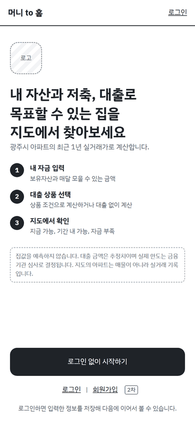](wireframes/P01_1_Start.png)

| 항목 | 내용 |
| --- | --- |
| 단계 | 1차 (로그인과 회원가입 버튼은 2차) |
| 화면 크기 | 모바일 390 × 844 |
| 요구사항 (Must) | FR-COMMON-01, 02, 03, 04 |
| 요구사항 (Should) | FR-COMMON-12 / FR-USER-20 |
| 그림 파일 | [wireframes/P01_1_Start.png](wireframes/P01_1_Start.png) (2배 크기) |

**언제 보이는가**

서비스에 처음 들어왔을 때. 로그인하지 않은 상태다.

**화면 구성** (위에서 아래로)

1. 헤더: 왼쪽에 서비스 이름, 오른쪽에 '로그인'
2. 로고 자리와 세 줄짜리 큰 소개 문구, 그 아래 '광주 5개 구 아파트의 최근 1년 실거래가로 계산합니다'
3. 번호가 붙은 세 단계 설명: 내 자금 입력, 대출 상품 선택, 지도에서 확인
4. 점선 상자의 안내: 집값을 예측하지 않음, 대출 금액은 추정치, 매물이 아니라 실거래 기록
5. 아래 고정 영역: 검은 '로그인 없이 시작하기' 버튼, '로그인 | 회원가입'(2차), 로그인하면 저장된다는 한 줄

**동작**

- '로그인 없이 시작하기'를 누르면 재무정보의 첫 질문(P-02 ①)으로 간다.
- '로그인'은 P-07, '회원가입'은 P-08로 간다.
- 헤더의 서비스 이름은 어느 화면에서 누르든 이 화면으로 돌아온다.

**규칙과 근거** (캔버스 메모)

- '로그인 없이 시작하기' → P-02 재무정보.
- 이 탭에서 입력하던 값이 남아 있으면 보던 자리로 바로 간다 (FR-PROFILE-11).
- 로그인, 회원가입 → P-07, P-08 (2차). 1차에는 버튼을 숨긴다.
- 헤더의 로고는 어느 화면에서든 이 화면으로 온다. 진행 바는 없다.

<a id="wf-P01_2_Saved" name="wf-P01_2_Saved"></a>

#### P-01 ② 로그인, 저장한 정보 있음

[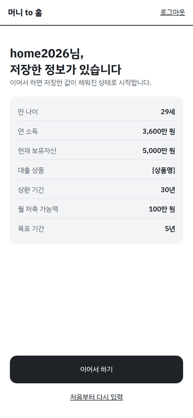](wireframes/P01_2_Saved.png)

| 항목 | 내용 |
| --- | --- |
| 단계 | 2차 |
| 화면 크기 | 모바일 390 × 844 |
| 요구사항 (Must) | FR-PROFILE-04, 05 |
| 요구사항 (Should) | FR-USER-09 / FR-PROFILE-10 |
| 그림 파일 | [wireframes/P01_2_Saved.png](wireframes/P01_2_Saved.png) (2배 크기) |

**언제 보이는가**

로그인했고 DB에 저장해 둔 값이 있을 때.

**화면 구성** (위에서 아래로)

1. 헤더 오른쪽이 '로그아웃'으로 바뀐다.
2. 제목 'home2026님, 저장한 정보가 있습니다'와 '이어서 하면 저장한 값이 채워진 상태로 시작합니다'
3. 회색 상자에 저장한 값 일곱 줄: 만 나이, 연 소득, 현재 보유자산, 대출 상품, 상환 기간, 월 저축 가능액, 목표 기간
4. 아래 고정 영역: '이어서 하기' 버튼과 '처음부터 다시 입력'

**동작**

- '이어서 하기'를 누르면 값이 채워진 확인 화면(P-02 ⑦)으로 간다.
- '처음부터 다시 입력'을 누르면 브라우저에 있던 값을 지우고 P-02 ①부터 시작한다.

**규칙과 근거** (캔버스 메모)

- 헤더가 '로그아웃'으로 바뀐다.
- DB에 저장된 재무정보, 대출 선택, 저축 계획을 보여 준다. 나이와 연 소득은 여기와 입력 요약에만 나온다.
- '이어서 하기' → 값이 채워진 P-02 ⑦.
- '처음부터 다시 입력' → 빈 P-02 ①. 저장된 값은 새 값으로 저장할 때 바뀐다.

<a id="wf-P01_3_NoSaved" name="wf-P01_3_NoSaved"></a>

#### P-01 ③ 로그인, 저장한 정보 없음

[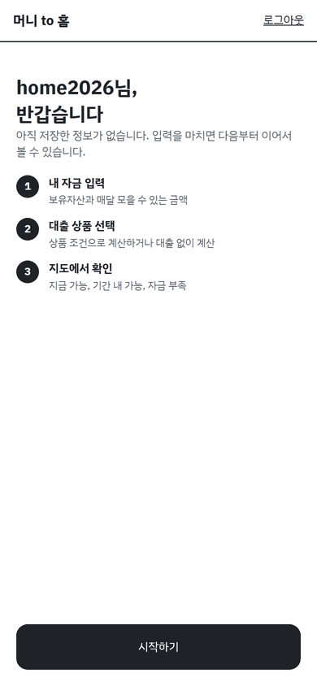](wireframes/P01_3_NoSaved.png)

| 항목 | 내용 |
| --- | --- |
| 단계 | 2차 |
| 화면 크기 | 모바일 390 × 844 |
| 요구사항 (Must) | FR-PROFILE-04 |
| 요구사항 (Should) | FR-USER-09 |
| 그림 파일 | [wireframes/P01_3_NoSaved.png](wireframes/P01_3_NoSaved.png) (2배 크기) |

**언제 보이는가**

로그인했지만 저장해 둔 값이 없을 때. 방금 가입한 회원이 여기에 해당한다.

**화면 구성** (위에서 아래로)

1. 헤더 오른쪽 '로그아웃'
2. 제목 'home2026님, 반갑습니다'와 아직 저장한 정보가 없다는 설명
3. 세 단계 설명
4. 아래 고정 영역: '시작하기' 버튼 하나

**동작**

- '시작하기'를 누르면 P-02 ①로 간다.

**규칙과 근거** (캔버스 메모)

- 방금 가입했거나 아직 한 단계도 마친 적이 없는 회원.
- '시작하기' → P-02 ①.

<a id="wf-P01_4_LoadFail" name="wf-P01_4_LoadFail"></a>

#### P-01 ④ 예외: 저장한 정보를 불러오지 못함

[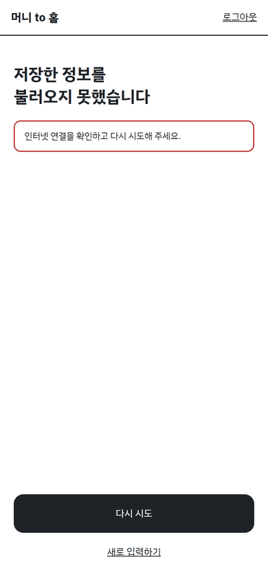](wireframes/P01_4_LoadFail.png)

| 항목 | 내용 |
| --- | --- |
| 단계 | 2차 |
| 화면 크기 | 모바일 390 × 844 |
| 요구사항 (Should) | FR-COMMON-07 / NFR-11 |
| 그림 파일 | [wireframes/P01_4_LoadFail.png](wireframes/P01_4_LoadFail.png) (2배 크기) |

**언제 보이는가**

로그인은 되었지만 저장한 값을 서버에서 불러오지 못했을 때.

**화면 구성** (위에서 아래로)

1. 제목 '저장한 정보를 불러오지 못했습니다'
2. 빨간 테두리 상자: '인터넷 연결을 확인하고 다시 시도해 주세요.'
3. 아래 고정 영역: '다시 시도' 버튼과 '새로 입력하기'

**동작**

- '다시 시도'는 같은 요청을 다시 보낸다.
- '새로 입력하기'는 빈 P-02 ①로 간다.

**규칙과 근거** (캔버스 메모)

- 서버나 네트워크 오류. 오류의 내부 정보는 보여 주지 않는다.
- '다시 시도'는 같은 요청을 다시 보낸다. '새로 입력하기' → 빈 P-02 ①.

<a id="wf-P01_5_Expired" name="wf-P01_5_Expired"></a>

#### P-01 ⑤ 예외: 로그인 시간이 끝남

[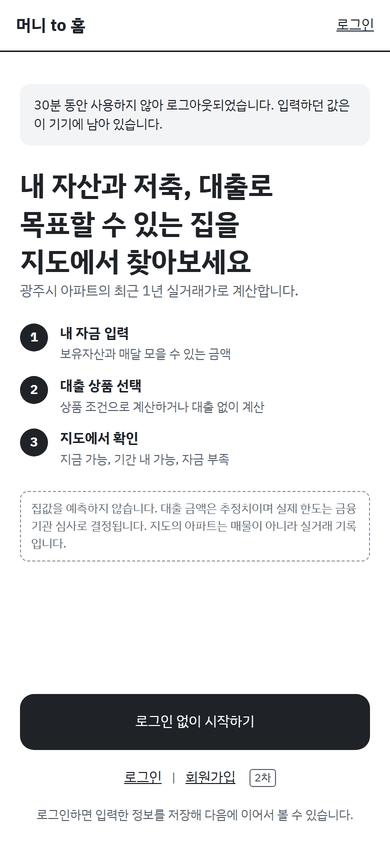](wireframes/P01_5_Expired.png)

| 항목 | 내용 |
| --- | --- |
| 단계 | 2차 |
| 화면 크기 | 모바일 390 × 844 |
| 요구사항 (Must) | FR-PROFILE-11 |
| 요구사항 (Should) | FR-USER-08 |
| 그림 파일 | [wireframes/P01_5_Expired.png](wireframes/P01_5_Expired.png) (2배 크기) |

**언제 보이는가**

로그인한 채 30분 동안 아무 요청이 없어 로그아웃되었을 때. 어느 화면에 있었든 이 화면으로 온다.

**화면 구성** (위에서 아래로)

1. 맨 위 회색 상자: '30분 동안 사용하지 않아 로그아웃되었습니다. 입력하던 값은 이 기기에 남아 있습니다.'
2. 그 아래는 시작 화면의 기본 상태와 같다. 로고 자리만 안내 상자로 바뀐다.

**동작**

- '로그인 없이 시작하기'를 누르면 입력하던 자리로 돌아간다.
- '로그인'으로 다시 로그인하면 저장한 정보가 있는 시작 화면(P-01 ②)이 된다.

**규칙과 근거** (캔버스 메모)

- 마지막 요청 후 30분이 지나면 로그아웃하고 이 화면으로 보낸다. 어느 화면에 있었든 같다.
- 입력하던 값은 브라우저에 남아 있어, '로그인 없이 시작하기'를 누르면 보던 자리로 돌아간다.
- 다시 로그인하면 저장한 정보가 있는 시작 화면(②)이 된다.

## 5. P-02 재무정보 입력

값 세 개를 한 번에 하나씩 묻는다. ① → ② → ③ → ④ → ⑤ → ⑥ → ⑦의 순서이고, ⑦에서 "다음"을 누르면 P-03으로 간다. 진행 표시는 1/4이다.

### 5.1 받는 값

| 값 | 형식 | 범위 | 계산에 쓰는가 |
| --- | --- | --- | --- |
| 주민등록번호 앞 7자리 → 만 나이 | 앞 6자리(생년월일)와 뒤 첫째 자리. 숫자만, 필수 | 실제 날짜여야 하고 만 15세 이상 100세 이하 (FR-PROFILE-08) | 쓰지 않는다. 만 나이를 표시만 한다. |
| 연 소득 (세전) | 만 원 단위 정수, 필수 | 0 이상 100억 원 이하 (FR-PROFILE-21) | 쓰지 않는다. 표시만 한다. |
| 현재 보유자산 | 만 원 단위 정수, 필수 | 0 이상 100억 원 이하 (FR-PROFILE-21) | 쓴다. C-03, C-06, C-08, C-09 |

- 뒤 첫째 자리가 1, 2, 5, 6이면 1900년대, 3, 4, 7, 8이면 2000년대로 본다. 0이나 9는 1800년대라서 100세 초과로 처리한다.
- 만 나이는 브라우저에서 계산한다. 일곱 자리는 저장하지 않고 서버로 보내지 않는다. 보관하고 저장하는 것은 계산한 만 나이뿐이다 (NFR-25).
- 서버로 보낼 때 금액에 10,000을 곱해 원으로 바꾼다 (C-01). 화면과 서버 양쪽에서 검증한다 (NFR-02).
- 로그인했으면 ⑦에서 "다음"을 누를 때 DB에 저장한다 (FR-PROFILE-04).

오류 문구

| 경우 | 문구 | 그림 |
| --- | --- | --- |
| 음수 | 0 이상의 숫자만 입력할 수 있습니다. | ⑧ |
| 소수 | 소수는 입력할 수 없습니다. 만 원 단위의 정수로 입력해 주세요. | ⑨ |
| 숫자가 아닌 값 | 숫자만 입력할 수 있습니다. | ⑩ |
| 없는 날짜, 오늘보다 뒤의 날짜 | 생년월일을 다시 확인해 주세요. | ⑪ |
| 나이가 범위 밖 | 만 15세부터 100세까지 입력할 수 있습니다. | ⑪ |
| 금액 상한 초과 | 100억 원(1,000,000만 원)까지 입력할 수 있습니다. | ⑫ |

### 5.2 흐름 (7장)

<a id="wf-P02_01_AgeEmpty" name="wf-P02_01_AgeEmpty"></a>

#### P-02 ① 주민등록번호 앞 7자리, 입력 전

[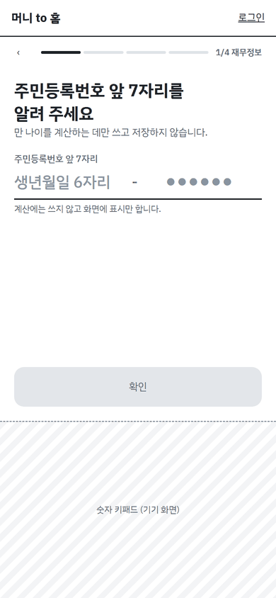](wireframes/P02_01_AgeEmpty.png)

| 항목 | 내용 |
| --- | --- |
| 단계 | 1차 |
| 화면 크기 | 모바일 390 × 844 |
| 요구사항 (Must) | FR-PROFILE-01, 03 / NFR-25 / FR-COMMON-05 |
| 요구사항 (Should) | FR-PROFILE-13 / FR-COMMON-09 |
| 그림 파일 | [wireframes/P02_01_AgeEmpty.png](wireframes/P02_01_AgeEmpty.png) (2배 크기) |

**언제 보이는가**

재무정보 단계에 처음 들어왔을 때.

**화면 구성** (위에서 아래로)

1. 헤더 아래에 진행 표시 줄: 왼쪽 ‹(이전), 네 칸 막대 중 첫 칸이 채워짐, 오른쪽 '1/4 재무정보'
2. 제목 '주민등록번호 앞 7자리를 알려 주세요', 설명 '만 나이를 계산하는 데만 쓰고 저장하지 않습니다.'
3. 입력란 하나: 앞 6자리 칸(자리 글자 '생년월일 6자리'), 줄표, 뒤 첫째 자리 칸, 회색 점 여섯 개. 아래에 '계산에는 쓰지 않고 화면에 표시만 합니다.'
4. 꺼진 '확인' 버튼이 키패드 자리 바로 위에 붙어 있다.

**동작**

- 들어오자마자 앞 6자리 칸에 커서가 가고 숫자 키패드가 뜬다.
- 여섯 자리를 다 치면 커서가 뒤 첫째 자리 칸으로 넘어간다.
- ‹ 를 누르면 시작 화면으로 간다.

**규칙과 근거** (캔버스 메모)

- 나이를 직접 묻지 않고 주민등록번호 앞 6자리와 뒤 첫째 자리를 받는다. 뒤의 나머지 여섯 자리는 받지 않고 점으로만 보여 준다.
- 앞 6자리를 다 치면 커서가 뒤 첫째 자리로 넘어간다.
- 값이 없으면 '확인'이 꺼져 있다. 버튼은 키패드 바로 위.
- ‹ → P-01. 진행 바 1/4.

<a id="wf-P02_02_AgeFilled" name="wf-P02_02_AgeFilled"></a>

#### P-02 ② 주민등록번호 앞 7자리, 입력함

[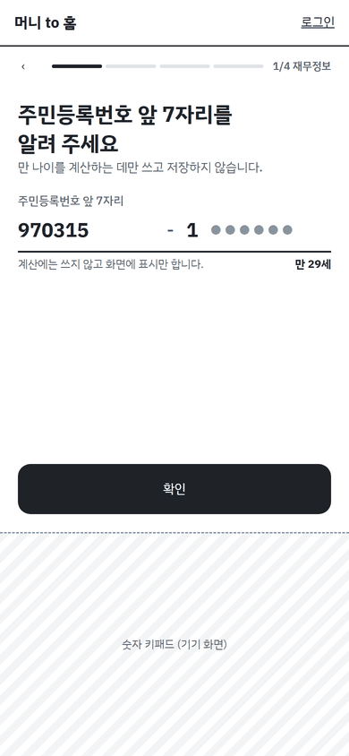](wireframes/P02_02_AgeFilled.png)

| 항목 | 내용 |
| --- | --- |
| 단계 | 1차 |
| 화면 크기 | 모바일 390 × 844 |
| 요구사항 (Must) | FR-PROFILE-01, 02 / NFR-25 |
| 요구사항 (Should) | FR-PROFILE-08 |
| 그림 파일 | [wireframes/P02_02_AgeFilled.png](wireframes/P02_02_AgeFilled.png) (2배 크기) |

**언제 보이는가**

일곱 자리를 맞게 입력했을 때.

**화면 구성** (위에서 아래로)

1. 입력란에 970315 - 1, 뒤 여섯 자리는 점으로만 보인다.
2. 입력란 아래 오른쪽에 계산 결과 '만 29세'가 나타난다.
3. '확인' 버튼이 검게 켜진다.

**동작**

- '확인'이나 키패드의 완료를 누르면 연 소득 질문(P-02 ③)으로 넘어간다.
- 일곱 자리는 브라우저에서 만 나이를 계산하는 데만 쓰고 저장하지도 서버로 보내지도 않는다.

**규칙과 근거** (캔버스 메모)

- 일곱 자리가 맞고 만 15세 이상 100세 이하이면 오른쪽 아래에 만 나이를 바로 보여 주고 '확인'이 켜진다.
- 970315-1 → 1997년 3월 15일생 → 만 29세 (2026년 10월 기준).
- 뒤 첫째 자리가 1, 2, 5, 6이면 1900년대, 3, 4, 7, 8이면 2000년대.
- 만 나이는 브라우저에서 계산한다. 일곱 자리는 저장하지 않고 서버로 보내지 않는다.

<a id="wf-P02_03_IncEmpty" name="wf-P02_03_IncEmpty"></a>

#### P-02 ③ 연 소득, 입력 전

[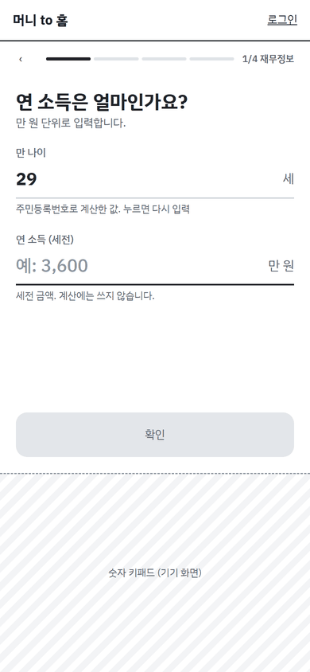](wireframes/P02_03_IncEmpty.png)

| 항목 | 내용 |
| --- | --- |
| 단계 | 1차 |
| 화면 크기 | 모바일 390 × 844 |
| 요구사항 (Must) | FR-PROFILE-01, 11, 20 / NFR-25 |
| 요구사항 (Should) | FR-PROFILE-13 |
| 그림 파일 | [wireframes/P02_03_IncEmpty.png](wireframes/P02_03_IncEmpty.png) (2배 크기) |

**언제 보이는가**

나이를 확인하고 넘어온 직후.

**화면 구성** (위에서 아래로)

1. 제목이 '연 소득은 얼마인가요?'로 바뀐다. 설명 '만 원 단위로 입력합니다.'
2. 위에는 주민등록번호가 사라지고 '만 나이 29세'만 남는다. 아래에 '주민등록번호로 계산한 값. 누르면 다시 입력'
3. 새 입력란 '연 소득 (세전)': 자리 글자 '예: 3,600', 오른쪽에 단위 '만 원'
4. 꺼진 '확인' 버튼과 키패드 자리

**동작**

- 커서는 새 입력란에 간다.
- 위의 만 나이를 누르면 주민등록번호 입력으로 돌아간다.

**규칙과 근거** (캔버스 메모)

- 제목이 바뀌고 새 입력란이 아래에 나타난다. 커서가 그리로 간다.
- 위에는 주민등록번호가 아니라 계산된 만 나이만 남는다. 누르면 주민등록번호를 다시 입력한다.
- 여기서 새로 고쳐도 만 나이가 채워진 이 화면으로 돌아온다.

<a id="wf-P02_04_IncFilled" name="wf-P02_04_IncFilled"></a>

#### P-02 ④ 연 소득, 입력함

[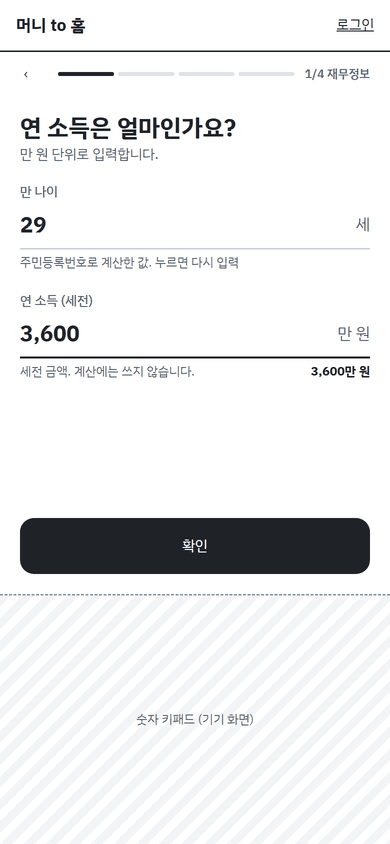](wireframes/P02_04_IncFilled.png)

| 항목 | 내용 |
| --- | --- |
| 단계 | 1차 (쉼표와 금액 읽어 주기는 2차) |
| 화면 크기 | 모바일 390 × 844 |
| 요구사항 (Must) | FR-PROFILE-20 |
| 요구사항 (Should) | FR-PROFILE-21, 22 / FR-COMMON-11 |
| 그림 파일 | [wireframes/P02_04_IncFilled.png](wireframes/P02_04_IncFilled.png) (2배 크기) |

**언제 보이는가**

연 소득을 입력했을 때.

**화면 구성** (위에서 아래로)

1. 입력란에 3,600. 천 단위 쉼표가 자동으로 들어간다.
2. 입력란 아래 오른쪽에 읽기 쉬운 금액 '3,600만 원'
3. '확인' 버튼이 켜진다.

**동작**

- '확인'을 누르면 보유자산 질문(P-02 ⑤)으로 넘어간다.

**규칙과 근거** (캔버스 메모)

- 3600을 치면 입력란에는 3,600, 오른쪽 아래에는 '3,600만 원'.
- 12000이면 '1억 2,000만 원'으로 읽어 준다.
- 0도 넣을 수 있다.

<a id="wf-P02_05_AstEmpty" name="wf-P02_05_AstEmpty"></a>

#### P-02 ⑤ 보유자산, 입력 전

[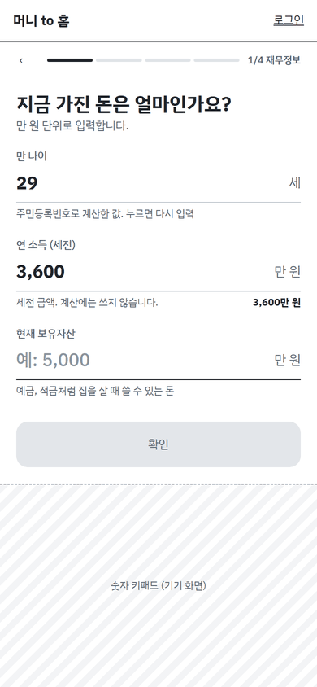](wireframes/P02_05_AstEmpty.png)

| 항목 | 내용 |
| --- | --- |
| 단계 | 1차 |
| 화면 크기 | 모바일 390 × 844 |
| 요구사항 (Must) | FR-PROFILE-01, 20 |
| 요구사항 (Should) | FR-PROFILE-13 |
| 그림 파일 | [wireframes/P02_05_AstEmpty.png](wireframes/P02_05_AstEmpty.png) (2배 크기) |

**언제 보이는가**

연 소득을 확인하고 넘어온 직후.

**화면 구성** (위에서 아래로)

1. 제목 '지금 가진 돈은 얼마인가요?'
2. 위에 만 나이와 연 소득이 채워진 채 남아 있다.
3. 새 입력란 '현재 보유자산': 자리 글자 '예: 5,000', 아래 설명 '예금, 적금처럼 집을 살 때 쓸 수 있는 돈'
4. 꺼진 '확인' 버튼과 키패드 자리

**동작**

- 세 값 가운데 계산에 쓰이는 것은 이 값 하나다.

**규칙과 근거** (캔버스 메모)

- 계산에 쓰는 값은 이것 하나다 (C-03, C-06, C-08).

<a id="wf-P02_06_AstFilled" name="wf-P02_06_AstFilled"></a>

#### P-02 ⑥ 보유자산, 입력함

[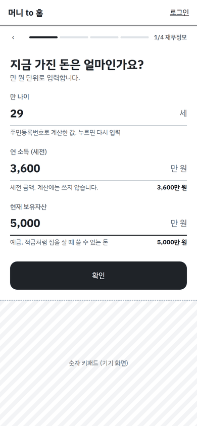](wireframes/P02_06_AstFilled.png)

| 항목 | 내용 |
| --- | --- |
| 단계 | 1차 |
| 화면 크기 | 모바일 390 × 844 |
| 요구사항 (Must) | FR-PROFILE-01, 02, 20 |
| 요구사항 (Should) | FR-PROFILE-21 |
| 그림 파일 | [wireframes/P02_06_AstFilled.png](wireframes/P02_06_AstFilled.png) (2배 크기) |

**언제 보이는가**

보유자산을 입력했을 때.

**화면 구성** (위에서 아래로)

1. 입력란에 5,000, 아래 오른쪽에 '5,000만 원'
2. '확인' 버튼이 켜진다.

**동작**

- '확인'을 누르면 키패드가 내려가고 확인 화면(P-02 ⑦)이 된다.

**규칙과 근거** (캔버스 메모)

- 0도 넣을 수 있다. 0이면 P-03에서 예상 대출금액이 0원으로 나오고 '대출 없이 계산'을 안내한다 (P-03 ⑩).

<a id="wf-P02_07_Confirm" name="wf-P02_07_Confirm"></a>

#### P-02 ⑦ 확인 / 다시 들어왔을 때

[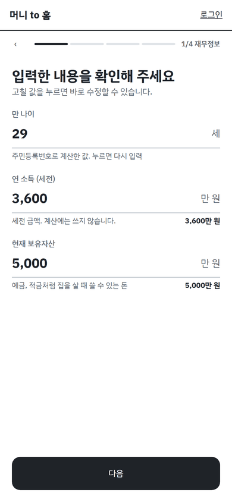](wireframes/P02_07_Confirm.png)

| 항목 | 내용 |
| --- | --- |
| 단계 | 1차 |
| 화면 크기 | 모바일 390 × 844 |
| 요구사항 (Must) | FR-PROFILE-03, 04, 05, 11, 12 / FR-COMMON-05 |
| 요구사항 (Should) | FR-PROFILE-10 |
| 그림 파일 | [wireframes/P02_07_Confirm.png](wireframes/P02_07_Confirm.png) (2배 크기) |

**언제 보이는가**

세 값을 모두 입력했을 때. 이전 단계에서 돌아왔거나 '이어서 하기'로 들어왔을 때도 이 모습이다.

**화면 구성** (위에서 아래로)

1. 제목 '입력한 내용이 맞는지 확인해 주세요', 설명 '고칠 값을 누르면 바로 수정할 수 있습니다.'
2. 세 값이 차례로 보인다: 만 나이 29세, 연 소득 3,600(3,600만 원), 현재 보유자산 5,000(5,000만 원)
3. 키패드가 없고, 화면 맨 아래에 켜진 '다음' 버튼

**동작**

- 값을 누르면 그 자리에서 고칠 수 있다.
- '다음'을 누르면 대출상품(P-03 ①)으로 간다. 로그인했으면 이때 DB에 저장한다.

**규칙과 근거** (캔버스 메모)

- 키패드가 내려가고 버튼이 '다음'으로 바뀐다. '다음' → P-03.
- 로그인했으면 이때 세 값을 DB에 저장한다.
- 값을 누르면 그 자리에서 고친다. 고친 값으로 이후 계산을 다시 한다.
- 이전 단계에서 돌아오거나 '이어서 하기'로 오면 이 모습으로 시작한다.

### 5.3 예외 (7장)

예외 상태에서는 버튼이 켜지지 않는다. 오류 문구는 그 입력란 바로 아래, 설명 줄의 자리에 나와서 화면이 밀리지 않는다.

<a id="wf-P02_08_ErrNegative" name="wf-P02_08_ErrNegative"></a>

#### P-02 ⑧ 예외: 음수

[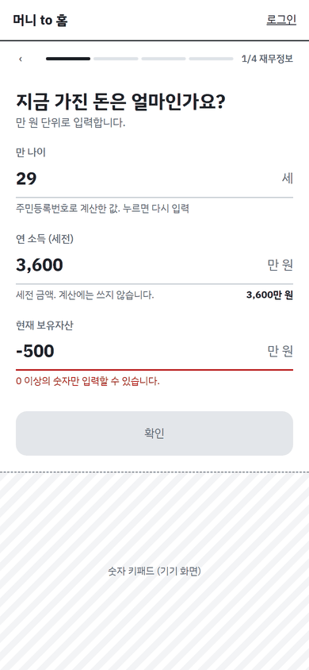](wireframes/P02_08_ErrNegative.png)

| 항목 | 내용 |
| --- | --- |
| 단계 | 1차 |
| 화면 크기 | 모바일 390 × 844 |
| 요구사항 (Must) | FR-PROFILE-02, 03 |
| 요구사항 (Should) | FR-PROFILE-14 |
| 그림 파일 | [wireframes/P02_08_ErrNegative.png](wireframes/P02_08_ErrNegative.png) (2배 크기) |

**언제 보이는가**

보유자산에 음수가 들어왔을 때. 주로 PC나 붙여넣기에서 생긴다.

**화면 구성** (위에서 아래로)

1. 보유자산 입력란에 -500, 밑줄이 빨갛게 바뀐다.
2. 입력란 바로 아래 빨간 글자: '0 이상의 숫자만 입력할 수 있습니다.'
3. '확인' 버튼이 꺼져 있다.

**동작**

- 값을 고치면 문구가 바로 사라지고 버튼이 켜진다.

**규칙과 근거** (캔버스 메모)

- 오류 문구는 그 입력란 바로 아래. 설명 줄의 자리를 써서 화면이 밀리지 않는다.
- 오류가 있는 동안 버튼은 켜지지 않는다. 값을 고치면 문구가 바로 사라진다.
- 모바일의 숫자 키패드에는 '-'가 없어 주로 PC나 붙여넣기에서 생긴다.

<a id="wf-P02_09_ErrDecimal" name="wf-P02_09_ErrDecimal"></a>

#### P-02 ⑨ 예외: 소수

[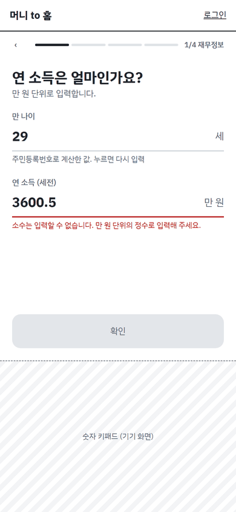](wireframes/P02_09_ErrDecimal.png)

| 항목 | 내용 |
| --- | --- |
| 단계 | 1차 |
| 화면 크기 | 모바일 390 × 844 |
| 요구사항 (Must) | FR-PROFILE-02, 03, 20 |
| 요구사항 (Should) | FR-PROFILE-14 |
| 그림 파일 | [wireframes/P02_09_ErrDecimal.png](wireframes/P02_09_ErrDecimal.png) (2배 크기) |

**언제 보이는가**

연 소득에 소수가 들어왔을 때.

**화면 구성** (위에서 아래로)

1. 연 소득 입력란에 3600.5, 빨간 밑줄
2. 아래 빨간 글자: '소수는 입력할 수 없습니다. 만 원 단위의 정수로 입력해 주세요.'
3. '확인' 버튼이 꺼져 있다.

**동작**

- 글자 입력을 막지 않고 문구로 알린다.

**규칙과 근거** (캔버스 메모)

- 글자를 막지 않고 문구로 알린다.

<a id="wf-P02_10_ErrText" name="wf-P02_10_ErrText"></a>

#### P-02 ⑩ 예외: 숫자가 아닌 값

[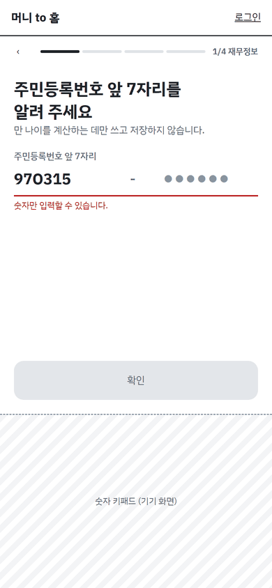](wireframes/P02_10_ErrText.png)

| 항목 | 내용 |
| --- | --- |
| 단계 | 1차 |
| 화면 크기 | 모바일 390 × 844 |
| 요구사항 (Must) | FR-PROFILE-02, 03 |
| 요구사항 (Should) | FR-PROFILE-14 |
| 그림 파일 | [wireframes/P02_10_ErrText.png](wireframes/P02_10_ErrText.png) (2배 크기) |

**언제 보이는가**

주민등록번호 칸에 숫자가 아닌 글자가 들어왔을 때. 그림은 숫자 0 자리에 영문 O를 넣은 경우다.

**화면 구성** (위에서 아래로)

1. 앞 6자리 칸에 97O315, 빨간 밑줄
2. 아래 빨간 글자: '숫자만 입력할 수 있습니다.'
3. '확인' 버튼이 꺼져 있다.

**동작**

- 숫자로 고치면 문구가 사라진다.

**규칙과 근거** (캔버스 메모)

- 한글, 영문, 기호가 들어왔을 때. 예시는 숫자 0 자리에 영문 O를 넣은 경우.
- 버튼이 켜지지 않는다.

<a id="wf-P02_11_AgeRange" name="wf-P02_11_AgeRange"></a>

#### P-02 ⑪ 예외: 없는 날짜, 만 15세 미만, 100세 초과

[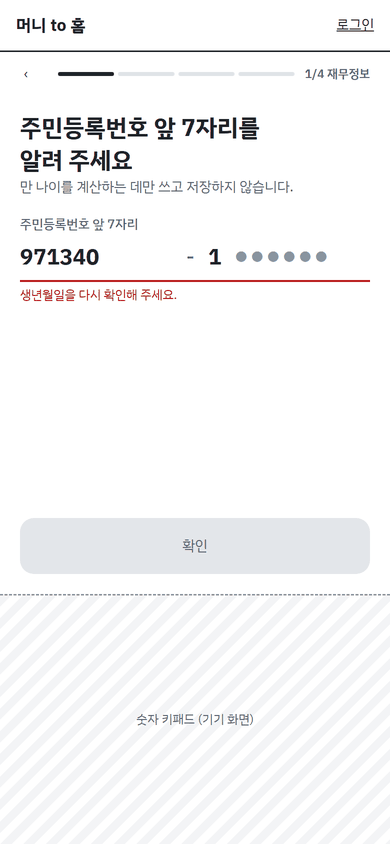](wireframes/P02_11_AgeRange.png)

| 항목 | 내용 |
| --- | --- |
| 단계 | 2차 |
| 화면 크기 | 모바일 390 × 844 |
| 요구사항 (Should) | FR-PROFILE-08, 14 |
| 그림 파일 | [wireframes/P02_11_AgeRange.png](wireframes/P02_11_AgeRange.png) (2배 크기) |

**언제 보이는가**

없는 날짜를 넣었거나 계산한 만 나이가 15세보다 어리거나 100세를 넘을 때. 그림은 13월 40일을 넣은 경우다.

**화면 구성** (위에서 아래로)

1. 입력란에 971340 - 1, 빨간 밑줄
2. 아래 빨간 글자: '생년월일을 다시 확인해 주세요.'
3. '확인' 버튼이 꺼져 있다.

**동작**

- 나이가 범위 밖이면 문구가 '만 15세부터 100세까지 입력할 수 있습니다.'로 나온다.

**규칙과 근거** (캔버스 메모)

- 13월 40일처럼 없는 날짜, 오늘보다 뒤의 날짜 → '생년월일을 다시 확인해 주세요.'
- 만 15세보다 어리거나 100세를 넘으면 → '만 15세부터 100세까지 입력할 수 있습니다.'
- 뒤 첫째 자리가 0이나 9면 1800년대라서 100세 초과로 처리한다.
- 버튼이 켜지지 않는다.

<a id="wf-P02_12_AmountMax" name="wf-P02_12_AmountMax"></a>

#### P-02 ⑫ 예외: 금액 상한

[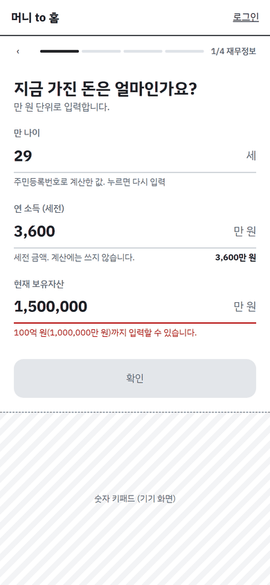](wireframes/P02_12_AmountMax.png)

| 항목 | 내용 |
| --- | --- |
| 단계 | 2차 |
| 화면 크기 | 모바일 390 × 844 |
| 요구사항 (Should) | FR-PROFILE-21, 14 |
| 그림 파일 | [wireframes/P02_12_AmountMax.png](wireframes/P02_12_AmountMax.png) (2배 크기) |

**언제 보이는가**

보유자산이나 연 소득이 100억 원을 넘을 때.

**화면 구성** (위에서 아래로)

1. 보유자산 입력란에 1,500,000, 빨간 밑줄
2. 아래 빨간 글자: '100억 원(1,000,000만 원)까지 입력할 수 있습니다.'
3. '확인' 버튼이 꺼져 있다.

**동작**

- 월 저축 가능액의 상한은 10억 원이다(P-04 ⑪).

**규칙과 근거** (캔버스 메모)

- 연 소득과 보유자산은 100억 원(1,000,000만 원)까지. 넘으면 오류이고 버튼이 켜지지 않는다.
- 연 소득의 상한은 보유자산과 같게 두었다.

<a id="wf-P02_13_ServerReject" name="wf-P02_13_ServerReject"></a>

#### P-02 ⑬ 예외: 서버가 값을 거부함

[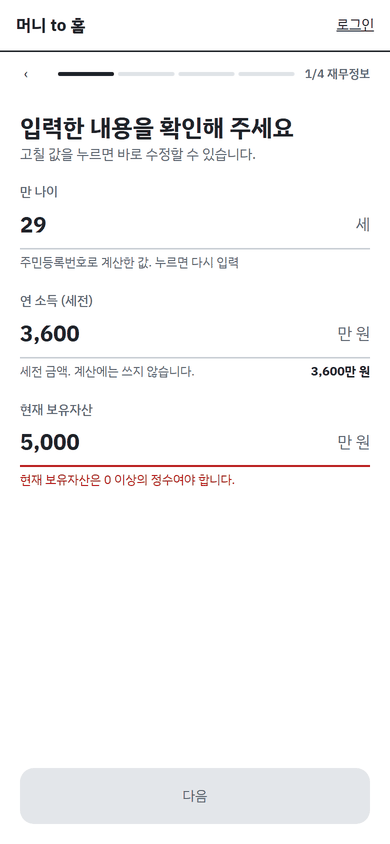](wireframes/P02_13_ServerReject.png)

| 항목 | 내용 |
| --- | --- |
| 단계 | 1차 |
| 화면 크기 | 모바일 390 × 844 |
| 요구사항 (Must) | FR-PROFILE-09 / NFR-02 |
| 요구사항 (Should) | NFR-19 |
| 그림 파일 | [wireframes/P02_13_ServerReject.png](wireframes/P02_13_ServerReject.png) (2배 크기) |

**언제 보이는가**

확인 화면에서 '다음'을 눌렀는데 서버 검증에서 걸렸을 때.

**화면 구성** (위에서 아래로)

1. 확인 화면과 같은 배치
2. 보유자산 아래에 서버가 보낸 문장이 빨갛게 나온다: '현재 보유자산은 0 이상의 정수여야 합니다.'
3. '다음' 버튼이 꺼져 있다.

**동작**

- 저장하지 않고 다음 단계로 가지 않는다.
- 값을 고치면 다시 '다음'을 누를 수 있다.

**규칙과 근거** (캔버스 메모)

- 화면 검증을 통과했지만 서버 검증에서 걸렸을 때. 서버가 보낸 문장(detail)을 해당 입력란 아래에 그대로 보여 준다.
- 저장하지 않고 다음 단계로 가지 않는다.

<a id="wf-P02_14_SaveFail" name="wf-P02_14_SaveFail"></a>

#### P-02 ⑭ 예외: 저장 실패

[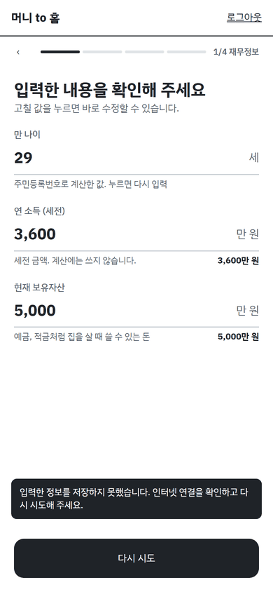](wireframes/P02_14_SaveFail.png)

| 항목 | 내용 |
| --- | --- |
| 단계 | 2차 |
| 화면 크기 | 모바일 390 × 844 |
| 요구사항 (Must) | FR-PROFILE-04 |
| 요구사항 (Should) | FR-COMMON-07 |
| 그림 파일 | [wireframes/P02_14_SaveFail.png](wireframes/P02_14_SaveFail.png) (2배 크기) |

**언제 보이는가**

로그인한 사용자가 '다음'을 눌렀는데 DB에 저장하지 못했을 때.

**화면 구성** (위에서 아래로)

1. 확인 화면과 같은 배치, 헤더는 '로그아웃'
2. 버튼 위에 검은 알림: '입력한 정보를 저장하지 못했습니다. 인터넷 연결을 확인하고 다시 시도해 주세요.'
3. 버튼 글자가 '다시 시도'로 바뀐다.

**동작**

- 입력한 값은 화면에 그대로 남는다.
- '다시 시도'를 누르면 같은 저장 요청을 다시 보낸다.

**규칙과 근거** (캔버스 메모)

- 로그인한 사용자의 값을 DB에 저장하지 못했을 때. 입력한 값은 화면에 그대로 둔다.
- P-03, P-04에서 '다음'을 눌렀을 때 저장이 실패해도 같은 모습이다.
- 로그인하지 않은 사용자는 서버에 저장하지 않으므로 이 상태가 없다.

## 6. P-03 대출상품 선택

상품 두 개와 "대출 없이 계산" 가운데 하나를 고른다. 상품을 고르면 상환 기간까지 골라야 "다음"이 켜진다. "대출 없이 계산"은 고르자마자 켜진다. 진행 표시는 2/4다.

### 6.1 받는 값과 결과

| 값 | 형식 | 규칙 | 계산에 쓰는가 |
| --- | --- | --- | --- |
| 대출 방법 | 상품 두 개와 "대출 없이 계산" 가운데 하나. 필수 (FR-LOAN-03) | 처음에는 아무것도 골라져 있지 않다. 카드 전체가 누르는 영역이다. 고른 카드만 펼쳐지고 나머지는 한 줄로 접힌다. | 쓴다. 최대 한도, 대출 비율, 금리 (C-05 ~ C-08). 대출 없이 계산이면 C-13 |
| 상환 기간 | 고른 상품이 제공하는 기간 중 하나 (FR-LOAN-11, 13) | 상품을 골랐을 때만 필수다. 기본 선택이 없다. 상품을 바꾸면 선택이 풀린다. | 쓴다. 월 상환액 (C-07) |

| 결과 | 계산 | 나오는 때 |
| --- | --- | --- |
| 예상 최대 대출금액 | min(최대 한도, 보유자산 × 대출 비율 ÷ (1 − 대출 비율)) (C-06) | 상품을 고르면 바로 |
| 예상 월 상환액 | 원리금균등 상환 (C-07) | 상환 기간까지 골라야 |

- 결과는 버튼 위의 고정 영역에 둔다. 서버가 계산한 값을 표시만 한다.
- 카드에 적는 조건: 상품명, 취급 기관, 최대 한도, 대출 비율, 금리, 대상 주택 가격 상한, 상환 기간, 자격 조건 요약, 기준일 (FR-LOAN-02, 09).
- 자격 조건은 안내용이다. 이 서비스는 자격을 확인하지 않고 충족한다고 가정해 계산한다.
- "다음"을 누를 때 로그인했으면 선택을 DB에 저장한다 (FR-PROFILE-04).
- 카드의 상품명과 숫자는 예시 값이다. 실제 화면은 `db/seed_loan_products.sql`의 값(R-01, R-02 조사 결과)을 보여 준다.

### 6.2 흐름 (5장)

<a id="wf-P03_1_Pick" name="wf-P03_1_Pick"></a>

#### P-03 ① 고르기 전

[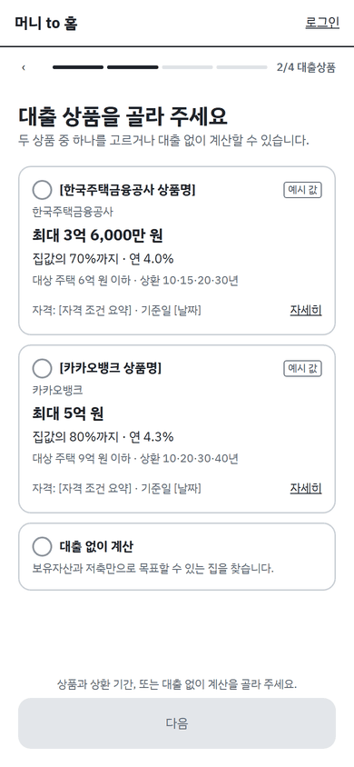](wireframes/P03_1_Pick.png)

| 항목 | 내용 |
| --- | --- |
| 단계 | 1차 |
| 화면 크기 | 모바일 390 × 844 |
| 요구사항 (Must) | FR-LOAN-01, 02, 03, 13 / FR-COMMON-05 |
| 요구사항 (Should) | FR-LOAN-09 / FR-COMMON-09 |
| 그림 파일 | [wireframes/P03_1_Pick.png](wireframes/P03_1_Pick.png) (2배 크기) |

**언제 보이는가**

대출상품 단계에 들어왔을 때. 아무것도 고르지 않은 상태다.

**화면 구성** (위에서 아래로)

1. 진행 표시 줄: 두 칸이 채워지고 '2/4 대출상품'
2. 제목 '대출 상품을 골라 주세요', 설명 '두 상품 중 하나를 고르거나 대출 없이 계산할 수 있습니다.'
3. 상품 카드 두 장이 펼쳐져 있다. 카드마다 동그란 선택 표시, 상품명, 취급 기관, 최대 한도(큰 글씨), 대출 비율과 금리, 대상 주택 가격과 상환 기간, 자격 조건 요약과 기준일, '자세히'
4. 세 번째 선택지 '대출 없이 계산': '보유자산과 저축만으로 목표할 수 있는 집을 찾습니다.'
5. 아래 고정 영역: 안내 '상품과 상환 기간, 또는 대출 없이 계산을 골라 주세요.'와 꺼진 '다음' 버튼

**동작**

- 카드 어디를 눌러도 그 선택지가 골라진다.
- '자세히'는 선택과 상관없이 조건 창(P-03 ⑥)을 연다.
- ‹ 를 누르면 P-02 ⑦로 돌아가고 값은 유지된다.

**규칙과 근거** (캔버스 메모)

- 선택지는 셋: 상품 두 개와 '대출 없이 계산'.
- 고르기 전에는 '다음'이 꺼져 있고, 버튼 위에 이유를 적는다.
- ‹ → P-02 ⑦ (값 유지). 진행 바 2/4.

<a id="wf-P03_2_PickedA" name="wf-P03_2_PickedA"></a>

#### P-03 ② 상품을 고름

[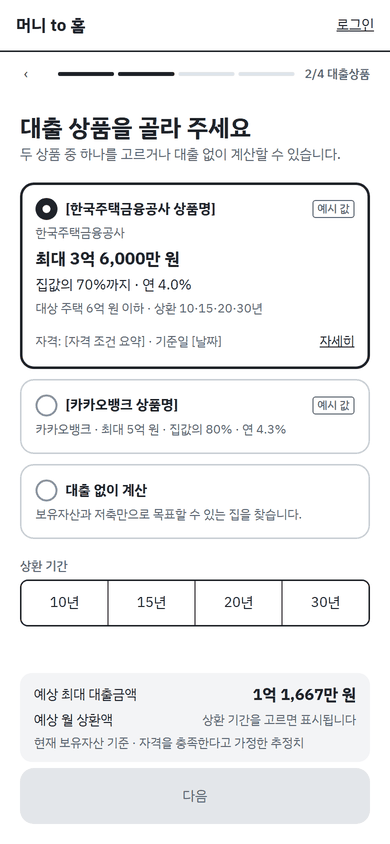](wireframes/P03_2_PickedA.png)

| 항목 | 내용 |
| --- | --- |
| 단계 | 1차 |
| 화면 크기 | 모바일 390 × 844 |
| 요구사항 (Must) | FR-LOAN-03, 06, 11, 12 |
| 계산 규칙 | C-06 최대 예상 대출금액 (아파트 선택 전) |
| 그림 파일 | [wireframes/P03_2_PickedA.png](wireframes/P03_2_PickedA.png) (2배 크기) |

**언제 보이는가**

첫째 상품을 골랐을 때.

**화면 구성** (위에서 아래로)

1. 고른 카드는 테두리가 굵어지고 동그라미가 채워진다. 나머지 두 선택지는 한 줄로 접힌다.
2. 카드 아래에 '상환 기간' 선택지 네 개가 나타난다: 10년, 15년, 20년, 30년. 아직 아무것도 골라지지 않았다.
3. 버튼 위 회색 상자: 예상 최대 대출금액 1억 1,667만 원, 예상 월 상환액 자리에는 '상환 기간을 고르면 표시됩니다'
4. '다음' 버튼은 아직 꺼져 있다.

**동작**

- 접힌 카드를 누르면 그 선택지로 바뀐다(P-03 ④).

**규칙과 근거** (캔버스 메모)

- 고른 카드의 테두리가 굵어지고 동그라미가 채워진다. 나머지 카드는 한 줄로 접힌다.
- 그 상품의 상환 기간 선택지가 나타난다.
- 예상 최대 대출금액이 바로 나온다: min(3억 6,000만, 5,000만 × 0.7 ÷ 0.3) = 1억 1,667만 원.
- 기간을 고르기 전이라 '다음'은 꺼져 있다.

<a id="wf-P03_3_TermPicked" name="wf-P03_3_TermPicked"></a>

#### P-03 ③ 상환 기간을 고름

[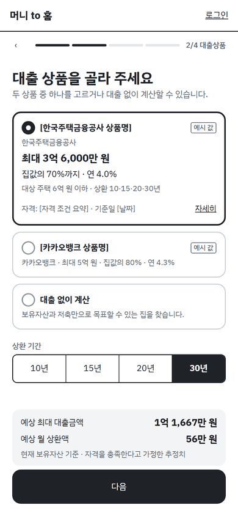](wireframes/P03_3_TermPicked.png)

| 항목 | 내용 |
| --- | --- |
| 단계 | 1차 |
| 화면 크기 | 모바일 390 × 844 |
| 요구사항 (Must) | FR-LOAN-07, 11, 13 |
| 계산 규칙 | C-07 예상 월 상환액 |
| 그림 파일 | [wireframes/P03_3_TermPicked.png](wireframes/P03_3_TermPicked.png) (2배 크기) |

**언제 보이는가**

상환 기간까지 골랐을 때.

**화면 구성** (위에서 아래로)

1. 상환 기간에서 30년이 검게 골라져 있다.
2. 회색 상자: 예상 최대 대출금액 1억 1,667만 원, 예상 월 상환액 56만 원, '현재 보유자산 기준 · 자격을 충족한다고 가정한 추정치'
3. '다음' 버튼이 켜진다.

**동작**

- 기간을 바꾸면 월 상환액이 바로 바뀐다.
- '다음'을 누르면 저축 계획(P-04 ①)으로 간다. 로그인했으면 이때 선택을 DB에 저장한다.

**규칙과 근거** (캔버스 메모)

- 월 상환액이 나오고 '다음'이 켜진다. '다음' → P-04.
- 56만 원은 1억 1,667만 원, 연 4.0%, 30년으로 계산한 값이다.

<a id="wf-P03_4_PickedB" name="wf-P03_4_PickedB"></a>

#### P-03 ④ 다른 상품으로 바꿈

[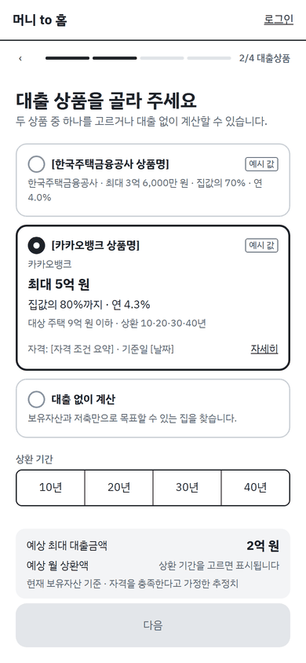](wireframes/P03_4_PickedB.png)

| 항목 | 내용 |
| --- | --- |
| 단계 | 1차 |
| 화면 크기 | 모바일 390 × 844 |
| 요구사항 (Must) | FR-LOAN-03, 06, 11, 13 |
| 그림 파일 | [wireframes/P03_4_PickedB.png](wireframes/P03_4_PickedB.png) (2배 크기) |

**언제 보이는가**

첫째 상품과 기간을 고른 뒤 둘째 상품으로 바꿨을 때.

**화면 구성** (위에서 아래로)

1. 둘째 카드가 펼쳐지고 첫째 카드는 한 줄로 접힌다.
2. 상환 기간 선택지가 둘째 상품의 것으로 바뀐다: 10년, 20년, 30년, 40년. 골라진 것이 없다.
3. 회색 상자: 예상 최대 대출금액 2억 원, 월 상환액은 다시 '상환 기간을 고르면 표시됩니다'
4. '다음' 버튼이 다시 꺼진다.

**동작**

- 한 번에 하나만 골라진다.

**규칙과 근거** (캔버스 메모)

- 한 번에 하나만 골라진다.
- 상환 기간 선택지가 그 상품의 것으로 바뀌고 선택이 풀린다. '다음'이 다시 꺼진다.
- 대출금액은 새 상품 조건으로 다시 계산한다: min(5억, 5,000만 × 0.8 ÷ 0.2) = 2억 원.

<a id="wf-P03_05_NoLoan" name="wf-P03_05_NoLoan"></a>

#### P-03 ⑤ 대출 없이 계산을 고름

[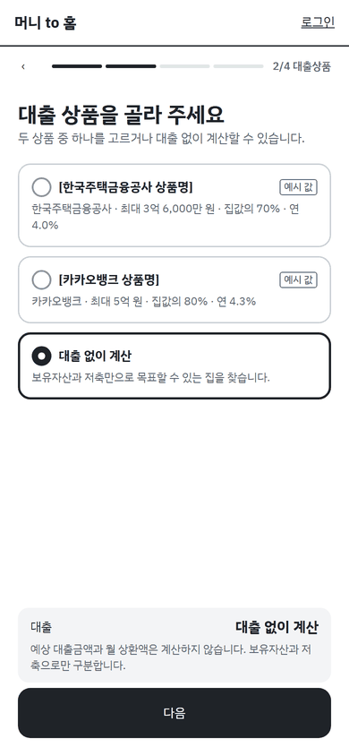](wireframes/P03_05_NoLoan.png)

| 항목 | 내용 |
| --- | --- |
| 단계 | 1차 |
| 화면 크기 | 모바일 390 × 844 |
| 요구사항 (Must) | FR-LOAN-03, 13, 15 |
| 계산 규칙 | C-13 대출 없이 계산 |
| 그림 파일 | [wireframes/P03_05_NoLoan.png](wireframes/P03_05_NoLoan.png) (2배 크기) |

**언제 보이는가**

'대출 없이 계산'을 골랐을 때.

**화면 구성** (위에서 아래로)

1. 상품 카드 두 장은 한 줄로 접히고 '대출 없이 계산'의 테두리가 굵어진다.
2. 상환 기간 선택지가 나타나지 않는다.
3. 회색 상자: '대출 없이 계산', 그 아래 '예상 대출금액과 월 상환액은 계산하지 않습니다. 보유자산과 저축으로만 구분합니다.'
4. '다음' 버튼이 바로 켜진다.

**동작**

- '다음'을 누르면 저축 계획으로 간다. 이후 화면에서 달라지는 점은 9장에 모았다.

**규칙과 근거** (캔버스 메모)

- 상환 기간을 묻지 않는다. 고르자마자 '다음'이 켜진다.
- 예상 대출금액과 월 상환액은 계산하지 않는다.
- 이후 계산은 예상 대출금액을 0원으로 두고 한다. 바뀌는 화면은 아래 '대출 없이 계산했을 때' 줄에 있다.

### 6.3 조건 창과 예외 (5장)

<a id="wf-P03_06_Terms" name="wf-P03_06_Terms"></a>

#### P-03 ⑥ 조건 자세히 (자격 조건, 출처)

[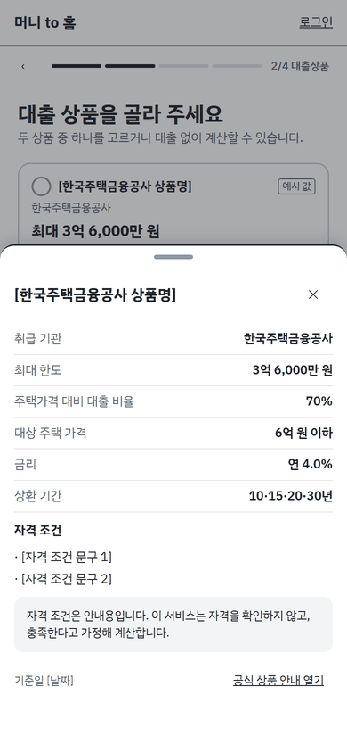](wireframes/P03_06_Terms.png)

| 항목 | 내용 |
| --- | --- |
| 단계 | 1차 (기준일과 출처 링크는 2차) |
| 화면 크기 | 모바일 390 × 844 |
| 요구사항 (Must) | FR-LOAN-02 |
| 요구사항 (Should) | FR-LOAN-09 |
| 그림 파일 | [wireframes/P03_06_Terms.png](wireframes/P03_06_Terms.png) (2배 크기) |

**언제 보이는가**

카드의 '자세히'를 눌렀을 때.

**화면 구성** (위에서 아래로)

1. 뒤 화면이 어두워지고 아래에서 창이 올라온다.
2. 창의 제목은 상품명, 오른쪽에 닫기
3. 조건 여섯 줄: 취급 기관, 최대 한도, 주택가격 대비 대출 비율, 대상 주택 가격, 금리, 상환 기간
4. '자격 조건' 제목과 문구 자리
5. 회색 상자: '자격 조건은 안내용입니다. 이 서비스는 자격을 확인하지 않고, 충족한다고 가정해 계산합니다.'
6. 맨 아래 기준일과 '공식 상품 안내 열기'

**동작**

- 창을 열어도 상품이 골라지지는 않는다.
- '공식 상품 안내 열기'는 새 탭으로 출처를 연다.

**규칙과 근거** (캔버스 메모)

- 카드의 '자세히'를 누르면 아래에서 올라온다. 상품을 고른 것으로 치지 않는다.
- 자격 조건은 안내용으로만 보여 준다. 문구는 `db/seed_loan_products.sql`에 있다 (R-01, R-02 조사 결과).
- '공식 상품 안내 열기'는 새 탭으로 연다.

<a id="wf-P03_07_Loading" name="wf-P03_07_Loading"></a>

#### P-03 ⑦ 상품을 불러오는 중

[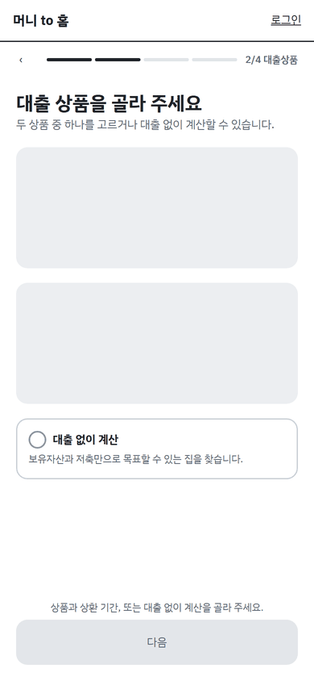](wireframes/P03_07_Loading.png)

| 항목 | 내용 |
| --- | --- |
| 단계 | 2차 |
| 화면 크기 | 모바일 390 × 844 |
| 요구사항 (Should) | FR-COMMON-10 |
| 그림 파일 | [wireframes/P03_07_Loading.png](wireframes/P03_07_Loading.png) (2배 크기) |

**언제 보이는가**

상품 목록을 서버에서 받아 오는 동안.

**화면 구성** (위에서 아래로)

1. 상품 카드 자리에 회색 자리 표시 두 개
2. '대출 없이 계산'은 서버 값이 필요 없어 바로 보인다.
3. 꺼진 '다음' 버튼

**동작**

- 상품이 도착하면 자리 표시가 카드로 바뀐다.

**규칙과 근거** (캔버스 메모)

- 상품 카드 자리에 회색 자리 표시. '대출 없이 계산'은 서버 값이 필요 없어 바로 보인다.

<a id="wf-P03_08_LoadFail" name="wf-P03_08_LoadFail"></a>

#### P-03 ⑧ 예외: 상품을 불러오지 못함

[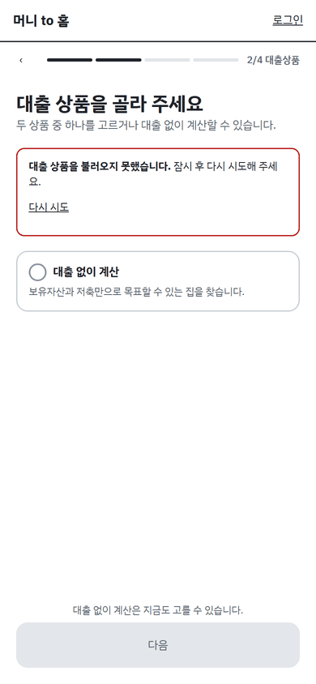](wireframes/P03_08_LoadFail.png)

| 항목 | 내용 |
| --- | --- |
| 단계 | 2차 |
| 화면 크기 | 모바일 390 × 844 |
| 요구사항 (Must) | FR-LOAN-15 |
| 요구사항 (Should) | FR-COMMON-07 / NFR-11 |
| 그림 파일 | [wireframes/P03_08_LoadFail.png](wireframes/P03_08_LoadFail.png) (2배 크기) |

**언제 보이는가**

상품 목록을 불러오지 못했을 때.

**화면 구성** (위에서 아래로)

1. 빨간 테두리 상자: '대출 상품을 불러오지 못했습니다. 잠시 후 다시 시도해 주세요.'와 '다시 시도'
2. '대출 없이 계산' 선택지는 그대로 있다.
3. 버튼 위 안내가 '대출 없이 계산은 지금도 고를 수 있습니다.'로 바뀐다.

**동작**

- '다시 시도'로 목록을 다시 불러온다.
- '대출 없이 계산'을 고르면 '다음'이 켜져 흐름이 막히지 않는다.

**규칙과 근거** (캔버스 메모)

- '다시 시도'로 다시 불러온다.
- 상품은 못 고르지만 '대출 없이 계산'은 고를 수 있어 흐름이 막히지 않는다.

<a id="wf-P03_09_CalcFail" name="wf-P03_09_CalcFail"></a>

#### P-03 ⑨ 예외: 계산하지 못함

[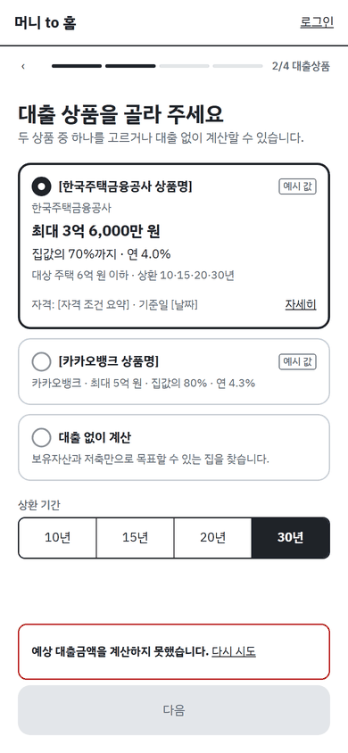](wireframes/P03_09_CalcFail.png)

| 항목 | 내용 |
| --- | --- |
| 단계 | 2차 |
| 화면 크기 | 모바일 390 × 844 |
| 요구사항 (Must) | NFR-13 |
| 요구사항 (Should) | FR-COMMON-07 |
| 그림 파일 | [wireframes/P03_09_CalcFail.png](wireframes/P03_09_CalcFail.png) (2배 크기) |

**언제 보이는가**

상품과 기간은 골랐지만 서버의 대출 계산이 실패했을 때.

**화면 구성** (위에서 아래로)

1. 카드와 상환 기간은 고른 상태 그대로
2. 결과 자리에 빨간 테두리 상자: '예상 대출금액을 계산하지 못했습니다.'와 '다시 시도'
3. '다음' 버튼이 꺼져 있다.

**동작**

- 계산 결과 없이는 다음 단계로 넘어가지 않는다.

**규칙과 근거** (캔버스 메모)

- 상품과 기간은 골랐지만 서버 계산이 실패했을 때. 결과 자리에 안내를 보여 준다.
- 예외이므로 '다음'이 켜지지 않는다.

<a id="wf-P03_10_ZeroAsset" name="wf-P03_10_ZeroAsset"></a>

#### P-03 ⑩ 보유자산이 0원일 때

[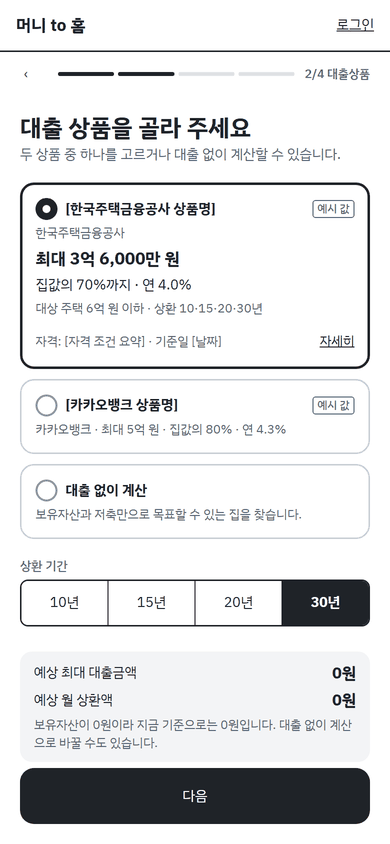](wireframes/P03_10_ZeroAsset.png)

| 항목 | 내용 |
| --- | --- |
| 단계 | 1차 |
| 화면 크기 | 모바일 390 × 844 |
| 요구사항 (Must) | FR-LOAN-06, 15 |
| 계산 규칙 | C-06 최대 예상 대출금액 (아파트 선택 전) |
| 그림 파일 | [wireframes/P03_10_ZeroAsset.png](wireframes/P03_10_ZeroAsset.png) (2배 크기) |

**언제 보이는가**

재무정보에서 보유자산을 0원으로 넣고 상품을 골랐을 때.

**화면 구성** (위에서 아래로)

1. 회색 상자: 예상 최대 대출금액 0원, 예상 월 상환액 0원
2. 그 아래 설명: '보유자산이 0원이라 지금 기준으로는 0원입니다. 대출 없이 계산으로 바꿀 수도 있습니다.'
3. '다음' 버튼은 켜져 있다.

**동작**

- 오류가 아니므로 진행을 막지 않는다. 저축 기간을 두면 지도에서는 결과가 달라진다.

**규칙과 근거** (캔버스 메모)

- C-06대로 계산하면 0원이 나온다. 오류가 아니라서 그대로 보여 주고 진행을 막지 않는다.
- 왜 0원인지와 '대출 없이 계산'으로 바꿀 수 있음을 한 줄로 알린다.

## 7. P-04 저축 계획

월 저축 가능액과 목표 기간을 받는다. 여기까지 받으면 계산에 필요한 값이 모두 모인다. "지도에서 보기"를 누르면 지도로 간다. 진행 표시는 3/4이다.

### 7.1 받는 값과 결과

| 값 | 형식 | 범위 | 계산에 쓰는가 |
| --- | --- | --- | --- |
| 월 저축 가능액 | 만 원 단위 정수, 필수 (FR-PLAN-01) | 0 이상 10억 원 이하 (FR-PROFILE-21) | 쓴다. 누적 저축액 (C-02) |
| 목표 기간 | 지금, 3년, 5년, 10년 중 하나. 필수 (FR-PLAN-02) | 기본 선택이 없다. 날짜를 넣는 방식이 아니라서 지난 시점은 고를 수 없다. | 쓴다. C-02, C-03, C-09, C-11, C-12 |

| 결과 | 계산 |
| --- | --- |
| 누적 저축액 | 월 저축 가능액 × 12 × 목표 연수 (C-02). "지금"은 0원 |
| 목표 시점 자기자금 | 현재 보유자산 + 누적 저축액 (C-03) |

- 이자와 소득 증가는 반영하지 않는다. 집값은 지금의 실거래 평균가 그대로 계산한다 (FR-PLAN-08).
- "지도에서 보기"를 누를 때 로그인했으면 저축 계획을 DB에 저장한다 (FR-PROFILE-04).
- 계산에 쓰는 값은 현재 보유자산, 대출 방법(상품과 상환 기간, 또는 대출 없이 계산), 월 저축 가능액, 목표 기간이다. 하나라도 빠지면 지도에서 계산하지 않고 빠진 단계로 안내한다 (FR-RESULT-10, P-05 ⑫).

### 7.2 흐름 (6장)

① → ② → ③ → ④ → ⑥ → 지도의 순서다. ⑤ 입력 요약은 3차에 넣으며, 넣기 전에는 ④에서 바로 ⑥으로 간다.

<a id="wf-P04_01_SavEmpty" name="wf-P04_01_SavEmpty"></a>

#### P-04 ① 월 저축액, 입력 전

[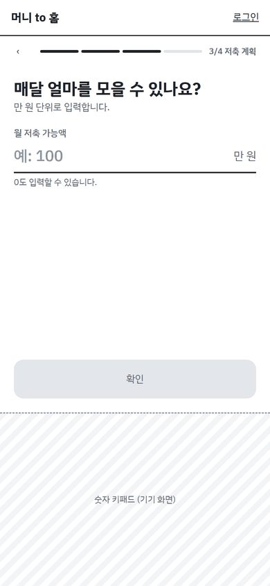](wireframes/P04_01_SavEmpty.png)

| 항목 | 내용 |
| --- | --- |
| 단계 | 1차 |
| 화면 크기 | 모바일 390 × 844 |
| 요구사항 (Must) | FR-PLAN-01 / FR-PROFILE-20 / FR-COMMON-05 |
| 요구사항 (Should) | FR-COMMON-09 |
| 그림 파일 | [wireframes/P04_01_SavEmpty.png](wireframes/P04_01_SavEmpty.png) (2배 크기) |

**언제 보이는가**

저축 계획 단계에 들어왔을 때.

**화면 구성** (위에서 아래로)

1. 진행 표시 줄: 세 칸이 채워지고 '3/4 저축 계획'
2. 제목 '매달 얼마를 모을 수 있나요?', 설명 '만 원 단위로 입력합니다.'
3. 입력란 '월 저축 가능액': 자리 글자 '예: 100', 아래 '0도 입력할 수 있습니다.'
4. 꺼진 '확인' 버튼과 키패드 자리

**동작**

- ‹ 를 누르면 대출상품 단계로 돌아가고 선택은 유지된다.

**규칙과 근거** (캔버스 메모)

- 커서가 바로 가고 숫자 키패드가 뜬다. 값이 없으면 '확인'이 꺼져 있다.
- ‹ → P-03 (선택 유지). 진행 바 3/4.

<a id="wf-P04_02_SavFilled" name="wf-P04_02_SavFilled"></a>

#### P-04 ② 월 저축액, 입력함

[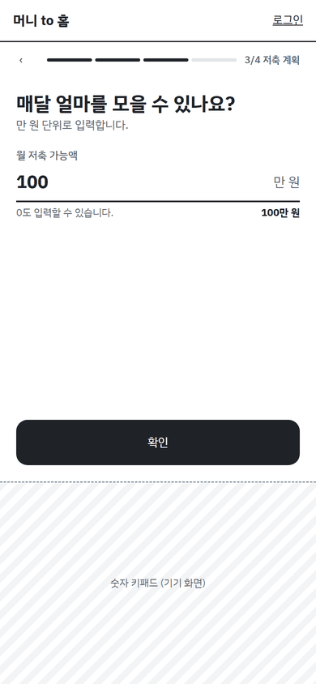](wireframes/P04_02_SavFilled.png)

| 항목 | 내용 |
| --- | --- |
| 단계 | 1차 |
| 화면 크기 | 모바일 390 × 844 |
| 요구사항 (Must) | FR-PLAN-01 |
| 요구사항 (Should) | FR-PROFILE-21, 22 / FR-COMMON-11 |
| 그림 파일 | [wireframes/P04_02_SavFilled.png](wireframes/P04_02_SavFilled.png) (2배 크기) |

**언제 보이는가**

월 저축 가능액을 입력했을 때.

**화면 구성** (위에서 아래로)

1. 입력란에 100, 아래 오른쪽에 '100만 원'
2. '확인' 버튼이 켜진다.

**동작**

- '확인'을 누르면 목표 기간 질문(P-04 ③)으로 넘어간다.

**규칙과 근거** (캔버스 메모)

- 0 이상 10억 원 이하의 정수면 '확인'이 켜진다. '확인' → ③.

<a id="wf-P04_03_TermEmpty" name="wf-P04_03_TermEmpty"></a>

#### P-04 ③ 목표 기간, 고르기 전

[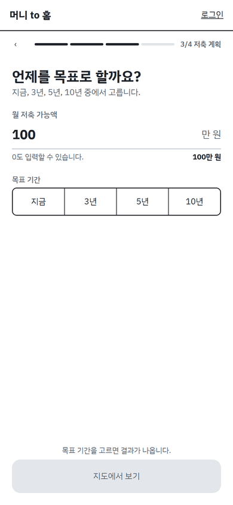](wireframes/P04_03_TermEmpty.png)

| 항목 | 내용 |
| --- | --- |
| 단계 | 1차 |
| 화면 크기 | 모바일 390 × 844 |
| 요구사항 (Must) | FR-PLAN-02 |
| 그림 파일 | [wireframes/P04_03_TermEmpty.png](wireframes/P04_03_TermEmpty.png) (2배 크기) |

**언제 보이는가**

월 저축액을 확인하고 넘어온 직후.

**화면 구성** (위에서 아래로)

1. 제목 '언제를 목표로 할까요?', 설명 '지금, 3년, 5년, 10년 중에서 고릅니다.'
2. 위에 월 저축 가능액 100이 남아 있다.
3. '목표 기간' 선택지 네 개. 골라진 것이 없다.
4. 버튼 위 안내 '목표 기간을 고르면 결과가 나옵니다.'와 꺼진 '지도에서 보기' 버튼

**동작**

- 선택지가 넷뿐이라 지난 시점은 고를 수 없다.

**규칙과 근거** (캔버스 메모)

- 키패드가 내려가고 선택지 네 개가 나타난다.
- 고르기 전에는 '지도에서 보기'가 꺼져 있고, 버튼 위에 이유를 적는다.

<a id="wf-P04_04_TermPicked" name="wf-P04_04_TermPicked"></a>

#### P-04 ④ 목표 기간을 고름

[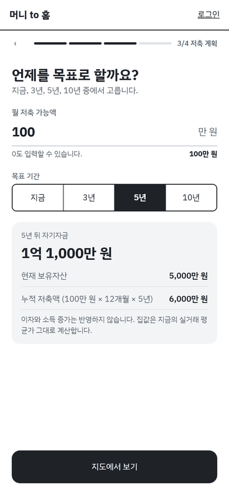](wireframes/P04_04_TermPicked.png)

| 항목 | 내용 |
| --- | --- |
| 단계 | 1차 |
| 화면 크기 | 모바일 390 × 844 |
| 요구사항 (Must) | FR-PLAN-02, 04, 05, 08 |
| 계산 규칙 | C-02 누적 저축액, C-03 목표 시점 자기자금 |
| 그림 파일 | [wireframes/P04_04_TermPicked.png](wireframes/P04_04_TermPicked.png) (2배 크기) |

**언제 보이는가**

목표 기간을 골랐을 때.

**화면 구성** (위에서 아래로)

1. 5년이 검게 골라져 있다.
2. 회색 결과 상자: '5년 뒤 자기자금 1억 1,000만 원'(큰 글씨), 현재 보유자산 5,000만 원, 누적 저축액 (100만 원 × 12개월 × 5년) 6,000만 원
3. 상자 아래 작은 글씨: '이자와 소득 증가는 반영하지 않습니다. 집값은 지금의 실거래 평균가 그대로 계산합니다.'
4. '지도에서 보기' 버튼이 켜진다.

**동작**

- 금액이나 기간을 바꾸면 결과가 바로 바뀐다.
- '지도에서 보기'를 누르면 지도로 간다. 로그인했으면 이때 저축 계획을 DB에 저장한다.

**규칙과 근거** (캔버스 메모)

- 누적 저축액 6,000만 원 = 100만 × 12 × 5. 자기자금 1억 1,000만 원 = 5,000만 + 6,000만.
- 금액이나 기간을 바꾸면 결과가 바로 바뀐다.
- '지도에서 보기' → ⑥을 거쳐 P-05. 3차에 요약을 넣으면 ⑤를 거친다.

<a id="wf-P04_05_Summary" name="wf-P04_05_Summary"></a>

#### P-04 ⑤ 입력 요약 (3차)

[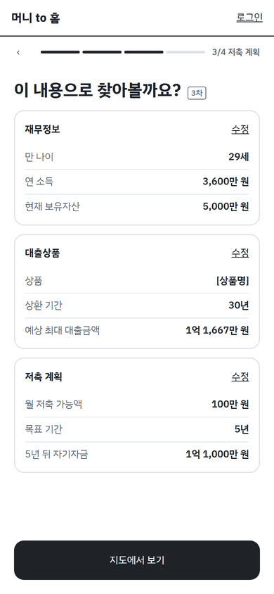](wireframes/P04_05_Summary.png)

| 항목 | 내용 |
| --- | --- |
| 단계 | 3차 |
| 화면 크기 | 모바일 390 × 844 |
| 요구사항 (Could) | FR-PROFILE-15 |
| 그림 파일 | [wireframes/P04_05_Summary.png](wireframes/P04_05_Summary.png) (2배 크기) |

**언제 보이는가**

3차에 입력 요약을 넣었을 때, 저축 계획 다음에 한 번 나온다.

**화면 구성** (위에서 아래로)

1. 제목 '이 내용으로 찾아볼까요?'
2. 묶음 세 개와 '수정': 재무정보(만 나이 29세, 연 소득 3,600만 원, 현재 보유자산 5,000만 원), 대출상품(상품, 상환 기간 30년, 예상 최대 대출금액 1억 1,667만 원), 저축 계획(월 100만 원, 5년, 5년 뒤 자기자금 1억 1,000만 원)
3. '지도에서 보기' 버튼

**동작**

- 받은 값 일곱 개가 모두 이 화면에 모인다.
- 3차 전에는 이 화면 없이 P-04 ④에서 바로 지도로 간다.

**규칙과 근거** (캔버스 메모)

- 받은 값 일곱 개와 계산 결과 두 개를 한 화면에 모아 보여 준다. 저축 계획 뒤, 지도 앞에 한 번만 나온다.
- '수정'을 누르면 그 단계로 가고, 고친 뒤 '다음'을 누르면 이 화면으로 돌아온다.
- 3차 전에는 이 화면 없이 ④에서 바로 지도로 간다.

<a id="wf-P04_06_Busy" name="wf-P04_06_Busy"></a>

#### P-04 ⑥ 지도로 넘어가는 중

[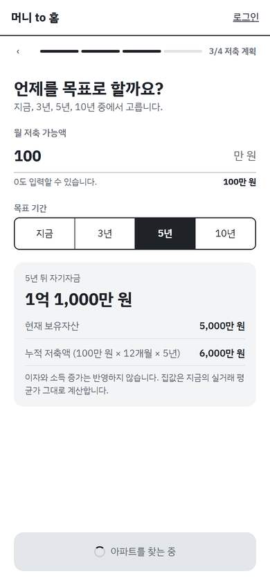](wireframes/P04_06_Busy.png)

| 항목 | 내용 |
| --- | --- |
| 단계 | 2차 |
| 화면 크기 | 모바일 390 × 844 |
| 요구사항 (Should) | FR-COMMON-10 / NFR-01 |
| 그림 파일 | [wireframes/P04_06_Busy.png](wireframes/P04_06_Busy.png) (2배 크기) |

**언제 보이는가**

'지도에서 보기'를 누른 직후, 아파트를 찾는 동안.

**화면 구성** (위에서 아래로)

1. 화면은 P-04 ④와 같다.
2. 버튼이 회색으로 바뀌고 돌아가는 표시와 '아파트를 찾는 중'이 나온다.

**동작**

- 버튼을 다시 누를 수 없다.
- 끝나면 지도(P-05 ①)로 간다.

**규칙과 근거** (캔버스 메모)

- 아파트를 찾는 동안 버튼에 진행 중 표시를 하고 다시 누를 수 없게 한다.
- 끝나면 P-05 지도로 간다.

### 7.3 경계 값과 예외 (5장)

<a id="wf-P04_07_Now" name="wf-P04_07_Now"></a>

#### P-04 ⑦ 목표 기간이 '지금'

[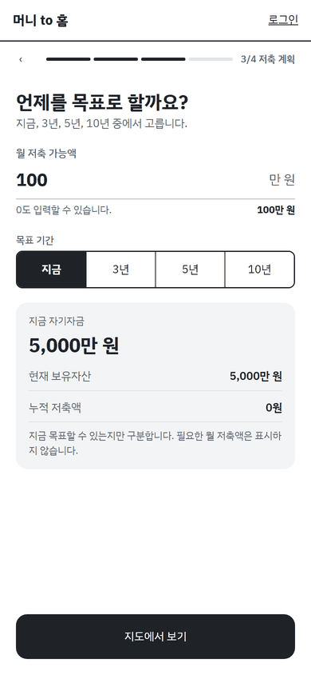](wireframes/P04_07_Now.png)

| 항목 | 내용 |
| --- | --- |
| 단계 | 1차 |
| 화면 크기 | 모바일 390 × 844 |
| 요구사항 (Must) | FR-PLAN-09 |
| 계산 규칙 | C-02 누적 저축액, C-09 3단계 구분 |
| 그림 파일 | [wireframes/P04_07_Now.png](wireframes/P04_07_Now.png) (2배 크기) |

**언제 보이는가**

목표 기간으로 '지금'을 골랐을 때.

**화면 구성** (위에서 아래로)

1. '지금'이 검게 골라져 있다.
2. 결과 상자: '지금 자기자금 5,000만 원', 현재 보유자산 5,000만 원, 누적 저축액 0원
3. 상자 아래: '지금 목표할 수 있는지만 구분합니다. 필요한 월 저축액은 표시하지 않습니다.'

**동작**

- 월 저축액은 지우지 않고 남겨 둔다. 기간을 바꾸면 다시 쓰인다.

**규칙과 근거** (캔버스 메모)

- 누적 저축액은 0원, 자기자금은 현재 보유자산과 같다.
- 이후 화면에서 '목표 기간 안에 가능' 구분, 필요 월 저축액, 허용 상승률이 나오지 않는다.
- 월 저축액은 지우지 않고 그대로 둔다. 기간을 바꾸면 다시 쓰인다.

<a id="wf-P04_08_Zero" name="wf-P04_08_Zero"></a>

#### P-04 ⑧ 월 저축액이 0원

[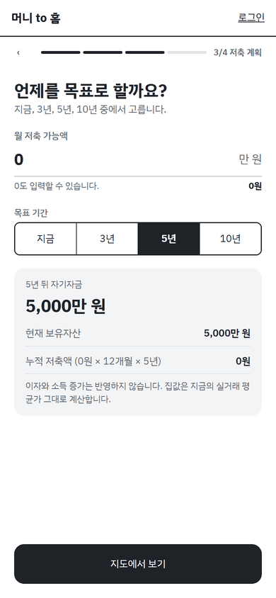](wireframes/P04_08_Zero.png)

| 항목 | 내용 |
| --- | --- |
| 단계 | 1차 |
| 화면 크기 | 모바일 390 × 844 |
| 요구사항 (Must) | FR-PLAN-01 |
| 계산 규칙 | C-02 누적 저축액 |
| 그림 파일 | [wireframes/P04_08_Zero.png](wireframes/P04_08_Zero.png) (2배 크기) |

**언제 보이는가**

월 저축 가능액을 0으로 넣었을 때.

**화면 구성** (위에서 아래로)

1. 입력란에 0, 아래 오른쪽에 '0원'
2. 결과 상자: '5년 뒤 자기자금 5,000만 원', 누적 저축액 (0원 × 12개월 × 5년) 0원
3. '지도에서 보기' 버튼은 켜져 있다.

**동작**

- 0원은 오류가 아니다.

**규칙과 근거** (캔버스 메모)

- 0원은 오류가 아니다. 누적 저축액이 0원이라 자기자금이 보유자산과 같다.

<a id="wf-P04_09_Error" name="wf-P04_09_Error"></a>

#### P-04 ⑨ 예외: 입력 오류

[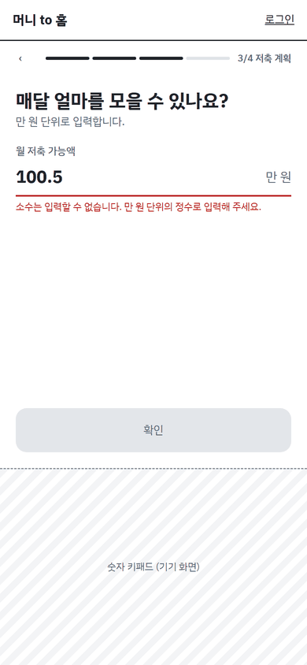](wireframes/P04_09_Error.png)

| 항목 | 내용 |
| --- | --- |
| 단계 | 1차 |
| 화면 크기 | 모바일 390 × 844 |
| 요구사항 (Must) | FR-PROFILE-02, 03 / NFR-02 |
| 요구사항 (Should) | FR-PROFILE-14 |
| 그림 파일 | [wireframes/P04_09_Error.png](wireframes/P04_09_Error.png) (2배 크기) |

**언제 보이는가**

월 저축 가능액에 소수가 들어왔을 때.

**화면 구성** (위에서 아래로)

1. 입력란에 100.5, 빨간 밑줄
2. 아래 빨간 글자: '소수는 입력할 수 없습니다. 만 원 단위의 정수로 입력해 주세요.'
3. '확인' 버튼이 꺼져 있다.

**동작**

- 음수와 숫자가 아닌 값도 P-02와 같은 문구로 알린다.

**규칙과 근거** (캔버스 메모)

- 음수, 소수, 숫자가 아닌 값. 문구는 P-02와 같다. 버튼이 켜지지 않는다.

<a id="wf-P04_10_MapFail" name="wf-P04_10_MapFail"></a>

#### P-04 ⑩ 예외: 아파트를 불러오지 못함

[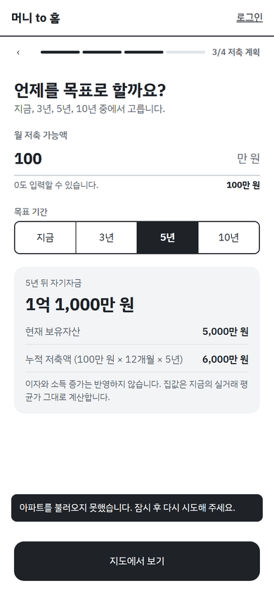](wireframes/P04_10_MapFail.png)

| 항목 | 내용 |
| --- | --- |
| 단계 | 2차 |
| 화면 크기 | 모바일 390 × 844 |
| 요구사항 (Should) | FR-COMMON-07 / NFR-11 |
| 그림 파일 | [wireframes/P04_10_MapFail.png](wireframes/P04_10_MapFail.png) (2배 크기) |

**언제 보이는가**

'지도에서 보기'를 눌렀는데 아파트 검색이 실패했을 때.

**화면 구성** (위에서 아래로)

1. 화면은 P-04 ④와 같다.
2. 버튼 위 검은 알림: '아파트를 불러오지 못했습니다. 잠시 후 다시 시도해 주세요.'
3. 버튼은 다시 '지도에서 보기'로 돌아와 있다.

**동작**

- 이 화면에 머문다. 입력한 값은 그대로다.

**규칙과 근거** (캔버스 메모)

- ⑥에서 실패하면 이 화면에 머물고 버튼을 되돌린다. 입력한 값은 그대로다.

<a id="wf-P04_11_AmountMax" name="wf-P04_11_AmountMax"></a>

#### P-04 ⑪ 예외: 금액 상한

[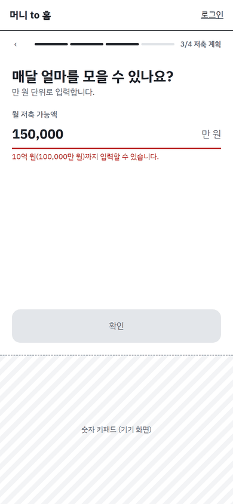](wireframes/P04_11_AmountMax.png)

| 항목 | 내용 |
| --- | --- |
| 단계 | 2차 |
| 화면 크기 | 모바일 390 × 844 |
| 요구사항 (Should) | FR-PROFILE-21, 14 |
| 그림 파일 | [wireframes/P04_11_AmountMax.png](wireframes/P04_11_AmountMax.png) (2배 크기) |

**언제 보이는가**

월 저축 가능액이 10억 원을 넘을 때.

**화면 구성** (위에서 아래로)

1. 입력란에 150,000, 빨간 밑줄
2. 아래 빨간 글자: '10억 원(100,000만 원)까지 입력할 수 있습니다.'
3. '확인' 버튼이 꺼져 있다.

**동작**

- 값을 줄이면 문구가 사라진다.

**규칙과 근거** (캔버스 메모)

- 월 저축 가능액은 10억 원(100,000만 원)까지. 넘으면 오류이고 버튼이 켜지지 않는다.

## 8. P-05 지도와 P-06 아래 창

이 서비스의 메인 화면이다. 저축 계획까지 입력하면 지도가 헤더와 내 조건 줄 아래를 가득 채운다. 구, 동, 아파트를 누르면 아래에서 창(P-06)이 올라온다. 지도와 아래 창은 한 화면에서 함께 움직이므로 번호를 ①부터 ㉑까지 이어 붙였다.

| 번호 | 내용 |
| --- | --- |
| ① ~ ③ | 지도: 기본, 조건 창, 넓게 본 모습 |
| ④ ~ ⑧ | 아래 창: 동의 30%, 목록 80%, 아파트 30%, 아파트 정보 80%, 시나리오 전체 |
| ⑨ | 결과 없음 |
| ⑩ | 비어 있다. PC 배치는 왼쪽 패널로 정해 W7 ~ W10에 그렸다. |
| ⑪ ~ ⑰ | 지도의 추가 상태와 예외: 광주 5개 구 전체, 입력이 빠짐, 구·동 선택, 검색, 불러오는 중, 지도 실패 |
| ⑱ ~ ⑳ | 아래 창의 추가 상태: 좌표 없음, 대상 주택 가격 상한 초과, 자금이 부족할 때의 시나리오 |
| ㉑ | 위치 권한이 꺼져 있음 |

아파트 표시의 모양은 2.4, 아래 창의 세 단계는 2.5에 적었다.

### 8.1 기본 흐름 (9장)

<a id="wf-Main" name="wf-Main"></a>

#### P-05 ① 지도 기본

[](wireframes/P05_Main.png)

| 항목 | 내용 |
| --- | --- |
| 단계 | 1차 (검색, 조건 칩, 범례, 지도 조작 버튼, 표시의 면적과 금액은 2차) |
| 화면 크기 | 모바일 390 × 844 |
| 요구사항 (Must) | FR-MAP-01, 02, 04, 11, 15 / FR-APT-02 / FR-COMMON-02, 04 |
| 요구사항 (Should) | FR-MAP-06, 08, 19, 24, 25, 26, 29, 30 / FR-APT-03, 09, 10 / NFR-24 |
| 그림 파일 | [wireframes/P05_Main.png](wireframes/P05_Main.png) (2배 크기) |

**언제 보이는가**

저축 계획까지 마치고 지도에 들어왔을 때. 이 서비스의 메인 화면이다.

**화면 구성** (위에서 아래로)

1. 헤더와 내 조건 줄: '5년 뒤 목표 가능 가격 3억 6,667만 원까지'와 '수정'
2. 지도 위에 검색 줄(구·동 선택 버튼, 아파트 이름 검색창)과 조건 칩 줄(면적, 가격, 준공 연도, 자금 부족 표시 스위치)
3. 집 모양의 아파트 표시 아홉 개와 내 위치를 나타내는 점
4. 왼쪽 아래 '범례' 버튼과 작은 안내 아이콘( ! ), 가운데 축척 200m, 오른쪽 아래 '목록 보기' 버튼
5. 오른쪽 아래 세로 버튼: ㎡/평 전환, 현재 위치, 확대, 축소

**동작**

- 표시를 누르면 30% 창이 올라온다(P-06 ⑥).
- '목록 보기'를 누르면 목록이 뜬다(P-06 ⑤).
- '수정'을 누르면 입력 단계로 돌아간다.
- 지도를 움직이면 보이는 영역의 아파트로 표시가 바뀐다(2차).

**규칙과 근거** (캔버스 메모)

- 위쪽 고정 영역은 헤더 52 + 내 조건 40 = 92px. 진행 바는 입력 화면에만 둔다.
- 칩은 면적, 가격, 준공 연도와 자금 부족 표시 스위치. 정렬은 목록의 머리에만 있다.
- 범례는 버튼으로 접고 편다. 그 옆의 ! 에 마우스를 올리거나 누르면 실거래 기록 안내가 뜬다. 펼친 범례는 B4에, 안내 문구는 B5에 있다.
- 예시 값: 보유 5,000만, 월 100만, 5년, 대출 비율 70%, 한도 3억 6,000만.
- 아파트 표시: 집 모양. 위 띠에 공급면적, 가운데에 실거래 평균가, 아래에 구분과 여유 또는 부족 금액. 띠의 색과 테두리로 구분한다. 오른쪽 아래의 ㎡/평 버튼으로 면적 단위를 바꾼다.

<a id="wf-P05_Filter" name="wf-P05_Filter"></a>

#### P-05 ② 조건

[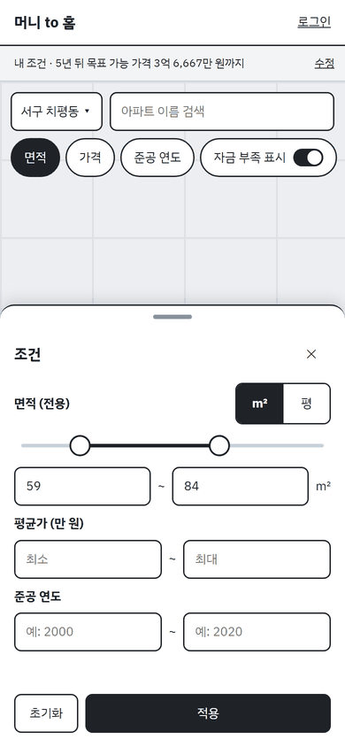](wireframes/P05_Filter.png)

| 항목 | 내용 |
| --- | --- |
| 단계 | 2차 |
| 화면 크기 | 모바일 390 × 844 |
| 요구사항 (Should) | FR-APT-03, 09, 10 |
| 그림 파일 | [wireframes/P05_Filter.png](wireframes/P05_Filter.png) (2배 크기) |

**언제 보이는가**

조건 칩(면적, 가격, 준공 연도)을 눌렀을 때.

**화면 구성** (위에서 아래로)

1. 누른 칩이 검게 바뀌고 아래에서 '조건' 창이 올라온다.
2. 면적(전용): ㎡/평 전환, 양쪽 손잡이가 있는 슬라이더, 최소와 최대 입력란(59 \~ 84)
3. 평균가(만 원): 최소, 최대 입력란
4. 준공 연도: 시작과 끝 입력란
5. 맨 아래 '초기화'와 '적용' 버튼

**동작**

- '적용'을 누르면 창이 닫히고 조건에 맞는 아파트만 남는다.
- '초기화'는 세 조건을 모두 비운다.

**규칙과 근거** (캔버스 메모)

- 칩을 누르면 뜨는 창. 누른 칩의 항목으로 내려가 있다. 모두 2차.

<a id="wf-P05_Wide" name="wf-P05_Wide"></a>

#### P-05 ③ 넓게 본 지도 (동 표시)

[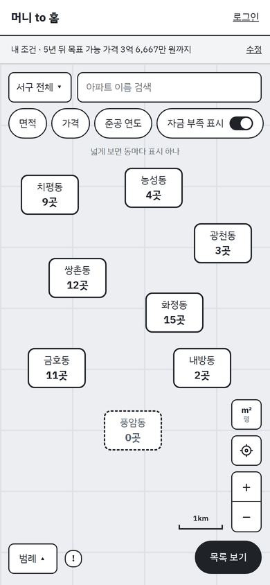](wireframes/P05_Wide.png)

| 항목 | 내용 |
| --- | --- |
| 단계 | 2차 |
| 화면 크기 | 모바일 390 × 844 |
| 요구사항 (Should) | FR-MAP-20, 21, 22 |
| 그림 파일 | [wireframes/P05_Wide.png](wireframes/P05_Wide.png) (2배 크기) |

**언제 보이는가**

지도를 구 하나가 보일 만큼 축소했을 때.

**화면 구성** (위에서 아래로)

1. 아파트 표시 대신 동마다 네모 표시 하나: 동 이름과 목표할 수 있는 아파트 수(치평동 9곳, 화정동 15곳 등)
2. 목표할 수 있는 곳이 0곳인 동은 점선 테두리(풍암동 0곳)
3. 구·동 선택 버튼이 '서구 전체'로 바뀐다.
4. 축척이 1km로 바뀐다.

**동작**

- 동 표시를 누르면 그 동으로 확대하고 30% 창이 올라온다(P-06 ④).

**규칙과 근거** (캔버스 메모)

- 동 표시의 숫자는 목표 가능한 아파트 수(지금 + 기간 내).
- 정함 (2026-10-13): 동 표시와 아파트 표시가 바뀌는 확대 수준은 카카오맵의 6이다. 6부터(더 넓게 보면) 동 표시, 5 이하는 아파트 표시다.
- 정함 (2026-10-13): 동 표시의 모양은 그림의 네모가 아니라 연보라 동그라미다. 동 이름과 숫자만 적고 "곳"은 적지 않는다. 0곳이면 점선 테두리다.
- 정함 (2026-10-13): 동 표시를 누르면 그 동이 화면 가운데로 오면서 0.6초 동안 확대된다. 30% 창은 아래 창을 만든 뒤에 붙인다.

<a id="wf-P06_Dong30" name="wf-P06_Dong30"></a>

#### P-06 ④ 동을 누름 30%

[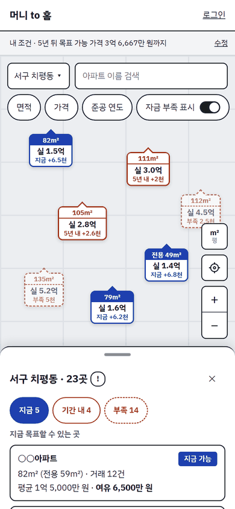](wireframes/P06_Dong30.png)

| 항목 | 내용 |
| --- | --- |
| 단계 | 2차 |
| 화면 크기 | 모바일 390 × 844 |
| 요구사항 (Must) | FR-MAP-13 / FR-APT-05 / FR-COMMON-02 |
| 요구사항 (Should) | FR-MAP-21 / FR-APT-13 |
| 그림 파일 | [wireframes/P06_Dong30.png](wireframes/P06_Dong30.png) (2배 크기) |

**언제 보이는가**

동 표시를 눌렀을 때.

**화면 구성** (위에서 아래로)

1. 지도가 그 동으로 확대되어 아파트 표시가 보인다.
2. 아래에서 30% 창: 제목 '서구 치평동 · 23곳'과 안내 아이콘, 닫기
3. 구분별 개수 세 개: 지금 5, 기간 내 4, 부족 14
4. '지금 목표할 수 있는 곳' 아래 첫 카드, 다음 카드가 걸쳐 보인다.
5. 지도의 조작 버튼은 창 바로 위로 올라간다.

**동작**

- 개수를 누르면 그 구분으로 내려간다.
- 손잡이를 올리면 80% 목록이 된다(P-06 ⑤).
- 카드를 누르면 그 아파트가 80%로 열린다(P-06 ⑦).

**규칙과 근거** (캔버스 메모)

- 30%에는 구분별 개수 한 줄과 '지금' 아파트의 첫 카드. 다음 카드를 걸쳐 보여 준다.
- 개수를 누르면 그 구분으로 내려간다.

<a id="wf-P06_List80" name="wf-P06_List80"></a>

#### P-06 ⑤ 목록 80%

[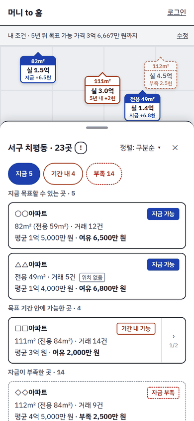](wireframes/P06_List80.png)

| 항목 | 내용 |
| --- | --- |
| 단계 | 1차 (정렬은 2차) |
| 화면 크기 | 모바일 390 × 844 |
| 요구사항 (Must) | FR-APT-04, 05 / FR-MAP-07, 13 / FR-COMMON-02 |
| 요구사항 (Should) | FR-APT-06, 13 / FR-MAP-05 |
| 그림 파일 | [wireframes/P06_List80.png](wireframes/P06_List80.png) (2배 크기) |

**언제 보이는가**

'목록 보기'를 눌렀거나 동의 30% 창을 위로 올렸을 때.

**화면 구성** (위에서 아래로)

1. 지도는 위쪽 150픽셀쯤만 남고 검색 줄과 칩은 숨는다.
2. 창의 머리: '서구 치평동 · 23곳', 안내 아이콘, 글자만 있는 '정렬: 구분순' 버튼, 닫기
3. 구분별 개수, 그 아래 구분마다 작은 제목과 카드
4. 카드: 아파트 이름, 구분 배지, 면적과 거래 건수, 평균가와 여유 또는 부족 금액
5. 면적이 여러 개인 아파트(□□아파트)는 카드 오른쪽에 › 와 '1/2'
6. 좌표가 없는 아파트(△△아파트)에는 '위치 없음' 표시, 자금이 부족한 카드는 점선 테두리

**동작**

- 카드를 누르면 지도가 그 아파트로 옮겨지고 80% 아파트 창이 열린다.
- › 를 누르면 같은 카드에서 다른 면적을 본다.
- '정렬'을 누르면 정렬 선택 창이 뜬다(2차).

**규칙과 근거** (캔버스 메모)

- 80%는 헤더와 내 조건 아래(752px)의 80%다. 지도는 140px 이상 남긴다.
- 카드는 아파트마다 한 장. 면적이 여러 개면 오른쪽의 › 로 다른 면적을 넘겨 본다 (□□아파트).
- 기본 순서: 구분순, 같은 구분 안에서는 목표 가능 가격에 가까운 순. 정렬은 여기서만 바꾼다.

<a id="wf-P06_Apt30" name="wf-P06_Apt30"></a>

#### P-06 ⑥ 지도의 아파트를 누름 30%

[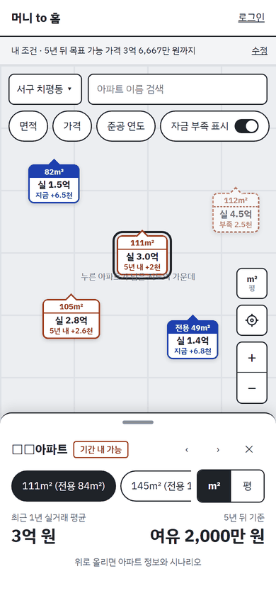](wireframes/P06_Apt30.png)

| 항목 | 내용 |
| --- | --- |
| 단계 | 1차 (좌우로 밀기와 ㎡/평 전환은 2차) |
| 화면 크기 | 모바일 390 × 844 |
| 요구사항 (Must) | FR-MAP-03, 13, 14, 16 / FR-APT-12 |
| 요구사항 (Should) | FR-MAP-18 / FR-APT-13, 14 |
| 그림 파일 | [wireframes/P06_Apt30.png](wireframes/P06_Apt30.png) (2배 크기) |

**언제 보이는가**

지도의 아파트 표시를 눌렀을 때.

**화면 구성** (위에서 아래로)

1. 누른 표시에 굵은 테두리가 생기고, 창을 뺀 남은 지도의 가운데로 온다.
2. 30% 창의 머리: □□아파트, '기간 내 가능' 배지, 이전(‹)·다음(›)·닫기
3. 면적 선택 칩: 111㎡ (전용 84㎡)이 골라져 있고 옆에 145㎡ (전용 114㎡), 오른쪽에 ㎡/평 전환
4. 왼쪽 '최근 1년 실거래 평균 3억 원', 오른쪽 '5년 뒤 기준 여유 2,000만 원'
5. 맨 아래 '위로 올리면 아파트 정보와 시나리오'

**동작**

- 손잡이를 올리면 80%가 되고 탭이 보인다.
- ‹ › 로 목록 순서대로 다른 아파트로 넘긴다. 이 상태에서는 좌우로 밀어도 넘어간다(2차).
- 면적을 바꾸면 평균가와 여유자금이 바뀐다.

**규칙과 근거** (캔버스 메모)

- 지도의 표시를 누르면 30%로 열린다. 누른 아파트는 남은 지도의 가운데로.
- 가장 싼 면적이 처음에 골라져 있다.
- 좌우로 밀기는 이 상태에서만 (2차).

<a id="wf-P06_AptInfo80" name="wf-P06_AptInfo80"></a>

#### P-06 ⑦ 목록에서 연 아파트 80% (아파트 정보)

[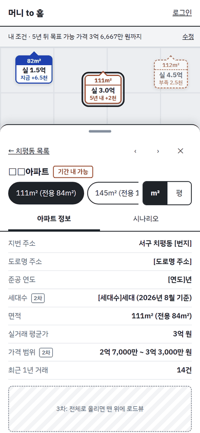](wireframes/P06_AptInfo80.png)

| 항목 | 내용 |
| --- | --- |
| 단계 | 1차 (세대수와 가격 범위는 2차, 로드뷰는 3차) |
| 화면 크기 | 모바일 390 × 844 |
| 요구사항 (Must) | FR-MAP-13, 14, 16 / FR-APT-12 |
| 요구사항 (Should) | FR-APT-13, 14, 15, 16 / FR-LOAN-14 |
| 그림 파일 | [wireframes/P06_AptInfo80.png](wireframes/P06_AptInfo80.png) (2배 크기) |

**언제 보이는가**

목록의 카드를 눌러 아파트를 열었을 때. 80%로 열리고 아파트 정보 탭이 보인다.

**화면 구성** (위에서 아래로)

1. 위쪽에 지도가 띠처럼 남고 누른 아파트가 그 가운데에 있다.
2. 머리: '← 치평동 목록', 이전·다음·닫기, 아파트 이름과 배지, 면적 칩과 ㎡/평 전환
3. 탭 두 개: 아파트 정보(선택됨), 시나리오
4. 정보 여덟 줄: 지번 주소, 도로명 주소, 준공 연도, 세대수(2차), 면적, 실거래 평균가, 가격 범위(2차), 최근 1년 거래
5. 맨 아래 점선 자리: '3차: 전체로 올리면 맨 위에 로드뷰'

**동작**

- '← 치평동 목록'을 누르면 목록의 보던 자리로 돌아간다.
- '시나리오' 탭을 누르면 계산 결과를 본다.

**규칙과 근거** (캔버스 메모)

- 목록의 카드를 누르면 80%로 열린다. '← 치평동 목록'은 목록에서 열었을 때만 보인다.
- 세대수, 가격 범위는 2차. 로드뷰는 3차이며 전체로 올렸을 때 불러온다.
- 목록에서 열었을 때 처음 보이는 탭은 아파트 정보다.

<a id="wf-P06_ScenarioFull" name="wf-P06_ScenarioFull"></a>

#### P-06 ⑧ 아파트 전체 (시나리오)

[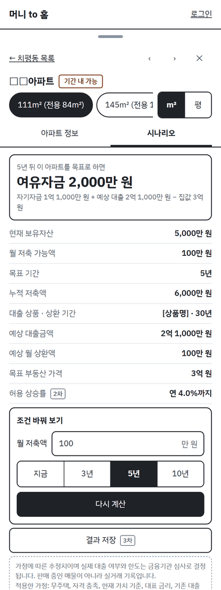](wireframes/P06_ScenarioFull.png)

| 항목 | 내용 |
| --- | --- |
| 단계 | 1차 (허용 상승률은 2차, 결과 저장은 3차) |
| 화면 크기 | 모바일 390 × 1040 (스크롤한 전체 내용을 보이려고 길게 그림) |
| 요구사항 (Must) | FR-RESULT-01, 02, 03, 04, 05, 06 / FR-LOAN-06, 07 / FR-COMMON-01, 02, 08 |
| 요구사항 (Should) | FR-RESULT-09 |
| 요구사항 (Could) | FR-RESULT-07 |
| 계산 규칙 | C-02 누적 저축액, C-03 목표 시점 자기자금, C-04 필요자금 (목표 부동산 가격), C-05 예상 대출금액 (아파트 기준), C-06 최대 예상 대출금액 (아파트 선택 전), C-07 예상 월 상환액, C-08 목표 가능 가격, C-09 3단계 구분, C-10 부족자금, C-11 필요 월 저축액, C-12 허용 상승률 |
| 그림 파일 | [wireframes/P06_ScenarioFull.png](wireframes/P06_ScenarioFull.png) (2배 크기) |

**언제 보이는가**

아파트 창을 전체로 올리고 시나리오 탭을 봤을 때. 스크롤한 전체 내용을 보이려고 그림이 길다.

**화면 구성** (위에서 아래로)

1. 지도가 가려지고 헤더만 남는다.
2. 결과 상자: '5년 뒤 이 아파트를 목표로 하면', 큰 글씨 '여유자금 2,000만 원', 식 '자기자금 1억 1,000만 원 + 예상 대출 2억 1,000만 원 − 집값 3억 원'
3. 값 아홉 줄: 현재 보유자산, 월 저축 가능액, 목표 기간, 누적 저축액, 대출 상품(값은 "상품 이름 · N년"), 예상 대출금액, 예상 월 상환액, 목표 부동산 가격, 허용 상승률(2차)
4. '조건 바꿔 보기' 상자: 월 저축액 입력란, 목표 기간 선택지, '다시 계산' 버튼
5. '결과 저장' 버튼(3차)
6. 점선 상자의 안내: 추정치, 실거래 기록, 적용한 가정

**동작**

- 월 저축액이나 기간을 바꾸고 '다시 계산'을 누르면 결과와 지도, 목록의 구분이 함께 바뀐다.
- 로그인했으면 바꾼 값을 DB에도 저장한다.

**규칙과 근거** (캔버스 메모)

- FR-RESULT-05가 요구하는 항목을 모두 줄로 나눠 적었다. 스크롤한 전체 내용을 보이려고 화면을 길게 그렸다.
- 월 상환액은 금리 4%를 넣은 예시다. 허용 상승률은 2차, 결과 저장은 3차 (로그인하지 않았으면 로그인 화면으로 안내).

<a id="wf-P05_Empty" name="wf-P05_Empty"></a>

#### P-05 ⑨ 결과 없음

[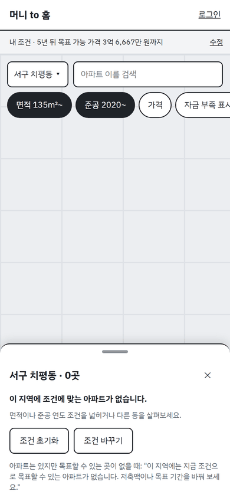](wireframes/P05_Empty.png)

| 항목 | 내용 |
| --- | --- |
| 단계 | 1차 |
| 화면 크기 | 모바일 390 × 844 |
| 요구사항 (Must) | FR-APT-07 |
| 요구사항 (Should) | FR-COMMON-07 |
| 그림 파일 | [wireframes/P05_Empty.png](wireframes/P05_Empty.png) (2배 크기) |

**언제 보이는가**

조건을 걸었더니 그 지역에 맞는 아파트가 하나도 없을 때.

**화면 구성** (위에서 아래로)

1. 칩에 걸린 조건이 검게 표시된다: '면적 135㎡\~', '준공 2020\~'
2. 지도에 표시가 없다.
3. 아래 창: '서구 치평동 · 0곳', '이 지역에 조건에 맞는 아파트가 없습니다.', '면적이나 준공 연도 조건을 넓히거나 다른 동을 살펴보세요.'
4. '조건 초기화'와 '조건 바꾸기' 버튼

**동작**

- '조건 초기화'는 조건을 모두 비우고 다시 찾는다.
- 아파트는 있지만 목표할 수 있는 곳이 없을 때는 문구가 다르다(A6).

**규칙과 근거** (캔버스 메모)

- 조건에 맞는 아파트가 없을 때. 아파트는 있지만 목표할 수 있는 곳이 없을 때는 문구가 다르다.

### 8.2 추가 상태와 예외 (11장)

<a id="wf-P05_City" name="wf-P05_City"></a>

#### P-05 ⑪ 광주 5개 구 전체 (구 표시, 경계선, 밖은 흐리게)

[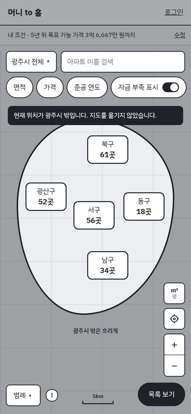](wireframes/P05_City.png)

| 항목 | 내용 |
| --- | --- |
| 단계 | 2차 |
| 화면 크기 | 모바일 390 × 844 |
| 요구사항 (Must) | NFR-23 |
| 요구사항 (Should) | FR-MAP-24, 25, 26, 28, 31 |
| 그림 파일 | [wireframes/P05_City.png](wireframes/P05_City.png) (2배 크기) |

**언제 보이는가**

지도를 광주 5개 구 전체가 보일 만큼 축소했을 때. 현재 위치 버튼을 눌렀는데 광주 5개 구 밖이었던 경우를 함께 그렸다.

**화면 구성** (위에서 아래로)

1. 광주 5개 구 경계선이 굵게 그려지고 경계 밖은 어둡게 덮인다.
2. 구마다 네모 표시 하나: 구 이름과 목표할 수 있는 아파트 수(광산구 52곳, 북구 61곳, 서구 56곳, 동구 18곳, 남구 34곳)
3. 구·동 선택 버튼이 '광주 5개 구 전체', 축척은 5km
4. 조건 칩 아래 검은 알림: '현재 위치가 광주 5개 구 밖입니다. 지도를 옮기지 않았습니다.'

**동작**

- 구 표시를 누르면 그 구로 확대하고 동 표시가 나온다(P-05 ③).

**규칙과 근거** (캔버스 메모)

- 광주 5개 구 전체가 보이면 구마다 표시 하나와 목표 가능한 아파트 수. 누르면 그 구로 확대한다. 표시는 구, 동, 아파트의 순으로 바뀐다.
- 경계 밖은 구멍이 뚫린 다각형을 반투명하게 덮는다 (카카오맵 Polygon에 좌표 배열을 두 개). 경계 좌표 자료가 필요하다 (T-MAP-26).
- 현재 위치가 광주 5개 구 밖일 때의 안내를 함께 그렸다.

<a id="wf-P05_NoInput" name="wf-P05_NoInput"></a>

#### P-05 ⑫ 입력이 빠졌을 때

[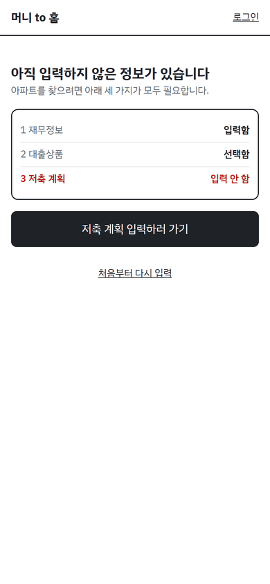](wireframes/P05_NoInput.png)

| 항목 | 내용 |
| --- | --- |
| 단계 | 1차 |
| 화면 크기 | 모바일 390 × 844 |
| 요구사항 (Must) | FR-RESULT-10 |
| 그림 파일 | [wireframes/P05_NoInput.png](wireframes/P05_NoInput.png) (2배 크기) |

**언제 보이는가**

입력을 마치지 않은 채 지도 주소로 바로 들어왔을 때.

**화면 구성** (위에서 아래로)

1. 지도 대신 안내 화면
2. 제목 '아직 입력하지 않은 정보가 있습니다', 설명 '아파트를 찾으려면 아래 세 가지가 모두 필요합니다.'
3. 상자에 단계 세 줄: 1 재무정보 입력함, 2 대출상품 선택함, 3 저축 계획 입력 안 함(빨간 글자)
4. '저축 계획 입력하러 가기' 버튼과 '처음부터 다시 입력'

**동작**

- 버튼은 빠진 단계 가운데 가장 앞의 것으로 간다.
- 계산은 하지 않는다.

**규칙과 근거** (캔버스 메모)

- 지도 주소로 바로 들어왔거나 단계를 건너뛰었을 때. 계산하지 않고 빠진 단계로 안내한다.

<a id="wf-P05_Region" name="wf-P05_Region"></a>

#### P-05 ⑬ 구·동 선택

[](wireframes/P05_Region.png)

| 항목 | 내용 |
| --- | --- |
| 단계 | 1차 |
| 화면 크기 | 모바일 390 × 844 |
| 요구사항 (Must) | FR-APT-02 |
| 요구사항 (Should) | FR-MAP-29 |
| 그림 파일 | [wireframes/P05_Region.png](wireframes/P05_Region.png) (2배 크기) |

**언제 보이는가**

구·동 선택 버튼을 눌렀을 때.

**화면 구성** (위에서 아래로)

1. 아래에서 '지역 선택' 창이 올라온다.
2. '구' 선택지 다섯 개: 동구, 서구(선택됨), 남구, 북구, 광산구
3. '동': '서구 전체' 버튼과 세 칸짜리 동 버튼 격자. 치평동이 골라져 있다.
4. '최근 1년 거래가 있는 구와 동만 나옵니다.'
5. 맨 아래 '이 지역으로 이동' 버튼

**동작**

- 구를 바꾸면 동 목록이 그 구의 것으로 바뀐다.
- '이 지역으로 이동'을 누르면 창이 닫히고 지도가 그 지역으로 옮겨진다.

**규칙과 근거** (캔버스 메모)

- 최근 1년 거래가 있는 구와 동만 나온다.
- 지도를 손으로 옮기면 버튼의 글자가 지도 가운데의 동 이름으로 바뀐다.

<a id="wf-P05_Search" name="wf-P05_Search"></a>

#### P-05 ⑭ 검색 결과

[](wireframes/P05_Search.png)

| 항목 | 내용 |
| --- | --- |
| 단계 | 2차 |
| 화면 크기 | 모바일 390 × 844 |
| 요구사항 (Should) | FR-MAP-08 |
| 그림 파일 | [wireframes/P05_Search.png](wireframes/P05_Search.png) (2배 크기) |

**언제 보이는가**

검색창에 아파트 이름을 입력했을 때.

**화면 구성** (위에서 아래로)

1. 검색창 바로 아래에 결과 목록이 뜬다.
2. 결과 한 줄: 아파트 이름, 구와 동, 구분 배지. 좌표가 없는 곳에는 '위치 없음'
3. 결과는 지금 보고 있는 동이 아니라 광주 5개 구 전체에서 찾은 것이다.

**동작**

- 결과를 누르면 지도가 그 아파트로 옮겨지고 30% 창이 열린다.

**규칙과 근거** (캔버스 메모)

- 광주 5개 구 전체에서 이름으로 찾는다. 결과를 누르면 지도가 그 아파트로 옮겨지고 30% 창이 열린다.

<a id="wf-P05_SearchNone" name="wf-P05_SearchNone"></a>

#### P-05 ⑮ 검색 결과 없음

[](wireframes/P05_SearchNone.png)

| 항목 | 내용 |
| --- | --- |
| 단계 | 2차 |
| 화면 크기 | 모바일 390 × 844 |
| 요구사항 (Must) | FR-APT-07 |
| 요구사항 (Should) | FR-MAP-08 |
| 그림 파일 | [wireframes/P05_SearchNone.png](wireframes/P05_SearchNone.png) (2배 크기) |

**언제 보이는가**

검색어에 맞는 아파트가 없을 때.

**화면 구성** (위에서 아래로)

1. 검색창 아래 상자: '검색 결과가 없습니다.', '아파트 이름을 다시 확인해 주세요. 최근 1년 거래가 없는 아파트는 나오지 않습니다.'

**동작**

- 검색어를 고치면 다시 찾는다.

<a id="wf-P05_Loading" name="wf-P05_Loading"></a>

#### P-05 ⑯ 불러오는 중

[](wireframes/P05_Loading.png)

| 항목 | 내용 |
| --- | --- |
| 단계 | 2차 |
| 화면 크기 | 모바일 390 × 844 |
| 요구사항 (Should) | FR-COMMON-10 / FR-MAP-22 |
| 그림 파일 | [wireframes/P05_Loading.png](wireframes/P05_Loading.png) (2배 크기) |

**언제 보이는가**

지도를 옮긴 직후, 새 영역의 아파트를 불러오는 동안.

**화면 구성** (위에서 아래로)

1. 이전 표시는 흐려진 채 남아 있다.
2. 지도 위쪽 가운데에 알약 모양 알림: 돌아가는 표시와 '아파트를 불러오는 중'
3. 구·동 선택 버튼은 이미 새 동 이름(서구 농성동)으로 바뀌어 있다.

**동작**

- 결과가 오면 흐린 표시가 새 표시로 바뀌고 알림이 사라진다.

**규칙과 근거** (캔버스 메모)

- 지도를 옮긴 직후. 이전 표시는 흐리게 남겨 두고 새 결과가 오면 바꾼다.

<a id="wf-P05_MapFail" name="wf-P05_MapFail"></a>

#### P-05 ⑰ 지도를 불러오지 못함

[](wireframes/P05_MapFail.png)

| 항목 | 내용 |
| --- | --- |
| 단계 | 2차 |
| 화면 크기 | 모바일 390 × 844 |
| 요구사항 (Should) | FR-MAP-12 |
| 그림 파일 | [wireframes/P05_MapFail.png](wireframes/P05_MapFail.png) (2배 크기) |

**언제 보이는가**

카카오맵을 불러오지 못했을 때.

**화면 구성** (위에서 아래로)

1. 지도 자리에 주황 테두리 상자: '지도를 불러오지 못했습니다. 목록으로 계속 볼 수 있습니다.'와 '다시 시도'
2. 그 아래 구·동 선택, 검색창, 조건 칩이 그대로 있다.
3. 목록이 화면 전체를 쓴다: 지역 이름과 아파트 수, 구분별 개수, 카드

**동작**

- 지도 없이도 목록, 아파트 정보, 시나리오는 모두 쓸 수 있다.
- '다시 시도'로 지도를 다시 불러온다.

**규칙과 근거** (캔버스 메모)

- 지도 자리에 안내를 두고 목록을 전체 화면으로 보여 준다. 구·동 선택과 조건은 그대로 쓸 수 있다.

<a id="wf-P06_NoCoord" name="wf-P06_NoCoord"></a>

#### P-06 ⑱ 좌표가 없는 아파트

[](wireframes/P06_NoCoord.png)

| 항목 | 내용 |
| --- | --- |
| 단계 | 1차 |
| 화면 크기 | 모바일 390 × 844 |
| 요구사항 (Must) | FR-MAP-07 |
| 그림 파일 | [wireframes/P06_NoCoord.png](wireframes/P06_NoCoord.png) (2배 크기) |

**언제 보이는가**

목록에서 좌표가 없는 아파트('위치 없음')를 눌렀을 때.

**화면 구성** (위에서 아래로)

1. 80% 창이 열리지만 지도는 옮겨지지 않고 굵은 테두리의 표시도 없다.
2. 아파트 이름 옆에 '위치 없음' 표시
3. 탭 아래 점선 상자: '이 아파트는 위치 정보가 없어 지도에 표시하지 못했습니다. 지도는 그대로 두었습니다.'
4. 정보 줄은 다른 아파트와 같다.

**동작**

- 시나리오 탭의 계산은 다른 아파트와 똑같이 된다.

**규칙과 근거** (캔버스 메모)

- 목록에서 '위치 없음' 아파트를 눌렀을 때. 창은 80%로 열리고 지도는 옮기지 않는다.

<a id="wf-P06_CapOver" name="wf-P06_CapOver"></a>

#### P-06 ⑲ 대상 주택 가격 상한 초과

[](wireframes/P06_CapOver.png)

| 항목 | 내용 |
| --- | --- |
| 단계 | 2차 |
| 화면 크기 | 모바일 390 × 844 |
| 요구사항 (Should) | FR-LOAN-14 |
| 그림 파일 | [wireframes/P06_CapOver.png](wireframes/P06_CapOver.png) (2배 크기) |

**언제 보이는가**

아파트의 평균가가 고른 대출 상품의 대상 주택 가격 상한을 넘을 때.

**화면 구성** (위에서 아래로)

1. 30% 창: ☆☆아파트, '자금 부족' 배지, 평균 6억 2,000만 원, 부족 1억 5,000만 원
2. 아래 주황 테두리 상자: '평균가가 선택한 상품의 대상 주택 가격 상한([금액])을 넘습니다. 계산에는 그대로 포함했습니다.'

**동작**

- 알리기만 하고 검색 결과와 계산에서 빼지 않는다.
- 대출 없이 계산일 때는 이 안내가 나오지 않는다.

**규칙과 근거** (캔버스 메모)

- 평균가가 선택한 상품의 대상 주택 가격 상한을 넘을 때. 표시만 하고 검색 결과와 계산에서는 빼지 않는다.

<a id="wf-P06_ScenarioLack" name="wf-P06_ScenarioLack"></a>

#### P-06 ⑳ 시나리오: 자금이 부족할 때

[](wireframes/P06_ScenarioLack.png)

| 항목 | 내용 |
| --- | --- |
| 단계 | 1차 |
| 화면 크기 | 모바일 390 × 1040 (스크롤한 전체 내용을 보이려고 길게 그림) |
| 요구사항 (Must) | FR-RESULT-02, 04 / FR-PLAN-09 |
| 계산 규칙 | C-10 부족자금, C-11 필요 월 저축액, C-12 허용 상승률 |
| 그림 파일 | [wireframes/P06_ScenarioLack.png](wireframes/P06_ScenarioLack.png) (2배 크기) |

**언제 보이는가**

자금이 부족한 아파트의 시나리오 탭.

**화면 구성** (위에서 아래로)

1. 결과 상자: 큰 글씨 '부족자금 2,500만 원', 식 '집값 4억 5,000만 원 − 자기자금 1억 1,000만 원 − 예상 대출 3억 1,500만 원'
2. 상자 안 아래쪽에 한 줄 더: '필요 월 저축액 142만 원'
3. 값 여덟 줄. 허용 상승률 줄은 없다(값이 음수라서).

**동작**

- 필요 월 저축액은 지금 저축액 대신 매달 모아야 목표 기간 안에 맞출 수 있는 금액이다.
- '조건 바꿔 보기'에서 월 저축액을 142 이상으로 바꾸면 구분이 '기간 내 가능'으로 바뀐다.

**규칙과 근거** (캔버스 메모)

- 부족자금이 있으면 필요 월 저축액을 함께 보여 준다. 허용 상승률은 음수라서 나오지 않는다.
- 목표 기간이 '지금'이면 필요 월 저축액과 허용 상승률을 모두 숨기고 부족자금만 보여 준다.

<a id="wf-P05_GpsDenied" name="wf-P05_GpsDenied"></a>

#### P-05 ㉑ 예외: 위치 권한이 꺼져 있음

[](wireframes/P05_GpsDenied.png)

| 항목 | 내용 |
| --- | --- |
| 단계 | 2차 |
| 화면 크기 | 모바일 390 × 844 |
| 요구사항 (Must) | NFR-23 |
| 요구사항 (Should) | FR-MAP-24 |
| 그림 파일 | [wireframes/P05_GpsDenied.png](wireframes/P05_GpsDenied.png) (2배 크기) |

**언제 보이는가**

현재 위치 버튼을 눌렀는데 브라우저의 위치 권한이 꺼져 있을 때.

**화면 구성** (위에서 아래로)

1. 조건 칩 아래 검은 알림: '위치 권한이 꺼져 있어 현재 위치로 옮기지 못했습니다. 브라우저 설정에서 위치를 허용해 주세요.'
2. 지도는 보던 자리 그대로다.

**동작**

- 알림은 잠시 뒤 사라진다.
- 위치는 저장하지 않고 서버로 보내지 않는다.

**규칙과 근거** (캔버스 메모)

- 현재 위치 버튼을 눌렀는데 위치 권한이 없을 때. 지도는 옮기지 않는다.
- 위치는 저장하지 않고 서버로 보내지 않는다.

## 9. 대출 없이 계산했을 때 바뀌는 화면

P-03 ⑤에서 "대출 없이 계산"을 고르면 예상 대출금액을 0원으로 두고 계산한다 (FR-LOAN-15, C-13). 입력 화면은 그대로이고 아래 다섯 곳이 달라진다.

| 화면 | 바뀌는 점 |
| --- | --- |
| 입력 요약, 저장한 정보 | 대출 상품과 상환 기간 대신 "대출 없이 계산" 한 줄 |
| 내 조건 줄 | 목표 가능 가격이 자기자금과 같아진다(1억 1,000만 원). "대출 없이"를 붙인다. |
| 지도와 목록의 구분 | 지금 가능은 평균가가 현재 보유자산 이하, 기간 내 가능은 목표 시점 자기자금 이하 |
| 아파트 30% 창 | 여유 또는 부족 금액 = 자기자금 − 평균가 |
| 시나리오 탭 | 대출 세 줄 대신 "대출 없이 계산" 한 줄. 안내 문구에서 대출 심사와 대출에 관한 가정을 뺀다. 대상 주택 가격 상한 안내(P-06 ⑲)는 나오지 않는다. |

P-04의 ① ~ ④와 ⑥은 대출을 쓰지 않으므로 바뀌지 않는다.

### 9.1 바뀌는 화면 (5장)

<a id="wf-NL_1_Summary" name="wf-NL_1_Summary"></a>

#### P-04 ⑤ 입력 요약 (대출 없이)

[](wireframes/NL_1_Summary.png)

| 항목 | 내용 |
| --- | --- |
| 단계 | 3차 |
| 화면 크기 | 모바일 390 × 844 |
| 요구사항 (Must) | FR-LOAN-15 |
| 요구사항 (Could) | FR-PROFILE-15 |
| 그림 파일 | [wireframes/NL_1_Summary.png](wireframes/NL_1_Summary.png) (2배 크기) |

**언제 보이는가**

대출 없이 계산을 고르고 저축 계획까지 마친 뒤의 입력 요약(3차).

**화면 구성** (위에서 아래로)

1. 제목 '이 내용으로 찾아볼까요?'
2. 묶음 세 개: 재무정보(만 나이, 연 소득, 현재 보유자산), 대출상품, 저축 계획(월 저축 가능액, 목표 기간, 5년 뒤 자기자금). 묶음마다 오른쪽에 '수정'
3. 대출상품 묶음에는 '대출: 대출 없이 계산' 한 줄만 있다.

**동작**

- '수정'을 누르면 그 단계로 가고, 고친 뒤 다시 이 화면으로 돌아온다.
- '지도에서 보기'를 누르면 지도로 간다.

**규칙과 근거** (캔버스 메모)

- 대출상품 묶음에 '대출 없이 계산' 한 줄만 나온다. 상환 기간과 예상 대출금액 줄이 없다.
- P-04의 ①\~④와 ⑥은 대출을 쓰지 않으므로 바뀌지 않는다.

<a id="wf-NL_2_Saved" name="wf-NL_2_Saved"></a>

#### P-01 ② 저장한 정보 (대출 없이)

[](wireframes/NL_2_Saved.png)

| 항목 | 내용 |
| --- | --- |
| 단계 | 2차 |
| 화면 크기 | 모바일 390 × 844 |
| 요구사항 (Must) | FR-PROFILE-04 |
| 그림 파일 | [wireframes/NL_2_Saved.png](wireframes/NL_2_Saved.png) (2배 크기) |

**언제 보이는가**

대출 없이 계산으로 저장해 둔 회원이 다시 로그인했을 때의 시작 화면.

**화면 구성** (위에서 아래로)

1. 저장한 값 상자에서 대출 상품과 상환 기간 두 줄 대신 '대출: 대출 없이 계산' 한 줄이 나온다.
2. 나머지는 P-01 ②와 같다.

**동작**

- '이어서 하기'로 이어 간다.

**규칙과 근거** (캔버스 메모)

- 대출 상품과 상환 기간 대신 '대출 없이 계산'이 저장되어 있다.

<a id="wf-NL_3_Map" name="wf-NL_3_Map"></a>

#### P-05 지도 (대출 없이)

[](wireframes/NL_3_Map.png)

| 항목 | 내용 |
| --- | --- |
| 단계 | 1차 |
| 화면 크기 | 모바일 390 × 844 |
| 요구사항 (Must) | FR-MAP-02 / FR-LOAN-15 |
| 요구사항 (Should) | FR-MAP-30 |
| 계산 규칙 | C-08 목표 가능 가격, C-09 3단계 구분, C-13 대출 없이 계산 |
| 그림 파일 | [wireframes/NL_3_Map.png](wireframes/NL_3_Map.png) (2배 크기) |

**언제 보이는가**

대출 없이 계산으로 지도에 들어왔을 때.

**화면 구성** (위에서 아래로)

1. 내 조건 줄: '5년 뒤 목표 가능 가격 1억 1,000만 원까지 · 대출 없이'
2. 표시의 구분이 달라진다. 5천만 원 이하만 '지금', 1억 1,000만 원 이하만 '5년 내', 나머지는 모두 '부족'이다.
3. 표시의 셋째 줄 금액도 대출 없이 계산한 값이다(예: 실 3.0억 → 부족 1.9억).

**동작**

- '수정'을 눌러 대출상품 단계로 돌아가면 대출을 넣어 다시 계산할 수 있다.

**규칙과 근거** (캔버스 메모)

- 목표 가능 가격이 자기자금과 같아진다: 1억 1,000만 원 (대출이 있을 때는 3억 6,667만 원).
- 구분 기준: 지금 가능은 보유자산 5,000만 원 이하, 기간 내 가능은 1억 1,000만 원 이하.
- 내 조건 줄에 '대출 없이'를 붙인다. '수정'으로 P-03에 돌아가 대출을 넣을 수 있다.

<a id="wf-NL_4_Apt30" name="wf-NL_4_Apt30"></a>

#### P-06 아파트 30% (대출 없이)

[](wireframes/NL_4_Apt30.png)

| 항목 | 내용 |
| --- | --- |
| 단계 | 1차 |
| 화면 크기 | 모바일 390 × 844 |
| 요구사항 (Must) | FR-MAP-03 / FR-RESULT-02, 03 |
| 계산 규칙 | C-10 부족자금, C-13 대출 없이 계산 |
| 그림 파일 | [wireframes/NL_4_Apt30.png](wireframes/NL_4_Apt30.png) (2배 크기) |

**언제 보이는가**

대출 없이 계산 상태에서 지도의 아파트를 눌렀을 때.

**화면 구성** (위에서 아래로)

1. 30% 창: △△아파트, '기간 내 가능' 배지, 면적 '전용 39㎡'
2. 왼쪽에 '최근 1년 실거래 평균 9,000만 원', 오른쪽에 '5년 뒤 기준 · 대출 없이'와 '여유 2,000만 원'

**동작**

- 여유자금은 자기자금 1억 1,000만 원에서 평균가 9,000만 원을 뺀 값이다.

**규칙과 근거** (캔버스 메모)

- 여유자금 = 자기자금 1억 1,000만 − 평균가 9,000만 = 2,000만 원.
- '대출 없이'를 기준 줄에 함께 적는다.

<a id="wf-NL_5_Scenario" name="wf-NL_5_Scenario"></a>

#### P-06 시나리오 (대출 없이)

[](wireframes/NL_5_Scenario.png)

| 항목 | 내용 |
| --- | --- |
| 단계 | 1차 (허용 상승률은 2차, 결과 저장은 3차) |
| 화면 크기 | 모바일 390 × 1040 (스크롤한 전체 내용을 보이려고 길게 그림) |
| 요구사항 (Must) | FR-RESULT-05 / FR-LOAN-15 / FR-COMMON-01, 08 |
| 요구사항 (Should) | FR-RESULT-09 |
| 계산 규칙 | C-10 부족자금, C-11 필요 월 저축액, C-12 허용 상승률, C-13 대출 없이 계산 |
| 그림 파일 | [wireframes/NL_5_Scenario.png](wireframes/NL_5_Scenario.png) (2배 크기) |

**언제 보이는가**

대출 없이 계산 상태에서 시나리오 탭을 전체로 올렸을 때.

**화면 구성** (위에서 아래로)

1. 결과 상자: '여유자금 2,000만 원', 그 아래 '자기자금 1억 1,000만 원 − 집값 9,000만 원'
2. 값 일곱 줄: 현재 보유자산, 월 저축 가능액, 목표 기간, 누적 저축액, 대출(대출 없이 계산), 목표 부동산 가격, 허용 상승률(2차)
3. 대출 상품, 예상 대출금액, 예상 월 상환액 줄이 없다.
4. 맨 아래 안내가 '가정에 따른 추정치입니다. … 적용한 가정: 무주택, 현재 가치 기준, 대출 없이 계산'으로 바뀐다.

**동작**

- '조건 바꿔 보기'로 월 저축액과 목표 기간을 바꿔 다시 계산할 수 있다.

**규칙과 근거** (캔버스 메모)

- 대출상품, 예상 대출금액, 예상 월 상환액 세 줄 대신 '대출 없이 계산' 한 줄.
- 부족하면 필요 월 저축액 = (평균가 − 보유자산) ÷ (12 × 목표 연수).
- 허용 상승률 = (자기자금 ÷ 평균가)^(1 ÷ 5) − 1 = 4.0%.
- 안내 문구에서 대출 심사와 대출에 관한 가정을 뺀다.
- 대상 주택 가격 상한 안내(⑲)는 나오지 않는다.

## 10. P-07 로그인

2차에 만든다. 로그인하지 않아도 입력, 계산, 탐색은 모두 할 수 있다. 로그인은 저장에만 필요하다 (FR-USER-20). 입력 방식은 입력 화면과 같다.

- 아이디 찾기와 비밀번호 초기화는 만들지 않는다 (명세서의 Won't).
- 마지막 요청 뒤 30분이 지나면 로그아웃하고 시작 화면으로 보낸다 (P-01 ⑤).

### 10.1 상태 (4장)

<a id="wf-P07a_Login" name="wf-P07a_Login"></a>

#### P-07 ① 기본

[](wireframes/P07a_Login.png)

| 항목 | 내용 |
| --- | --- |
| 단계 | 2차 (아이디 기억하기는 3차) |
| 화면 크기 | 모바일 390 × 844 |
| 요구사항 (Must) | FR-COMMON-04 |
| 요구사항 (Should) | FR-USER-06, 20 |
| 요구사항 (Could) | FR-USER-18 |
| 그림 파일 | [wireframes/P07a_Login.png](wireframes/P07a_Login.png) (2배 크기) |

**언제 보이는가**

시작 화면이나 헤더에서 '로그인'을 눌렀을 때.

**화면 구성** (위에서 아래로)

1. 헤더 오른쪽 '회원가입', 그 아래 ‹(뒤로)
2. 제목 '로그인', 설명 '저장한 정보를 이어서 볼 수 있습니다.'
3. 입력란 두 개: 아이디, 비밀번호
4. 체크 상자 '아이디 기억하기'(3차)
5. 아래 고정 영역: 꺼진 '로그인' 버튼, '회원가입 | 로그인 없이 계속하기', '아이디 찾기와 비밀번호 초기화는 제공하지 않습니다.'

**동작**

- 두 값을 모두 넣으면 '로그인'이 켜진다.
- 로그인에 성공하면 시작 화면의 로그인 상태(P-01 ② 또는 ③)로 간다.

**규칙과 근거** (캔버스 메모)

- 두 값을 모두 넣기 전에는 버튼이 꺼져 있다.
- 아이디 기억하기는 3차. 아이디 찾기와 비밀번호 초기화는 만들지 않는다 (FR-USER-17, Won't).

<a id="wf-P07b_Fail" name="wf-P07b_Fail"></a>

#### P-07 ② 예외: 로그인 실패

[](wireframes/P07b_Fail.png)

| 항목 | 내용 |
| --- | --- |
| 단계 | 2차 |
| 화면 크기 | 모바일 390 × 844 |
| 요구사항 (Could) | FR-USER-07 |
| 그림 파일 | [wireframes/P07b_Fail.png](wireframes/P07b_Fail.png) (2배 크기) |

**언제 보이는가**

아이디나 비밀번호가 틀렸을 때.

**화면 구성** (위에서 아래로)

1. 아이디 home2026과 비밀번호(점으로 표시)가 그대로 남아 있다.
2. 비밀번호 입력란 아래 빨간 글자: '아이디 또는 비밀번호가 맞지 않습니다.'
3. '로그인' 버튼은 켜져 있어 고친 뒤 바로 다시 누를 수 있다.

**동작**

- 어느 쪽이 틀렸는지 구분해 주지 않는다.

**규칙과 근거** (캔버스 메모)

- 아이디와 비밀번호 중 어느 쪽이 틀렸는지 구분하지 않는다. 넣은 값은 지우지 않는다.

<a id="wf-P07c_NeedLogin" name="wf-P07c_NeedLogin"></a>

#### P-07 ③ 저장하려다 넘어온 경우

[](wireframes/P07c_NeedLogin.png)

| 항목 | 내용 |
| --- | --- |
| 단계 | 3차 (결과 저장이 3차라서) |
| 화면 크기 | 모바일 390 × 844 |
| 요구사항 (Should) | FR-USER-10 |
| 그림 파일 | [wireframes/P07c_NeedLogin.png](wireframes/P07c_NeedLogin.png) (2배 크기) |

**언제 보이는가**

로그인하지 않은 채 결과 저장(3차)을 눌러 이 화면으로 넘어왔을 때.

**화면 구성** (위에서 아래로)

1. 제목 위 회색 상자: '결과를 저장하려면 로그인이 필요합니다. 입력한 값은 이 기기에 그대로 남아 있습니다.'
2. 나머지는 P-07 ①과 같다.

**동작**

- 로그인하면 원래 보던 화면으로 돌아가 저장을 이어 간다.

**규칙과 근거** (캔버스 메모)

- 왜 이 화면에 왔는지 위쪽에 알린다. 로그인하면 원래 보던 화면으로 돌아간다.

<a id="wf-P07e_NetFail" name="wf-P07e_NetFail"></a>

#### P-07 ④ 예외: 서버나 네트워크 오류

[](wireframes/P07e_NetFail.png)

| 항목 | 내용 |
| --- | --- |
| 단계 | 2차 |
| 화면 크기 | 모바일 390 × 844 |
| 요구사항 (Should) | FR-COMMON-07 / NFR-11 |
| 그림 파일 | [wireframes/P07e_NetFail.png](wireframes/P07e_NetFail.png) (2배 크기) |

**언제 보이는가**

로그인 요청이 서버나 네트워크 문제로 실패했을 때.

**화면 구성** (위에서 아래로)

1. 아이디와 비밀번호가 그대로 남아 있다.
2. 버튼 위 검은 알림: '로그인하지 못했습니다. 인터넷 연결을 확인하고 다시 시도해 주세요.'

**동작**

- 오류의 내부 정보는 보여 주지 않는다.
- '로그인'을 다시 누를 수 있다.

**규칙과 근거** (캔버스 메모)

- 오류의 내부 정보는 보여 주지 않는다. 넣은 값은 그대로 둔다.

## 11. P-08 회원가입

2차에 만든다. 아이디, 비밀번호, 비밀번호 확인을 차례로 묻는다. 실명과 연락처는 받지 않는다. 가입을 마치면 바로 로그인된 상태가 된다.

| 값 | 규칙 |
| --- | --- |
| 아이디 | 영문 소문자로 시작. 영문 소문자와 숫자만. 5자 이상 20자 이하 (FR-USER-19) |
| 비밀번호 | 8자 이상. 영문과 숫자를 포함 (FR-USER-03). 되돌릴 수 없는 단방향 해시로 저장 (FR-USER-14) |
| 비밀번호 확인 | 비밀번호와 같아야 한다 (FR-USER-04) |

### 11.1 흐름과 예외 (7장)

<a id="wf-P08a_Id" name="wf-P08a_Id"></a>

#### P-08 ① 아이디 입력 중

[](wireframes/P08a_Id.png)

| 항목 | 내용 |
| --- | --- |
| 단계 | 2차 |
| 화면 크기 | 모바일 390 × 844 |
| 요구사항 (Should) | FR-USER-01, 16, 19 |
| 그림 파일 | [wireframes/P08a_Id.png](wireframes/P08a_Id.png) (2배 크기) |

**언제 보이는가**

회원가입을 시작했을 때. 아이디를 입력하는 중이다.

**화면 구성** (위에서 아래로)

1. 헤더 오른쪽 '로그인', 그 아래 ‹(뒤로)
2. 제목 '사용할 아이디를 정해 주세요', 설명 '실명과 연락처는 받지 않습니다.'
3. 아이디 입력란에 ho
4. 입력란 아래 규칙 세 줄: ✓ 영문 소문자로 시작, ✓ 영문 소문자와 숫자만, · 5자 이상 20자 이하 (지금 2자)
5. 꺼진 '확인' 버튼과 키패드 자리

**동작**

- 글자를 칠 때마다 맞은 규칙에 ✓ 가 붙는다.
- 세 줄이 모두 ✓ 가 되면 '확인'이 켜진다.

**규칙과 근거** (캔버스 메모)

- 규칙을 입력란 아래에 늘 보여 주고, 글자를 넣을 때마다 맞은 항목에 ✓ 를 붙인다. 규칙을 다 맞추기 전에는 버튼이 꺼져 있다.

<a id="wf-P08b_IdRule" name="wf-P08b_IdRule"></a>

#### P-08 ② 예외: 아이디 규칙 위반

[](wireframes/P08b_IdRule.png)

| 항목 | 내용 |
| --- | --- |
| 단계 | 2차 |
| 화면 크기 | 모바일 390 × 844 |
| 요구사항 (Must) | NFR-02 |
| 요구사항 (Should) | FR-USER-19 |
| 그림 파일 | [wireframes/P08b_IdRule.png](wireframes/P08b_IdRule.png) (2배 크기) |

**언제 보이는가**

아이디가 규칙에 맞지 않을 때.

**화면 구성** (위에서 아래로)

1. 아이디 입력란에 Home_2026, 빨간 밑줄
2. 규칙 줄에서 어긴 두 항목이 빨간 ✕ 로 바뀐다: 영문 소문자로 시작, 영문 소문자와 숫자만
3. '확인' 버튼이 꺼져 있다.

**동작**

- 색만이 아니라 ✓ 와 ✕ 로도 구분한다.

**규칙과 근거** (캔버스 메모)

- 어긴 항목에 ✕ 를 붙인다. 색만으로 구분하지 않는다.
- 서버에서도 같은 규칙으로 다시 확인한다.

<a id="wf-P08c_IdDup" name="wf-P08c_IdDup"></a>

#### P-08 ③ 예외: 이미 사용 중인 아이디

[](wireframes/P08c_IdDup.png)

| 항목 | 내용 |
| --- | --- |
| 단계 | 2차 |
| 화면 크기 | 모바일 390 × 844 |
| 요구사항 (Should) | FR-USER-02 |
| 그림 파일 | [wireframes/P08c_IdDup.png](wireframes/P08c_IdDup.png) (2배 크기) |

**언제 보이는가**

'확인'을 눌렀는데 이미 있는 아이디일 때.

**화면 구성** (위에서 아래로)

1. 아이디 입력란에 home2026, 빨간 밑줄
2. 아래 빨간 글자: '이미 사용 중인 아이디입니다. 다른 아이디를 입력해 주세요.'

**동작**

- 중복은 서버에서 확인한다.
- 아이디를 고치면 문구가 사라진다.

**규칙과 근거** (캔버스 메모)

- '확인'을 눌렀을 때 서버에서 확인한다. 아이디를 고치면 문구가 사라진다.

<a id="wf-P08d_Pw" name="wf-P08d_Pw"></a>

#### P-08 ④ 비밀번호 입력 중

[](wireframes/P08d_Pw.png)

| 항목 | 내용 |
| --- | --- |
| 단계 | 2차 |
| 화면 크기 | 모바일 390 × 844 |
| 요구사항 (Should) | FR-USER-03, 14 |
| 그림 파일 | [wireframes/P08d_Pw.png](wireframes/P08d_Pw.png) (2배 크기) |

**언제 보이는가**

아이디를 정하고 비밀번호를 입력하는 중.

**화면 구성** (위에서 아래로)

1. 제목 '비밀번호를 정해 주세요'
2. 위에 아이디 home2026이 남아 있다.
3. 비밀번호 입력란(점 여섯 개)
4. 규칙 세 줄: · 8자 이상 (지금 6자), ✓ 영문 포함, ✓ 숫자 포함
5. 꺼진 '확인' 버튼과 키패드 자리

**동작**

- 규칙을 다 맞추고 '확인'을 누르면 비밀번호 확인 입력란이 나타난다.

**규칙과 근거** (캔버스 메모)

- 아이디는 위에 남고, 누르면 다시 고칠 수 있다.
- 규칙을 다 맞추고 '확인'을 누르면 비밀번호 확인 입력란이 나타난다.

<a id="wf-P08e_PwMismatch" name="wf-P08e_PwMismatch"></a>

#### P-08 ⑤ 예외: 비밀번호 확인 불일치

[](wireframes/P08e_PwMismatch.png)

| 항목 | 내용 |
| --- | --- |
| 단계 | 2차 |
| 화면 크기 | 모바일 390 × 844 |
| 요구사항 (Should) | FR-USER-04 |
| 그림 파일 | [wireframes/P08e_PwMismatch.png](wireframes/P08e_PwMismatch.png) (2배 크기) |

**언제 보이는가**

비밀번호 확인이 처음 넣은 것과 다를 때.

**화면 구성** (위에서 아래로)

1. 제목 '비밀번호를 한 번 더 입력해 주세요'
2. 아이디, 비밀번호, 비밀번호 확인 세 입력란
3. 비밀번호 확인 아래 빨간 글자: '비밀번호가 서로 다릅니다.'
4. '확인' 버튼이 꺼져 있다.

**동작**

- 두 값이 같아지면 버튼이 켜진다.

**규칙과 근거** (캔버스 메모)

- 두 값이 같아질 때까지 버튼이 꺼져 있다.

<a id="wf-P08f_Ready" name="wf-P08f_Ready"></a>

#### P-08 ⑥ 가입 전 확인

[](wireframes/P08f_Ready.png)

| 항목 | 내용 |
| --- | --- |
| 단계 | 2차 (동의 체크 상자는 3차) |
| 화면 크기 | 모바일 390 × 844 |
| 요구사항 (Should) | FR-USER-01, 04, 16 |
| 요구사항 (Could) | FR-USER-05 |
| 그림 파일 | [wireframes/P08f_Ready.png](wireframes/P08f_Ready.png) (2배 크기) |

**언제 보이는가**

세 값이 모두 맞았을 때.

**화면 구성** (위에서 아래로)

1. 제목 '이대로 가입할까요?'
2. 비밀번호 확인 아래 '✓ 비밀번호가 같습니다'
3. 회색 상자: 체크 상자 '수집 항목과 목적에 동의합니다'(3차), 수집 항목과 목적 설명
4. 아래 고정 영역: 켜진 '가입하기' 버튼과 '이미 계정이 있습니다. 로그인'

**동작**

- '가입하기'를 누르면 가입하고 완료 화면(P-08 ⑦)으로 간다.

**규칙과 근거** (캔버스 메모)

- 수집 항목과 목적에 대한 동의는 3차. 넣는다면 동의해야 '가입하기'가 켜진다.
- 가입 요청이 실패하면 버튼 위에 안내를 띄운다 (FR-COMMON-07).

<a id="wf-P08g_Welcome" name="wf-P08g_Welcome"></a>

#### P-08 ⑦ 가입 완료

[](wireframes/P08g_Welcome.png)

| 항목 | 내용 |
| --- | --- |
| 단계 | 2차 |
| 화면 크기 | 모바일 390 × 844 |
| 요구사항 (Should) | FR-USER-01 |
| 그림 파일 | [wireframes/P08g_Welcome.png](wireframes/P08g_Welcome.png) (2배 크기) |

**언제 보이는가**

가입이 끝났을 때.

**화면 구성** (위에서 아래로)

1. 헤더 오른쪽이 '로그아웃'이다. 가입과 함께 로그인된 상태다.
2. 동그란 완료 표시, 제목 '가입이 끝났습니다', 설명 'home2026님, 이제 입력한 정보를 저장해 다음에 이어서 볼 수 있습니다.'
3. '시작하기' 버튼

**동작**

- '시작하기'를 누르면 재무정보로 간다. 입력하던 값이 브라우저에 남아 있으면 그 자리로 간다.

**규칙과 근거** (캔버스 메모)

- 가입을 마치면 바로 로그인된 상태가 된다. 헤더가 '로그아웃'으로 바뀐다.
- '시작하기' → P-02 ①. 입력하던 값이 브라우저에 남아 있으면 그 자리로 간다.

## 12. 추가 상태 · 1차 (A)

1차에 필요한 상태 8장이다. 시나리오의 "다시 계산"이 도는 과정, 자금 부족 표시를 껐을 때, 목표할 수 있는 곳이 없을 때, 아파트 정보 탭을 전체로 올렸을 때를 담았다. 번호 A8은 비어 있다.

### 12.1 그림 (8장)

<a id="wf-A1_GoalNow" name="wf-A1_GoalNow"></a>

#### A1 시나리오: 목표 기간이 '지금'

[](wireframes/A1_GoalNow.png)

| 항목 | 내용 |
| --- | --- |
| 단계 | 1차 |
| 화면 크기 | 모바일 390 × 1040 (스크롤한 전체 내용을 보이려고 길게 그림) |
| 요구사항 (Must) | FR-PLAN-09 |
| 계산 규칙 | C-09 3단계 구분, C-11 필요 월 저축액, C-12 허용 상승률 |
| 그림 파일 | [wireframes/A1_GoalNow.png](wireframes/A1_GoalNow.png) (2배 크기) |

**언제 보이는가**

목표 기간을 '지금'으로 두고 아파트의 시나리오 탭을 봤을 때.

**화면 구성** (위에서 아래로)

1. 배지는 '자금 부족', 결과 상자에 '지금 이 아파트를 목표로 하면 부족자금 4,000만 원'
2. 값 여덟 줄: 목표 기간 '지금', 누적 저축액 0원. 필요 월 저축액과 허용 상승률 줄이 없다.
3. 회색 상자: '목표 기간이 지금이라 필요한 월 저축액과 허용 상승률은 나오지 않습니다. 아래에서 기간을 바꾸면 볼 수 있습니다.'
4. '조건 바꿔 보기'에서 '지금'이 골라져 있다.

**동작**

- 기간을 3년 이상으로 바꿔 '다시 계산'을 누르면 두 줄이 나타난다.

**규칙과 근거** (캔버스 메모)

- 부족자금만 보여 준다. 필요 월 저축액과 허용 상승률 줄이 없다.
- '목표 기간 안에 가능' 구분이 없어서 배지는 지금 가능 아니면 자금 부족이다.

<a id="wf-A2_Recalc" name="wf-A2_Recalc"></a>

#### A2 시나리오: 다시 계산하는 중

[](wireframes/A2_Recalc.png)

| 항목 | 내용 |
| --- | --- |
| 단계 | 1차 |
| 화면 크기 | 모바일 390 × 1040 (스크롤한 전체 내용을 보이려고 길게 그림) |
| 요구사항 (Must) | FR-RESULT-06 |
| 요구사항 (Should) | FR-COMMON-10 |
| 그림 파일 | [wireframes/A2_Recalc.png](wireframes/A2_Recalc.png) (2배 크기) |

**언제 보이는가**

'조건 바꿔 보기'에서 월 저축액을 150으로 바꾸고 '다시 계산'을 누른 직후.

**화면 구성** (위에서 아래로)

1. 결과 상자가 흐려진다. 이전 결과가 남아 있다.
2. 버튼 자리에 돌아가는 표시와 '계산하는 중'

**동작**

- 계산이 끝날 때까지 버튼을 다시 누를 수 없다.

**규칙과 근거** (캔버스 메모)

- 월 저축액을 150으로 바꾸고 '다시 계산'을 누른 직후.
- 버튼을 다시 누를 수 없게 하고, 이전 결과는 흐리게 남겨 둔다.

<a id="wf-A3_Recalced" name="wf-A3_Recalced"></a>

#### A3 시나리오: 다시 계산한 뒤

[](wireframes/A3_Recalced.png)

| 항목 | 내용 |
| --- | --- |
| 단계 | 1차 |
| 화면 크기 | 모바일 390 × 1040 (스크롤한 전체 내용을 보이려고 길게 그림) |
| 요구사항 (Must) | FR-RESULT-06 / FR-PROFILE-04 |
| 그림 파일 | [wireframes/A3_Recalced.png](wireframes/A3_Recalced.png) (2배 크기) |

**언제 보이는가**

다시 계산이 끝났을 때. 로그인한 상태다.

**화면 구성** (위에서 아래로)

1. 결과 상자가 '여유자금 5,000만 원'으로 바뀐다.
2. 월 저축 가능액 150만 원, 누적 저축액 9,000만 원, 허용 상승률 연 9.2%까지
3. 화면 아래 검은 알림: '바꾼 저축 계획을 저장했습니다.'

**동작**

- 지도와 목록의 구분, 내 조건 줄의 목표 가능 가격도 함께 바뀐다.
- 로그인하지 않았으면 알림 없이 브라우저에만 반영한다.

**규칙과 근거** (캔버스 메모)

- 누적 저축액 9,000만 원 = 150만 × 12 × 5. 여유자금 5,000만 원.
- 바꾼 값은 저축 계획에 반영하고, 지도와 목록의 구분과 내 조건 줄의 목표 가능 가격도 함께 바뀐다.
- 로그인했으면 DB에도 저장하고 알린다. 로그인하지 않았으면 알림 없이 브라우저에만 둔다.

<a id="wf-A4_RecalcFail" name="wf-A4_RecalcFail"></a>

#### A4 시나리오: 다시 계산하지 못함

[](wireframes/A4_RecalcFail.png)

| 항목 | 내용 |
| --- | --- |
| 단계 | 1차 |
| 화면 크기 | 모바일 390 × 1040 (스크롤한 전체 내용을 보이려고 길게 그림) |
| 요구사항 (Should) | FR-COMMON-07 / NFR-11 |
| 그림 파일 | [wireframes/A4_RecalcFail.png](wireframes/A4_RecalcFail.png) (2배 크기) |

**언제 보이는가**

다시 계산이 실패했을 때.

**화면 구성** (위에서 아래로)

1. 결과와 값은 이전 그대로다.
2. 월 저축액 입력란에는 바꾼 값 150이 남아 있다.
3. 화면 아래 검은 알림: '다시 계산하지 못했습니다. 잠시 후 다시 시도해 주세요.'

**동작**

- '다시 계산'을 다시 누를 수 있다.

**규칙과 근거** (캔버스 메모)

- 이전 결과를 그대로 두고 아래에 알린다. 입력한 150은 지우지 않는다.

<a id="wf-A5_LackOff" name="wf-A5_LackOff"></a>

#### A5 지도: 자금 부족 표시를 끔

[](wireframes/A5_LackOff.png)

| 항목 | 내용 |
| --- | --- |
| 단계 | 1차 |
| 화면 크기 | 모바일 390 × 844 |
| 요구사항 (Must) | FR-MAP-15 |
| 그림 파일 | [wireframes/A5_LackOff.png](wireframes/A5_LackOff.png) (2배 크기) |

**언제 보이는가**

조건 칩 줄의 '자금 부족 표시' 스위치를 껐을 때.

**화면 구성** (위에서 아래로)

1. 스위치가 회색으로 바뀌고 손잡이가 왼쪽에 있다.
2. 빨간 점선의 자금 부족 표시가 지도에서 사라지고 '지금'과 '5년 내' 표시만 남는다.

**동작**

- 목록에서도 자금이 부족한 아파트가 빠진다.
- 다시 켜면 흐린 표시로 돌아온다.

**규칙과 근거** (캔버스 메모)

- 스위치를 끄면 자금이 부족한 아파트의 표시가 사라진다. 목록에서도 빠진다.
- 켜고 끈 상태는 탭을 닫기 전까지 유지한다.

<a id="wf-A6_NoTarget" name="wf-A6_NoTarget"></a>

#### A6 목록: 목표할 수 있는 곳이 없음

[](wireframes/A6_NoTarget.png)

| 항목 | 내용 |
| --- | --- |
| 단계 | 1차 |
| 화면 크기 | 모바일 390 × 844 |
| 요구사항 (Must) | FR-APT-07 |
| 그림 파일 | [wireframes/A6_NoTarget.png](wireframes/A6_NoTarget.png) (2배 크기) |

**언제 보이는가**

그 동에 아파트는 있지만 지금 조건으로 목표할 수 있는 곳이 하나도 없을 때.

**화면 구성** (위에서 아래로)

1. 목록의 머리 '서구 ○○동 · 12곳', 구분별 개수 지금 0, 기간 내 0, 부족 12
2. 회색 상자: '이 동에는 지금 조건으로 목표할 수 있는 아파트가 없습니다.', '저축액이나 목표 기간을 바꾸거나 다른 동을 살펴보세요.', '조건 수정'
3. 그 아래 '자금이 부족한 곳 · 12'와 점선 카드

**동작**

- '조건 수정'을 누르면 저축 계획 단계로 간다.

**규칙과 근거** (캔버스 메모)

- 아파트는 있지만 지금 가능과 기간 내 가능이 0곳일 때.
- 조건에 맞는 아파트가 아예 없는 경우(⑨ 결과 없음)와 문구가 다르다.
- '조건 수정'은 저축 계획 화면으로 간다.

<a id="wf-A7_NoNow" name="wf-A7_NoNow"></a>

#### A7 동을 누름: '지금'이 없는 동

[](wireframes/A7_NoNow.png)

| 항목 | 내용 |
| --- | --- |
| 단계 | 1차 |
| 화면 크기 | 모바일 390 × 844 |
| 요구사항 (Must) | FR-APT-07 |
| 요구사항 (Should) | FR-MAP-21 |
| 그림 파일 | [wireframes/A7_NoNow.png](wireframes/A7_NoNow.png) (2배 크기) |

**언제 보이는가**

동 표시를 눌렀는데 그 동에 '지금 가능'이 0곳일 때.

**화면 구성** (위에서 아래로)

1. 30% 창: '서구 농성동 · 9곳', 구분별 개수 지금 0, 기간 내 4, 부족 5
2. '지금 목표할 수 있는 곳은 없습니다.' 한 줄
3. '목표 기간 안에 가능한 곳' 아래 첫 카드

**동작**

- 비어 있는 구분은 건너뛰고 다음 구분의 아파트부터 보여 준다.

**규칙과 근거** (캔버스 메모)

- '지금'이 0곳이면 그 사실을 한 줄로 알리고 다음 구분의 아파트부터 보여 준다.

<a id="wf-A9_InfoFull" name="wf-A9_InfoFull"></a>

#### A9 아파트 정보 탭: 전체로 올림

[](wireframes/A9_InfoFull.png)

| 항목 | 내용 |
| --- | --- |
| 단계 | 1차 |
| 화면 크기 | 모바일 390 × 844 |
| 요구사항 (Must) | FR-MAP-13 / FR-APT-01 |
| 요구사항 (Should) | FR-APT-13, 15, 16 |
| 그림 파일 | [wireframes/A9_InfoFull.png](wireframes/A9_InfoFull.png) (2배 크기) |

**언제 보이는가**

아파트 정보 탭을 전체로 올렸을 때(1차, 2차 내용).

**화면 구성** (위에서 아래로)

1. 헤더 바로 아래 점선 자리: '3차: 이 자리에 로드뷰 (없으면 기본 이미지)'
2. 아파트 머리와 탭
3. 정보 여덟 줄: 지번 주소, 도로명 주소, 준공 연도, 면적, 실거래 평균가, 최근 1년 거래, 세대수(2차), 가격 범위(2차)
4. 맨 아래 점선 자리: '3차: 주변 시설, 비슷한 아파트, 공유하기'

**동작**

- 3차 내용이 들어간 모습은 C6에 있다.

**규칙과 근거** (캔버스 메모)

- 전체로 올리면 지도가 가려지고 헤더만 남는다.
- 1차에는 기본 정보 여섯 줄, 2차에 세대수와 가격 범위가 붙는다.
- 3차에는 헤더 바로 아래 맨 위에 로드뷰가, 기본 정보 아래에 주변 시설·비슷한 아파트·공유하기가 붙는다 (C6).

## 13. 추가 상태 · 2차 (B)

2차 기능을 눌렀을 때의 모습 6장이다. 정렬, 카드에서 면적 넘기기, 범례, 안내 아이콘, 로그인한 상태의 지도를 담았다.

### 13.1 그림 (6장)

<a id="wf-B1_SortOpen" name="wf-B1_SortOpen"></a>

#### B1 목록: 정렬을 펼침

[](wireframes/B1_SortOpen.png)

| 항목 | 내용 |
| --- | --- |
| 단계 | 2차 |
| 화면 크기 | 모바일 390 × 844 |
| 요구사항 (Should) | FR-APT-06 |
| 그림 파일 | [wireframes/B1_SortOpen.png](wireframes/B1_SortOpen.png) (2배 크기) |

**언제 보이는가**

목록 머리의 '정렬: 구분순'을 눌렀을 때.

**화면 구성** (위에서 아래로)

1. 버튼 아래에 작은 선택 창이 뜬다: 구분순(✓), 가격 낮은 순, 가격 높은 순
2. 정렬 버튼은 테두리 없이 글자만 있다.

**동작**

- 항목을 누르면 창이 닫히고 목록이 다시 줄 선다.

**규칙과 근거** (캔버스 메모)

- 구분순이 기본이다. 구분순은 지금 → 기간 내 → 부족, 같은 구분 안에서는 목표 가능 가격에 가까운 순.
- 정렬은 목록의 머리에서만 바꾼다.

<a id="wf-B2_SortPrice" name="wf-B2_SortPrice"></a>

#### B2 목록: 가격 낮은 순

[](wireframes/B2_SortPrice.png)

| 항목 | 내용 |
| --- | --- |
| 단계 | 2차 |
| 화면 크기 | 모바일 390 × 844 |
| 요구사항 (Must) | FR-MAP-16 |
| 요구사항 (Should) | FR-APT-06 |
| 그림 파일 | [wireframes/B2_SortPrice.png](wireframes/B2_SortPrice.png) (2배 크기) |

**언제 보이는가**

정렬을 '가격 낮은 순'으로 바꿨을 때.

**화면 구성** (위에서 아래로)

1. 버튼 글자가 '정렬: 가격 낮은 순'
2. 구분별 작은 제목이 사라지고 카드가 가격순으로 이어진다: 1억 4,000만 → 1억 5,000만 → 3억 → 4억 5,000만
3. 구분은 카드의 배지로만 알 수 있다.

**동작**

- 이전·다음으로 넘기는 순서도 이 순서를 따른다.

**규칙과 근거** (캔버스 메모)

- 가격순일 때는 구분별 제목이 사라지고 배지로 구분한다.
- 이전·다음으로 넘기는 순서도 이 순서를 따른다.
- 면적이 여러 개인 아파트는 보이고 있는 면적의 가격으로 줄을 세운다.

<a id="wf-B3_AreaNext" name="wf-B3_AreaNext"></a>

#### B3 목록: 카드에서 다른 면적으로 넘김

[](wireframes/B3_AreaNext.png)

| 항목 | 내용 |
| --- | --- |
| 단계 | 2차 |
| 화면 크기 | 모바일 390 × 844 |
| 요구사항 (Must) | FR-APT-05, 12 |
| 그 밖 | Task T-APT-12 |
| 그림 파일 | [wireframes/B3_AreaNext.png](wireframes/B3_AreaNext.png) (2배 크기) |

**언제 보이는가**

면적이 여러 개인 아파트 카드에서 › 를 눌렀을 때.

**화면 구성** (위에서 아래로)

1. □□아파트 카드의 내용이 둘째 면적으로 바뀐다: 145㎡ (전용 114㎡), 평균 3억 9,000만 원, 부족 700만 원
2. 배지가 '자금 부족'으로 바뀌고 오른쪽 표시는 '2/2'

**동작**

- 마지막 면적에서 누르면 첫 면적으로 돌아온다.
- 카드의 자리와 구분별 개수는 가장 싼 면적 기준 그대로다.
- 카드를 누르면 보이고 있는 면적이 골라진 채 열린다.

**규칙과 근거** (캔버스 메모)

- › 를 누르면 같은 카드 안에서 다음 면적으로 바뀐다. 마지막에서 누르면 처음으로 돌아온다.
- 면적에 따라 구분이 달라질 수 있다. 카드의 자리와 구분별 개수는 가장 싼 면적 기준 그대로 둔다.
- 카드를 누르면 보이고 있는 면적이 골라진 채로 80% 창이 열린다.

<a id="wf-B4_LegendOpen" name="wf-B4_LegendOpen"></a>

#### B4 지도: 범례를 펼침

[](wireframes/B4_LegendOpen.png)

| 항목 | 내용 |
| --- | --- |
| 단계 | 2차 |
| 화면 크기 | 모바일 390 × 844 |
| 요구사항 (Should) | FR-MAP-06 |
| 요구사항 (Could) | NFR-17 |
| 그림 파일 | [wireframes/B4_LegendOpen.png](wireframes/B4_LegendOpen.png) (2배 크기) |

**언제 보이는가**

모바일 지도에서 '범례' 버튼을 눌렀을 때.

**화면 구성** (위에서 아래로)

1. 버튼 자리에서 위로 상자가 펼쳐진다: '범례 ▾', 지금 가능(파란 동그라미), 기간 내 가능(주황 테두리), 자금 부족(빨간 테두리)
2. 넷째 줄에 표시 읽는 법: '위 면적 · 가운데 실거래 평균 · 아래 여유 또는 부족'
3. 안내 아이콘과 축척은 상자 오른쪽으로 비켜난다.

**동작**

- '범례 ▾'를 다시 누르면 접힌다.

**규칙과 근거** (캔버스 메모)

- '범례'를 누르면 위로 펼쳐지고 다시 누르면 접힌다.
- 색과 함께 모양(채움, 실선, 점선)으로도 구분한다.

<a id="wf-B5_InfoTip" name="wf-B5_InfoTip"></a>

#### B5 지도: 안내 아이콘을 누름

[](wireframes/B5_InfoTip.png)

| 항목 | 내용 |
| --- | --- |
| 단계 | 2차 |
| 화면 크기 | 모바일 390 × 844 |
| 요구사항 (Must) | FR-COMMON-02 |
| 요구사항 (Should) | FR-DATA-05 |
| 그림 파일 | [wireframes/B5_InfoTip.png](wireframes/B5_InfoTip.png) (2배 크기) |

**언제 보이는가**

범례 옆의 작은 안내 아이콘( ! )을 눌렀을 때.

**화면 구성** (위에서 아래로)

1. 아이콘 위에 검은 말풍선: '판매 중인 매물이 아니라 최근 1년 실거래 기록입니다. 금액은 가정에 따른 추정치입니다. 실거래 [기준일] 기준.'
2. 문구의 끝에 실거래 수집 기준일이 있다. 휴대폰 화면에서 기준일을 보여 주는 자리다.

**동작**

- 바깥을 누르면 닫힌다.
- PC에서는 마우스를 올려도 뜬다.

**규칙과 근거** (캔버스 메모)

- 휴대폰에서는 누르면 뜨고, 바깥을 누르면 닫힌다. PC에서는 마우스를 올려도 뜬다.
- 목록 머리의 ! 도 같은 문구를 보여 준다.
- 문구 끝에 실거래 수집 기준일을 적는다. 휴대폰 화면에서 기준일을 보여 주는 자리다.

<a id="wf-B6_LoggedIn" name="wf-B6_LoggedIn"></a>

#### B6 지도: 로그인한 상태

[](wireframes/B6_LoggedIn.png)

| 항목 | 내용 |
| --- | --- |
| 단계 | 2차 |
| 화면 크기 | 모바일 390 × 844 |
| 요구사항 (Should) | FR-USER-09 |
| 그림 파일 | [wireframes/B6_LoggedIn.png](wireframes/B6_LoggedIn.png) (2배 크기) |

**언제 보이는가**

로그인한 채 지도를 볼 때.

**화면 구성** (위에서 아래로)

1. 헤더 오른쪽이 '로그아웃'이다. 나머지는 지도 기본 화면과 같다.

**동작**

- '로그아웃'을 누르면 로그아웃하고 시작 화면으로 간다.

**규칙과 근거** (캔버스 메모)

- 헤더의 '로그인'이 '로그아웃'으로 바뀐다. 누르면 로그아웃하고 시작 화면으로 간다.
- 3차에 계정 메뉴(C0)를 넣으면 이 자리가 아이디 버튼으로 바뀐다.

## 14. 3차 화면 (C)

3차 기능을 넣었을 때의 화면 9장이다. 새 화면 세 개에 번호를 붙였다.

| 화면 번호 | 화면 | 그림 | 들어가는 길 |
| --- | --- | --- | --- |
| P-09 | 저장한 결과 | C1, C3 | 헤더의 계정 메뉴 (C0) |
| P-10 | 비밀번호 변경 | C4 | 헤더의 계정 메뉴 (C0) |
| P-11 | 회원 탈퇴 | C5 | 헤더의 계정 메뉴 (C0) |

- 나머지는 이미 있는 화면에 붙는 3차 기능이다: 결과 저장(C2), 아파트 정보 탭의 로드뷰와 주변 시설(C6, C6b), 용어 설명(C8).
- 번호 C7(구별 변동 그래프)은 보류해서 16장에 있다.

### 14.1 그림 (9장)

<a id="wf-C0_AccountMenu" name="wf-C0_AccountMenu"></a>

#### C0 계정 메뉴

[](wireframes/C0_AccountMenu.png)

| 항목 | 내용 |
| --- | --- |
| 단계 | 3차 |
| 화면 크기 | 모바일 390 × 844 |
| 요구사항 (Should) | FR-USER-09 |
| 요구사항 (Could) | FR-RESULT-08 / FR-USER-11, 13 |
| 그림 파일 | [wireframes/C0_AccountMenu.png](wireframes/C0_AccountMenu.png) (2배 크기) |

**언제 보이는가**

3차에 계정 메뉴를 넣었을 때. 로그인하면 헤더 오른쪽이 아이디 버튼이 된다.

**화면 구성** (위에서 아래로)

1. 헤더 오른쪽 'home2026 ▾'
2. 누르면 그 아래 메뉴: 저장한 결과, 비밀번호 변경, 회원 탈퇴, 로그아웃

**동작**

- 항목을 누르면 C1, C4, C5로 간다.

**규칙과 근거** (캔버스 메모)

- 3차 화면 세 개(P-09 저장한 결과, P-10 비밀번호 변경, P-11 회원 탈퇴)로 들어가는 길이다.
- 로그인하면 헤더의 '로그아웃' 자리가 아이디 버튼으로 바뀐다.

<a id="wf-C1_SavedList" name="wf-C1_SavedList"></a>

#### C1 P-09 저장한 결과 목록

[](wireframes/C1_SavedList.png)

| 항목 | 내용 |
| --- | --- |
| 단계 | 3차 (새 화면 P-09) |
| 화면 크기 | 모바일 390 × 844 |
| 요구사항 (Should) | FR-USER-15 |
| 요구사항 (Could) | FR-RESULT-08 |
| 그림 파일 | [wireframes/C1_SavedList.png](wireframes/C1_SavedList.png) (2배 크기) |

**언제 보이는가**

계정 메뉴에서 '저장한 결과'를 눌렀을 때. 화면 번호는 P-09다.

**화면 구성** (위에서 아래로)

1. 제목 '저장한 결과', 설명 '저장했을 때의 조건과 평균가로 계산한 값입니다.'
2. 카드 세 장: 아파트 이름, 저장 날짜, 면적과 결과(여유 2,000만 원 등), 저장 당시 조건 한 줄
3. 저장한 것이 없을 때의 문구가 아래에 적혀 있다.

**동작**

- 카드를 누르면 C3으로 간다.
- ‹ 를 누르면 지도로 돌아간다.

**규칙과 근거** (캔버스 메모)

- 화면 번호는 P-09다.
- 본인이 저장한 것만 보인다. 누르면 C3으로 간다.
- 삭제는 명세서에 없어 넣지 않았다.

<a id="wf-C2_Saved" name="wf-C2_Saved"></a>

#### C2 시나리오: 결과를 저장함

[](wireframes/C2_Saved.png)

| 항목 | 내용 |
| --- | --- |
| 단계 | 3차 |
| 화면 크기 | 모바일 390 × 1040 (스크롤한 전체 내용을 보이려고 길게 그림) |
| 요구사항 (Should) | FR-USER-10 |
| 요구사항 (Could) | FR-RESULT-07 |
| 그림 파일 | [wireframes/C2_Saved.png](wireframes/C2_Saved.png) (2배 크기) |

**언제 보이는가**

시나리오 탭에서 '결과 저장'을 눌렀을 때.

**화면 구성** (위에서 아래로)

1. 버튼이 '저장됨 ✓'으로 바뀐다.
2. 화면 아래 검은 알림: '결과를 저장했습니다.'와 '저장한 결과 보기'

**동작**

- '저장한 결과 보기'를 누르면 C1으로 간다.
- 로그인하지 않았으면 저장하지 않고 로그인 화면(P-07 ③)으로 보낸다.

**규칙과 근거** (캔버스 메모)

- '결과 저장'을 누르면 조건과 결과를 함께 저장하고 버튼이 '저장됨'으로 바뀐다.
- 로그인하지 않았으면 로그인 화면으로 보낸다 (본 와이어프레임의 P-07 ③).

<a id="wf-C3_SavedOpen" name="wf-C3_SavedOpen"></a>

#### C3 P-09 저장한 결과 열어 보기

[](wireframes/C3_SavedOpen.png)

| 항목 | 내용 |
| --- | --- |
| 단계 | 3차 (새 화면 P-09) |
| 화면 크기 | 모바일 390 × 844 |
| 요구사항 (Could) | FR-RESULT-08 |
| 그림 파일 | [wireframes/C3_SavedOpen.png](wireframes/C3_SavedOpen.png) (2배 크기) |

**언제 보이는가**

저장한 결과 목록에서 카드를 눌렀을 때.

**화면 구성** (위에서 아래로)

1. 아파트 이름과 배지, '111㎡ (전용 84㎡) · 2026-10-11에 저장'
2. 결과 상자와 값 아홉 줄. 시나리오 탭과 같은 내용이다.
3. 점선 상자: '저장했을 때의 조건과 평균가로 계산한 값입니다. 지금의 평균가와 다를 수 있습니다.'
4. '지도에서 이 아파트 보기' 버튼

**동작**

- 저장한 그대로 보여 주고 다시 계산하지 않는다.
- 버튼을 누르면 지금 조건으로 지도와 아파트 창을 연다.

**규칙과 근거** (캔버스 메모)

- 저장한 그대로 보여 주고 다시 계산하지 않는다.
- '지도에서 이 아파트 보기'는 지금의 조건으로 지도와 아파트 창을 연다.

<a id="wf-C4_Password" name="wf-C4_Password"></a>

#### C4 P-10 비밀번호 변경

[](wireframes/C4_Password.png)

| 항목 | 내용 |
| --- | --- |
| 단계 | 3차 (새 화면 P-10) |
| 화면 크기 | 모바일 390 × 844 |
| 요구사항 (Should) | FR-USER-03, 04, 14 |
| 요구사항 (Could) | FR-USER-13 |
| 그림 파일 | [wireframes/C4_Password.png](wireframes/C4_Password.png) (2배 크기) |

**언제 보이는가**

계정 메뉴에서 '비밀번호 변경'을 눌렀을 때.

**화면 구성** (위에서 아래로)

1. 제목 '비밀번호를 바꿉니다'
2. 입력란 세 개: 지금 비밀번호, 새 비밀번호, 새 비밀번호 확인
3. 새 비밀번호 아래 규칙 세 줄(✓ 8자 이상, ✓ 영문 포함, ✓ 숫자 포함), 확인 아래 '✓ 비밀번호가 같습니다'
4. '바꾸기' 버튼

**동작**

- 지금 비밀번호가 틀리면 그 입력란 아래에 알린다.

**규칙과 근거** (캔버스 메모)

- 지금 비밀번호가 틀리면 그 입력란 아래에 '지금 비밀번호가 맞지 않습니다.'
- 새 비밀번호의 규칙은 회원가입과 같다.

<a id="wf-C5_Withdraw" name="wf-C5_Withdraw"></a>

#### C5 P-11 회원 탈퇴

[](wireframes/C5_Withdraw.png)

| 항목 | 내용 |
| --- | --- |
| 단계 | 3차 (새 화면 P-11) |
| 화면 크기 | 모바일 390 × 844 |
| 요구사항 (Could) | FR-USER-11, 12 |
| 그림 파일 | [wireframes/C5_Withdraw.png](wireframes/C5_Withdraw.png) (2배 크기) |

**언제 보이는가**

계정 메뉴에서 '회원 탈퇴'를 눌렀을 때.

**화면 구성** (위에서 아래로)

1. 제목 '탈퇴하면 저장한 정보가 모두 지워집니다'
2. 빨간 테두리 상자에 지워지는 정보: 재무정보·대출 선택·저축 계획, 저장한 결과, 아이디와 비밀번호. '지운 뒤에는 되돌릴 수 없습니다.'
3. 입력란 '비밀번호를 한 번 더 입력해 주세요'
4. 꺼진 '탈퇴하기' 버튼과 '취소'

**동작**

- 비밀번호를 넣어야 '탈퇴하기'가 켜진다.
- 탈퇴하면 로그아웃하고 시작 화면으로 간다.

**규칙과 근거** (캔버스 메모)

- 비밀번호를 넣어야 '탈퇴하기'가 켜진다.
- 탈퇴하면 로그아웃하고 시작 화면으로 간다.

<a id="wf-C6_InfoExtra" name="wf-C6_InfoExtra"></a>

#### C6 아파트 정보 탭: 로드뷰와 3차 내용

[](wireframes/C6_InfoExtra.png)

| 항목 | 내용 |
| --- | --- |
| 단계 | 3차 |
| 화면 크기 | 모바일 390 × 1260 (스크롤한 전체 내용을 보이려고 길게 그림) |
| 요구사항 (Could) | FR-MAP-09, 10, 23 / FR-APT-17, 18 |
| 그림 파일 | [wireframes/C6_InfoExtra.png](wireframes/C6_InfoExtra.png) (2배 크기) |

**언제 보이는가**

3차 기능이 모두 들어간 뒤 아파트 정보 탭을 전체로 올렸을 때.

**화면 구성** (위에서 아래로)

1. 헤더 바로 아래 맨 위에 로드뷰
2. 아파트 머리와 탭
3. '기본 정보' 여덟 줄
4. '주변 시설'(3차) 네 줄: 지하철역, 학교, 대형마트, 병원. 줄마다 수와 가장 가까운 곳까지의 거리
5. '비슷한 아파트'(3차) 카드 두 장
6. '주소 복사해서 공유하기'(3차) 버튼

**동작**

- 로드뷰는 좌우로 끌어 돌려 본다.
- 비슷한 아파트의 카드를 누르면 그 아파트로 옮겨 간다.
- 공유하는 주소에는 재무정보가 들어가지 않는다.

**규칙과 근거** (캔버스 메모)

- 전체로 올리면 헤더 바로 아래 맨 위에 로드뷰가 온다. 전체로 올렸을 때만 불러온다.
- 그 아래에 기본 정보, 주변 시설, 비슷한 아파트, 공유하기의 순서.
- 주변 시설의 수와 거리는 카카오맵의 장소 검색으로 구한다.
- 비슷한 아파트의 기준은 정해지지 않았다.
- 공유하는 주소에는 재무정보를 넣지 않는다.

<a id="wf-C6b_NoRoadview" name="wf-C6b_NoRoadview"></a>

#### C6b 아파트 정보 탭: 로드뷰가 없을 때

[](wireframes/C6b_NoRoadview.png)

| 항목 | 내용 |
| --- | --- |
| 단계 | 3차 |
| 화면 크기 | 모바일 390 × 844 |
| 요구사항 (Could) | FR-MAP-10 |
| 그림 파일 | [wireframes/C6b_NoRoadview.png](wireframes/C6b_NoRoadview.png) (2배 크기) |

**언제 보이는가**

그 위치에 로드뷰가 없을 때.

**화면 구성** (위에서 아래로)

1. 로드뷰 자리에 집 모양 그림과 '기본 이미지 (이 위치에는 로드뷰가 없습니다)'
2. 아래 내용은 C6과 같다.

**동작**

- 자리를 비우지 않고 같은 높이의 기본 이미지로 채운다.

**규칙과 근거** (캔버스 메모)

- 그 위치에 로드뷰가 없으면 같은 자리에 기본 이미지를 보여 준다. 아래 내용은 C6과 같다.

<a id="wf-C8_Glossary" name="wf-C8_Glossary"></a>

#### C8 용어 설명

[](wireframes/C8_Glossary.png)

| 항목 | 내용 |
| --- | --- |
| 단계 | 3차 |
| 화면 크기 | 모바일 390 × 844 |
| 요구사항 (Could) | FR-COMMON-06 |
| 그림 파일 | [wireframes/C8_Glossary.png](wireframes/C8_Glossary.png) (2배 크기) |

**언제 보이는가**

금융 용어 옆의 ? 를 눌렀을 때. 그림은 대출상품 카드의 '대출 비율'이다.

**화면 구성** (위에서 아래로)

1. '집값의 70%까지' 옆에 작은 ? 버튼
2. 그 아래 검은 말풍선: '대출 비율', '집값 가운데 대출로 낼 수 있는 비율입니다. 70%면 3억 원짜리 집에 2억 1,000만 원까지 빌릴 수 있습니다.'

**동작**

- 바깥을 누르면 닫힌다.

**규칙과 근거** (캔버스 메모)

- 용어 옆의 ? 를 누르면 짧은 설명이 뜬다.
- 넣을 용어: 대출 비율, 대상 주택 가격 상한, 원리금균등 상환, 자기자금, 허용 상승률, 공급면적과 전용면적.

## 15. 웹 화면 (W)

가로 1200픽셀 이상의 배치 10장이다. W1 ~ W6은 1280 × 800, 지도인 W7 ~ W10은 1440 × 900으로 그렸다.

| 화면 | 배치 |
| --- | --- |
| 시작 (W1) | 왼쪽에 문구와 버튼, 오른쪽에 지도 미리 보기 |
| 입력 (W2 ~ W4) | 왼쪽에 단계 목록과 지금까지 넣은 값, 오른쪽에 질문과 입력란 |
| 회원 (W5, W6) | 회색 바탕 가운데에 카드 하나 |
| 지도 (W7 ~ W10) | 헤더에 검색창, 그 아래 조건 줄, 왼쪽에 목록 패널, 그 옆에 아파트 패널, 나머지가 지도 |

- 지도의 패널은 **왼쪽**으로 정했다 (2026-10-11). 목록 패널, 아파트 패널, 지도의 순서다. 오른쪽 패널로 그렸던 P-05 ⑩은 뺐다.
- 목록과 아파트 정보가 나란히 보여서, 목록을 보면서 다른 아파트로 바로 넘어갈 수 있다.
- 지도 화면은 실제 부동산 서비스의 배치를 참고해 실제 화면에 가깝게 자세히 그렸다.

### 15.1 그림 (10장)

<a id="wf-W1_Start" name="wf-W1_Start"></a>

#### W1 웹: 시작

[](wireframes/W1_Start.png)

| 항목 | 내용 |
| --- | --- |
| 단계 | 2차 (웹 배치) |
| 화면 크기 | 웹 1280 × 800 |
| 요구사항 (Must) | FR-COMMON-01, 02 |
| 요구사항 (Should) | FR-COMMON-12 / NFR-15 |
| 그림 파일 | [wireframes/W1_Start.png](wireframes/W1_Start.png) |

**언제 보이는가**

넓은 화면의 시작 화면.

**화면 구성** (위에서 아래로)

1. 헤더: 왼쪽 서비스 이름, 오른쪽 '로그인'과 '회원가입'(같은 글자 버튼)
2. 왼쪽 단: 작은 글씨 '광주 5개 구 아파트 · 최근 1년 실거래가 기준', 큰 소개 문구, '로그인 없이 시작하기' 버튼, 세 단계 설명이 가로로 나란히
3. 오른쪽 단: 둥근 테두리의 지도 미리 보기. 표시 네 개와 범례
4. 맨 아래 가로로 긴 안내 문구

**동작**

- 버튼의 동작은 모바일과 같다.

**규칙과 근거** (캔버스 메모)

- 왼쪽에 문구와 버튼, 오른쪽에 지도 미리 보기를 둔다. 부동산 사이트의 첫 화면처럼 지도를 먼저 보여 준다.
- 로그인과 회원가입은 헤더 오른쪽에 둔다.

<a id="wf-W2_Profile" name="wf-W2_Profile"></a>

#### W2 웹: 재무정보

[](wireframes/W2_Profile.png)

| 항목 | 내용 |
| --- | --- |
| 단계 | 2차 (웹 배치) |
| 화면 크기 | 웹 1280 × 800 |
| 요구사항 (Must) | FR-PROFILE-01 / NFR-25 |
| 요구사항 (Should) | FR-PROFILE-08, 13 / FR-COMMON-09 / NFR-15 |
| 그림 파일 | [wireframes/W2_Profile.png](wireframes/W2_Profile.png) |

**언제 보이는가**

넓은 화면의 재무정보 첫 질문.

**화면 구성** (위에서 아래로)

1. 왼쪽 회색 단: '네 단계면 끝납니다', 세로로 늘어선 단계 네 개(재무정보에 '주민등록번호 앞 7자리 입력 중'), 맨 아래 안내 문구
2. 오른쪽 단: 큰 제목 '주민등록번호 앞 7자리를 알려 주세요', 입력란(970315 - 1, 오른쪽에 만 29세)
3. 입력란 아래 '‹ 이전', '확인' 버튼, 'Enter 키로도 넘어갑니다.'

**동작**

- 모바일의 진행 막대가 왼쪽 단의 단계 목록으로 바뀐 것이다.
- 키패드가 없으므로 버튼이 입력란 바로 아래에 있다.

**규칙과 근거** (캔버스 메모)

- 재무정보의 첫 질문. 나이를 직접 받지 않고 주민등록번호 앞 6자리와 뒤 첫째 자리를 받아 만 나이를 계산한다.
- '확인'을 누르면 연 소득, 보유자산의 순서로 묻는다. 그때는 위에 계산된 만 나이만 남는다.
- 왼쪽에 단계와 지금까지 넣은 값을 세로로 보여 준다. 모바일의 진행 바가 이 자리로 옮겨 온 것이다.

<a id="wf-W3_Loan" name="wf-W3_Loan"></a>

#### W3 웹: 대출상품

[](wireframes/W3_Loan.png)

| 항목 | 내용 |
| --- | --- |
| 단계 | 2차 (웹 배치) |
| 화면 크기 | 웹 1280 × 800 |
| 요구사항 (Must) | FR-LOAN-01, 02, 03, 06, 07, 11, 13 |
| 요구사항 (Should) | NFR-15 |
| 그림 파일 | [wireframes/W3_Loan.png](wireframes/W3_Loan.png) |

**언제 보이는가**

넓은 화면의 대출상품. 첫째 상품과 30년을 고른 상태다.

**화면 구성** (위에서 아래로)

1. 왼쪽 단계 목록: 재무정보에 ✓ 와 넣은 값, 대출상품이 지금 단계
2. 오른쪽: 선택지 세 개가 가로로 나란히 펼쳐져 있다. 첫째 카드의 테두리가 굵다.
3. 카드 아래 한 줄: 왼쪽에 상환 기간 선택지, 오른쪽에 결과 상자(1억 1,667만 원, 56만 원)
4. '‹ 이전'과 '다음' 버튼

**동작**

- 넓은 화면에서는 카드를 접지 않아 조건을 한눈에 견줄 수 있다.

**규칙과 근거** (캔버스 메모)

- 넓은 화면에서는 선택지 세 개를 가로로 나란히 놓고 모두 펼쳐 둔다. 조건을 한눈에 견줄 수 있다.
- 상환 기간과 결과는 카드 아래 한 줄에 둔다.

<a id="wf-W4_Plan" name="wf-W4_Plan"></a>

#### W4 웹: 저축 계획

[](wireframes/W4_Plan.png)

| 항목 | 내용 |
| --- | --- |
| 단계 | 2차 (웹 배치) |
| 화면 크기 | 웹 1280 × 800 |
| 요구사항 (Must) | FR-PLAN-01, 02, 04, 05, 08 |
| 요구사항 (Should) | NFR-15 |
| 그림 파일 | [wireframes/W4_Plan.png](wireframes/W4_Plan.png) |

**언제 보이는가**

넓은 화면의 저축 계획. 값을 모두 넣은 상태다.

**화면 구성** (위에서 아래로)

1. 왼쪽 단계 목록: 재무정보와 대출상품에 ✓ 와 넣은 값
2. 오른쪽 가운데: 월 저축 가능액 입력란, 목표 기간 선택지, '‹ 이전'과 '지도에서 보기'
3. 오른쪽 끝: 회색 결과 상자 '5년 뒤 자기자금 1억 1,000만 원'과 계산 내역

**동작**

- 왼쪽에서 값을 바꾸면 오른쪽 결과가 바로 바뀐다.

**규칙과 근거** (캔버스 메모)

- 왼쪽에서 값을 바꾸면 오른쪽 결과가 바로 바뀐다.
- 왼쪽 단계 목록에는 앞에서 넣은 값이 요약되어 남는다.

<a id="wf-W5_Login" name="wf-W5_Login"></a>

#### W5 웹: 로그인

[](wireframes/W5_Login.png)

| 항목 | 내용 |
| --- | --- |
| 단계 | 2차 (웹 배치) |
| 화면 크기 | 웹 1280 × 800 |
| 요구사항 (Should) | FR-USER-06, 20 / NFR-15 |
| 요구사항 (Could) | FR-USER-07, 18 |
| 그림 파일 | [wireframes/W5_Login.png](wireframes/W5_Login.png) |

**언제 보이는가**

넓은 화면의 로그인.

**화면 구성** (위에서 아래로)

1. 회색 바탕 가운데에 흰 카드 하나
2. 카드 안: 제목, 아이디와 비밀번호 입력란, 아이디 기억하기(3차), '로그인' 버튼, '회원가입 | 로그인 없이 계속하기', 아이디 찾기를 제공하지 않는다는 한 줄

**동작**

- 내용과 동작은 모바일과 같다.

**규칙과 근거** (캔버스 메모)

- 가운데에 카드 하나. 내용은 모바일과 같다.

<a id="wf-W6_Signup" name="wf-W6_Signup"></a>

#### W6 웹: 회원가입

[](wireframes/W6_Signup.png)

| 항목 | 내용 |
| --- | --- |
| 단계 | 2차 (웹 배치) |
| 화면 크기 | 웹 1280 × 800 |
| 요구사항 (Should) | FR-USER-01, 03, 04, 19 / NFR-15 |
| 그림 파일 | [wireframes/W6_Signup.png](wireframes/W6_Signup.png) |

**언제 보이는가**

넓은 화면의 회원가입. 비밀번호를 입력하는 중이다.

**화면 구성** (위에서 아래로)

1. 회색 바탕 가운데에 흰 카드 하나
2. 카드 안: 제목 '비밀번호를 정해 주세요', 아이디(home2026), 비밀번호 입력란, 규칙 세 줄, 꺼진 '확인' 버튼, 로그인으로 가는 글자 버튼

**동작**

- 모바일과 같이 한 번에 하나씩 묻는다.

**규칙과 근거** (캔버스 메모)

- 모바일과 같이 아이디, 비밀번호, 비밀번호 확인을 차례로 묻는다. 가입을 마치면 바로 로그인된 상태로 재무정보 화면에 간다.

<a id="wf-W7_MapList" name="wf-W7_MapList"></a>

#### W7 웹: 지도와 목록

[](wireframes/W7_MapList.png)

| 항목 | 내용 |
| --- | --- |
| 단계 | 2차 (웹 배치) |
| 화면 크기 | 웹 1440 × 900 |
| 요구사항 (Must) | FR-MAP-01, 02, 11, 15 / FR-APT-02, 05 / FR-COMMON-02 |
| 요구사항 (Should) | FR-MAP-06, 08, 19, 21, 22, 24, 25, 26, 29, 30 / FR-APT-03, 06, 09, 10, 13, 14, 15 / FR-DATA-05 / NFR-15 |
| 그림 파일 | [wireframes/W7_MapList.png](wireframes/W7_MapList.png) |

**언제 보이는가**

넓은 화면의 지도. 실제 화면에 가깝게 자세히 그렸다.

**화면 구성** (위에서 아래로)

1. 헤더: 서비스 이름, 둥근 검색창 '아파트 이름으로 검색 (광주 5개 구 전체)', 오른쪽 '로그인'과 '회원가입'
2. 조건 줄: 구 선택, 동 선택, 면적·가격·준공 연도, 자금 부족 표시 스위치, 오른쪽 끝에 ㎡/평 전환과 '실거래 [기준일] 기준', 안내 아이콘
3. 왼쪽 패널 맨 위 회색 상자: '내 조건으로 목표할 수 있는 가격 3억 6,667만 원까지', 조건 한 줄, '수정'
4. 패널의 목록 머리: '서구 치평동 아파트 23곳', 정렬, 접기(«). 그 아래 네 칸 탭: 전체 23, 지금 가능 5, 기간 내 가능 4, 자금 부족 14
5. 카드: 이름과 배지, 면적·준공 연도·세대수·거래 건수, 실거래 평균과 여유 또는 부족
6. 오른쪽 지도: 도로, 공원, 동 이름 위에 표시 열 개. 왼쪽 아래 범례, 오른쪽 아래 단위·현재 위치·확대·축소·축척

**동작**

- 지도를 움직이면 왼쪽 목록이 따라 바뀐다.
- 탭을 누르면 그 구분의 카드만 보인다.
- 카드나 표시를 누르면 아파트 패널이 붙는다(W8).

**규칙과 근거** (캔버스 메모)

- 헤더: 로고, 아파트 이름 검색, 로그인과 회원가입.
- 조건 줄: 구와 동 선택, 면적·가격·준공 연도, 자금 부족 표시, 오른쪽에 ㎡/평 전환과 실거래 기준일.
- 왼쪽 패널: 맨 위에 내 조건(목표 가능 가격과 수정), 그 아래 구분별 개수 탭과 아파트 카드. 카드에 면적, 준공 연도, 세대수, 거래 건수, 실거래 평균, 여유 또는 부족.
- 지도: 새 표시(위 공급면적, 가운데 실거래 평균, 아래 구분과 여유·부족), 왼쪽 아래 범례, 오른쪽 아래 단위·현재 위치·확대·축소·축척.
- 패널은 왼쪽이다. 목록 패널, 아파트 패널, 지도의 순서로 놓는다.

<a id="wf-W8_MapApt" name="wf-W8_MapApt"></a>

#### W8 웹: 아파트를 고름 (시나리오)

[](wireframes/W8_MapApt.png)

| 항목 | 내용 |
| --- | --- |
| 단계 | 2차 (웹 배치) |
| 화면 크기 | 웹 1440 × 900 |
| 요구사항 (Must) | FR-MAP-03, 14, 16 / FR-RESULT-01, 02, 03, 04, 05, 06 |
| 요구사항 (Should) | FR-RESULT-09 / NFR-15 |
| 그림 파일 | [wireframes/W8_MapApt.png](wireframes/W8_MapApt.png) |

**언제 보이는가**

넓은 화면에서 아파트를 골랐을 때. 시나리오 탭이다.

**화면 구성** (위에서 아래로)

1. 목록 패널은 그대로 있고 고른 카드에 굵은 테두리
2. 목록 오른쪽에 아파트 패널이 붙는다: 주소 한 줄과 이전·다음·닫기, 이름과 배지, 면적 칩, 탭
3. 시나리오 내용: 결과 상자, 값 아홉 줄, 조건 바꿔 보기
4. 지도는 남은 폭을 쓰고, 고른 표시가 그 가운데에 굵은 테두리로 보인다.

**동작**

- 목록의 다른 카드를 누르면 아파트 패널의 내용이 바뀐다.
- 닫기를 누르면 패널이 사라지고 지도가 넓어진다.

**규칙과 근거** (캔버스 메모)

- 카드나 지도의 표시를 누르면 목록 오른쪽에 아파트 패널이 붙는다. 목록은 그대로 남아 다른 아파트로 바로 옮겨 갈 수 있다.
- 고른 카드와 지도의 표시에 굵은 테두리. 고른 아파트는 남은 지도 영역의 가운데에 온다.
- 패널 안에서 스크롤한다. 아래에 결과 저장과 안내 문구가 이어진다.

<a id="wf-W9_MapWide" name="wf-W9_MapWide"></a>

#### W9 웹: 패널을 접음

[](wireframes/W9_MapWide.png)

| 항목 | 내용 |
| --- | --- |
| 단계 | 2차 (웹 배치) |
| 화면 크기 | 웹 1440 × 900 |
| 요구사항 (Must) | FR-MAP-11 |
| 요구사항 (Should) | NFR-15 |
| 그림 파일 | [wireframes/W9_MapWide.png](wireframes/W9_MapWide.png) |

**언제 보이는가**

목록 패널의 « 를 눌러 접었을 때.

**화면 구성** (위에서 아래로)

1. 패널이 사라지고 지도가 화면 폭을 다 쓴다.
2. 왼쪽 가장자리에 세로 손잡이 '목록 23곳 »'

**동작**

- 손잡이를 누르면 패널이 다시 펴진다.

**규칙과 근거** (캔버스 메모)

- 목록의 « 를 누르면 패널이 접히고 지도가 화면을 다 쓴다. 왼쪽 가장자리의 손잡이로 다시 편다.

<a id="wf-W10_MapInfo" name="wf-W10_MapInfo"></a>

#### W10 웹: 아파트를 고름 (아파트 정보)

[](wireframes/W10_MapInfo.png)

| 항목 | 내용 |
| --- | --- |
| 단계 | 2차 (로드뷰, 주변 시설, 비슷한 아파트, 공유하기는 3차) |
| 화면 크기 | 웹 1440 × 900 |
| 요구사항 (Should) | FR-APT-13, 14, 15, 16 / NFR-15 |
| 요구사항 (Could) | FR-MAP-09, 10, 23 / FR-APT-17, 18 |
| 그림 파일 | [wireframes/W10_MapInfo.png](wireframes/W10_MapInfo.png) |

**언제 보이는가**

넓은 화면에서 아파트를 고르고 아파트 정보 탭을 봤을 때.

**화면 구성** (위에서 아래로)

1. 아파트 패널 맨 위에 로드뷰 자리(없으면 기본 이미지, 3차)
2. 주소 줄, 이름과 배지, 면적 칩, 탭
3. 기본 정보 여섯 줄
4. '주변 시설'(3차) 네 칸, '비슷한 아파트'(3차) 카드, '주소 복사해서 공유하기'(3차)

**동작**

- 순서는 모바일의 C6과 같다.

**규칙과 근거** (캔버스 메모)

- 아파트 패널의 맨 위에 로드뷰. 로드뷰가 없으면 기본 이미지.
- 그 아래에 기본 정보, 주변 시설, 비슷한 아파트, 공유하기의 순서.

---

> **2부. 보류** (16장, 1장). 자료가 정해지지 않아 본 와이어프레임에 넣지 않았다.

## 16. 보류: 구별 변동 그래프 (C7)

3차 기능인 구별 집값 변동 그래프(FR-PLAN-06, 10)의 그림이다. 변동률을 어떤 자료로 구할지(N-06)와 그래프를 어떻게 그릴지(N-07)가 정해지지 않아 값이 비어 있다. 두 가지가 정해지면 다시 그려 본 와이어프레임에 넣는다.

### 16.1 그림 (1장)

<a id="cand-C7_Trend" name="cand-C7_Trend"></a>

#### C7 시나리오: 구별 변동 그래프

[](wireframes/cand_C7_Trend.png)

| 항목 | 내용 |
| --- | --- |
| 단계 | 3차 |
| 화면 크기 | 모바일 390 × 844 |
| 요구사항 (Could) | FR-PLAN-06, 10 |
| 그 밖 | 남은 결정 N-06, N-07 |
| 그림 파일 | [wireframes/cand_C7_Trend.png](wireframes/cand_C7_Trend.png) (2배 크기) |

**언제 보이는가**

3차에 변동 그래프를 넣었을 때의 시나리오 탭.

**화면 구성** (위에서 아래로)

1. 결과 상자 아래에 '참고: 서구의 집값 변동'(3차)
2. 꺾은선 그래프 자리와 '최근 평균 변동률 연 [변동률]%'
3. 세 줄 비교: 이대로 오르면 부족 얼마, 그대로면 여유 2,000만 원, 같은 폭으로 내리면 여유 얼마
4. 점선 상자: '지난 변동을 그대로 넣어 본 참고 값입니다. 앞으로의 집값을 예측한 것이 아닙니다.'

**동작**

- 변동률 자료와 그리는 방식이 정해지지 않아 값은 비어 있다.

**규칙과 근거** (캔버스 메모)

- 변동률을 어떤 자료로 구할지(N-06), 그래프를 어떻게 그릴지(N-07)가 정해지지 않아 값은 비워 두었다.
- 오를 때와 내릴 때를 함께 보여 주고 참고용임을 알린다.
- 시나리오 탭의 계산 결과 아래에 붙는다.

---

## 17. 정한 것과 남은 것

### 17.1 정한 것 (2026-10-11)

| 번호 | 질문 | 결정 |
| --- | --- | --- |
| S-1 | 후보 A (1차 상태 8장) | 모두 본 와이어프레임에 넣었다 (12장). |
| S-2 | 후보 B (2차 상태 6장) | 모두 넣었다 (13장). |
| S-3 | 후보 C (3차 화면 10장) | C7을 뺀 9장을 넣었다 (14장). C7은 보류했다 (16장). |
| S-4 | 3차 화면의 번호와 들어가는 길 | P-09 저장한 결과, P-10 비밀번호 변경, P-11 회원 탈퇴. 헤더의 계정 메뉴로 들어간다 ([C0](#wf-C0_AccountMenu)). |
| S-5 | 입력과 회원 화면의 PC 배치 (W1 ~ W6) | 넣었다 (15장). |
| S-6 | PC 지도의 패널 방향 | 왼쪽 ([W7](#wf-W7_MapList) ~ [W10](#wf-W10_MapInfo)). 오른쪽 패널로 그린 P-05 ⑩은 뺐다. |
| S-7 | 아파트를 열었을 때 처음 보이는 탭 | 아파트 정보 ([P-06 ⑦](#wf-P06_AptInfo80)) |
| S-8 | 지도의 아파트 표시 | 셋째 줄에 구분과 여유·부족 금액을 적는다. 처음 단위는 ㎡다 ([P-05 ①](#wf-Main), 2.4). |
| S-9 | 휴대폰 화면에서 실거래 수집 기준일을 보여 주는 곳 | 안내 아이콘을 눌렀을 때 나오는 문구의 끝 ([B5](#wf-B5_InfoTip)). PC에서는 조건 줄에도 적는다 ([W7](#wf-W7_MapList)). |

명세서에 없어서 제안으로 그렸던 아래 항목도 그대로 쓰기로 했다.

| 그림 | 내용 |
| --- | --- |
| [P-05 ⑯](#wf-P05_Loading) | 지도를 옮긴 직후에는 이전 표시를 흐리게 남겨 두고 새 결과가 오면 바꾼다. |
| [A5](#wf-A5_LackOff) | 자금 부족 표시 스위치의 상태는 탭을 닫기 전까지 유지한다. |
| [C5](#wf-C5_Withdraw) | 회원 탈퇴는 비밀번호를 넣어야 진행된다. |
| [C8](#wf-C8_Glossary) | 용어 설명을 붙일 용어는 여섯 개다: 대출 비율, 대상 주택 가격 상한, 원리금균등 상환, 자기자금, 허용 상승률, 공급면적과 전용면적. |
| [W9](#wf-W9_MapWide) | 목록 패널을 접으면 지도가 화면을 다 쓴다. |

### 17.2 남은 것

| 번호 | 질문 | 관련 그림 |
| --- | --- | --- |
| 1 | 구 표시가 나오는 확대 수준. 동 표시와 아파트 표시가 바뀌는 수준은 6으로 정했다 (2026-10-13). | [P-05 ⑪](#wf-P05_City), [P-05 ③](#wf-P05_Wide) |
| 2 | 변동 그래프의 자료와 그리는 방식 (N-06, N-07) | [C7](#cand-C7_Trend) |
| 3 | 광주 5개 구 경계 좌표의 출처 | [P-05 ⑪](#wf-P05_City) |
| 4 | 대출 상품 두 개의 실제 조건 (R-01, R-02). 그림의 상품명과 숫자는 예시다. | [P-03 ①](#wf-P03_1_Pick), [P-03 ⑥](#wf-P03_06_Terms) |
| 5 | 비슷한 아파트의 기준 (3차) | [C6](#wf-C6_InfoExtra) |

### 17.3 그림이 없는 요구사항

요구사항 159개 가운데 132개가 그림의 메모에 번호로 걸려 있다 (본 와이어프레임 130개, 보류한 그림에만 2개).

화면 기능인데 그림이 없는 것

| 번호 | 분류 | 요구사항 | 이유 |
| --- | --- | --- | --- |
| FR-PLAN-07 | Could | 사용자는 저축 수익률 가정을 선택할 수 있어야 한다. | 3차(Could)다. 저축 수익률 가정을 고르는 화면은 아직 그리지 않았다. 넣기로 하면 P-04에 선택지를 더해 그린다. |
| FR-MAP-17 | Should | 사용자는 창의 손잡이를 위로 끌어 창을 키우고, 아래로 길게 끌어 닫을 수 있어야 한다. | 손으로 끄는 동작이라 정지 그림에 담지 않았다. 규칙은 화면 설계서 7.1과 7.6에 있고, 끌어서 바뀐 뒤의 모습은 P-06 ④ \~ ⑧이다. |
| FR-MAP-27 | Should | 시스템은 아래 창이 열린 상태에서 브라우저의 뒤로 가기를 누르면 이전 화면으로 가지 않고 창을 닫아야 한다. 목록에서 아파트를 연 상태라면 목록으로 돌아간다. | 뒤로 가기를 눌렀을 때의 동작이라 따로 그리지 않았다. 창이 닫힌 모습은 P-05 ①, 목록으로 돌아간 모습은 P-06 ⑤와 같다. |

데이터 수집(FR-DATA) 12개와 성능, 보안, 정확성, 구조, 테스트에 관한 비기능 요구사항(NFR) 12개는 화면에 드러나지 않아 그림이 없다: FR-DATA-01, 02, 03, 04, 06, 07, 08, 09, 10, 11, 12, 13 / NFR-03, 04, 05, 06, 08, 09, 10, 12, 18, 20, 21, 22.

보류한 그림의 메모에만 번호가 걸린 요구사항

| 번호 | 분류 | 요구사항 | 그림 | 비고 |
| --- | --- | --- | --- | --- |
| FR-PLAN-06 | Could | 시스템은 선택한 지역의 최근 평균 변동률을 참고 정보로 표시해야 한다. | [C7](#cand-C7_Trend) |  |
| FR-PLAN-10 | Could | 시스템은 구별 집값 변동 그래프와, 그 변동률을 적용했을 때의 부족자금과 여유자금을 참고용으로 표시해야 한다. 오를 때와 내릴 때를 함께 보여 주고 참고용임을 알린다. | [C7](#cand-C7_Trend) |  |

---

## 부록 A. 요구사항 번호로 그림 찾기

그림의 메모에 적힌 번호를 거꾸로 모았다. 번호를 누르면 그 그림의 설명으로 간다. 대출 없이 계산의 그림은 "대출 없이 · 지도"처럼 적었고, A1 ~ W10은 12 ~ 15장의 그림이고 C7은 보류한 그림이다.

| 번호 | 분류 | 그림 |
| --- | --- | --- |
| FR-USER-01 | Should | [P-08 ①](#wf-P08a_Id), [P-08 ⑥](#wf-P08f_Ready), [P-08 ⑦](#wf-P08g_Welcome), [W6](#wf-W6_Signup) |
| FR-USER-19 | Should | [P-08 ①](#wf-P08a_Id), [P-08 ②](#wf-P08b_IdRule), [W6](#wf-W6_Signup) |
| FR-USER-02 | Should | [P-08 ③](#wf-P08c_IdDup) |
| FR-USER-03 | Should | [P-08 ④](#wf-P08d_Pw), [C4](#wf-C4_Password), [W6](#wf-W6_Signup) |
| FR-USER-04 | Should | [P-08 ⑤](#wf-P08e_PwMismatch), [P-08 ⑥](#wf-P08f_Ready), [C4](#wf-C4_Password), [W6](#wf-W6_Signup) |
| FR-USER-05 | Could | [P-08 ⑥](#wf-P08f_Ready) |
| FR-USER-06 | Should | [P-07 ①](#wf-P07a_Login), [W5](#wf-W5_Login) |
| FR-USER-07 | Could | [P-07 ②](#wf-P07b_Fail), [W5](#wf-W5_Login) |
| FR-USER-08 | Should | [P-01 ⑤](#wf-P01_5_Expired) |
| FR-USER-09 | Should | [P-01 ②](#wf-P01_2_Saved), [P-01 ③](#wf-P01_3_NoSaved), [B6](#wf-B6_LoggedIn), [C0](#wf-C0_AccountMenu) |
| FR-USER-10 | Should | [P-07 ③](#wf-P07c_NeedLogin), [C2](#wf-C2_Saved) |
| FR-USER-20 | Should | [P-01 ①](#wf-P01_1_Start), [P-07 ①](#wf-P07a_Login), [W5](#wf-W5_Login) |
| FR-USER-18 | Could | [P-07 ①](#wf-P07a_Login), [W5](#wf-W5_Login) |
| FR-USER-11 | Could | [C0](#wf-C0_AccountMenu), [C5](#wf-C5_Withdraw) |
| FR-USER-12 | Could | [C5](#wf-C5_Withdraw) |
| FR-USER-13 | Could | [C0](#wf-C0_AccountMenu), [C4](#wf-C4_Password) |
| FR-USER-14 | Should | [P-08 ④](#wf-P08d_Pw), [C4](#wf-C4_Password) |
| FR-USER-15 | Should | [C1](#wf-C1_SavedList) |
| FR-USER-16 | Should | [P-08 ①](#wf-P08a_Id), [P-08 ⑥](#wf-P08f_Ready) |
| FR-PROFILE-01 | Must | [P-02 ①](#wf-P02_01_AgeEmpty), [P-02 ②](#wf-P02_02_AgeFilled), [P-02 ③](#wf-P02_03_IncEmpty), [P-02 ⑤](#wf-P02_05_AstEmpty), [P-02 ⑥](#wf-P02_06_AstFilled), [W2](#wf-W2_Profile) |
| FR-PROFILE-20 | Must | [P-02 ③](#wf-P02_03_IncEmpty), [P-02 ④](#wf-P02_04_IncFilled), [P-02 ⑤](#wf-P02_05_AstEmpty), [P-02 ⑥](#wf-P02_06_AstFilled), [P-02 ⑨](#wf-P02_09_ErrDecimal), [P-04 ①](#wf-P04_01_SavEmpty) |
| FR-PROFILE-02 | Must | [P-02 ②](#wf-P02_02_AgeFilled), [P-02 ⑥](#wf-P02_06_AstFilled), [P-02 ⑧](#wf-P02_08_ErrNegative), [P-02 ⑨](#wf-P02_09_ErrDecimal), [P-02 ⑩](#wf-P02_10_ErrText), [P-04 ⑨](#wf-P04_09_Error) |
| FR-PROFILE-03 | Must | [P-02 ①](#wf-P02_01_AgeEmpty), [P-02 ⑦](#wf-P02_07_Confirm), [P-02 ⑧](#wf-P02_08_ErrNegative), [P-02 ⑨](#wf-P02_09_ErrDecimal), [P-02 ⑩](#wf-P02_10_ErrText), [P-04 ⑨](#wf-P04_09_Error) |
| FR-PROFILE-04 | Must | [P-01 ②](#wf-P01_2_Saved), [P-01 ③](#wf-P01_3_NoSaved), [P-02 ⑦](#wf-P02_07_Confirm), [P-02 ⑭](#wf-P02_14_SaveFail), [대출 없이 · 저장한 정보](#wf-NL_2_Saved), [A3](#wf-A3_Recalced) |
| FR-PROFILE-05 | Must | [P-01 ②](#wf-P01_2_Saved), [P-02 ⑦](#wf-P02_07_Confirm) |
| FR-PROFILE-09 | Must | [P-02 ⑬](#wf-P02_13_ServerReject) |
| FR-PROFILE-11 | Must | [P-01 ⑤](#wf-P01_5_Expired), [P-02 ③](#wf-P02_03_IncEmpty), [P-02 ⑦](#wf-P02_07_Confirm) |
| FR-PROFILE-12 | Must | [P-02 ⑦](#wf-P02_07_Confirm) |
| FR-PROFILE-10 | Should | [P-01 ②](#wf-P01_2_Saved), [P-02 ⑦](#wf-P02_07_Confirm) |
| FR-PROFILE-13 | Should | [P-02 ①](#wf-P02_01_AgeEmpty), [P-02 ③](#wf-P02_03_IncEmpty), [P-02 ⑤](#wf-P02_05_AstEmpty), [W2](#wf-W2_Profile) |
| FR-PROFILE-14 | Should | [P-02 ⑧](#wf-P02_08_ErrNegative), [P-02 ⑨](#wf-P02_09_ErrDecimal), [P-02 ⑩](#wf-P02_10_ErrText), [P-02 ⑪](#wf-P02_11_AgeRange), [P-02 ⑫](#wf-P02_12_AmountMax), [P-04 ⑨](#wf-P04_09_Error), [P-04 ⑪](#wf-P04_11_AmountMax) |
| FR-PROFILE-08 | Should | [P-02 ②](#wf-P02_02_AgeFilled), [P-02 ⑪](#wf-P02_11_AgeRange), [W2](#wf-W2_Profile) |
| FR-PROFILE-21 | Should | [P-02 ④](#wf-P02_04_IncFilled), [P-02 ⑥](#wf-P02_06_AstFilled), [P-02 ⑫](#wf-P02_12_AmountMax), [P-04 ②](#wf-P04_02_SavFilled), [P-04 ⑪](#wf-P04_11_AmountMax) |
| FR-PROFILE-22 | Should | [P-02 ④](#wf-P02_04_IncFilled), [P-04 ②](#wf-P04_02_SavFilled) |
| FR-PROFILE-15 | Could | [P-04 ⑤](#wf-P04_05_Summary), [대출 없이 · 입력 요약](#wf-NL_1_Summary) |
| FR-LOAN-01 | Must | [P-03 ①](#wf-P03_1_Pick), [W3](#wf-W3_Loan) |
| FR-LOAN-02 | Must | [P-03 ①](#wf-P03_1_Pick), [P-03 ⑥](#wf-P03_06_Terms), [W3](#wf-W3_Loan) |
| FR-LOAN-03 | Must | [P-03 ①](#wf-P03_1_Pick), [P-03 ②](#wf-P03_2_PickedA), [P-03 ④](#wf-P03_4_PickedB), [P-03 ⑤](#wf-P03_05_NoLoan), [W3](#wf-W3_Loan) |
| FR-LOAN-11 | Must | [P-03 ②](#wf-P03_2_PickedA), [P-03 ③](#wf-P03_3_TermPicked), [P-03 ④](#wf-P03_4_PickedB), [W3](#wf-W3_Loan) |
| FR-LOAN-13 | Must | [P-03 ①](#wf-P03_1_Pick), [P-03 ③](#wf-P03_3_TermPicked), [P-03 ④](#wf-P03_4_PickedB), [P-03 ⑤](#wf-P03_05_NoLoan), [W3](#wf-W3_Loan) |
| FR-LOAN-15 | Must | [P-03 ⑤](#wf-P03_05_NoLoan), [P-03 ⑧](#wf-P03_08_LoadFail), [P-03 ⑩](#wf-P03_10_ZeroAsset), [대출 없이 · 입력 요약](#wf-NL_1_Summary), [대출 없이 · 지도](#wf-NL_3_Map), [대출 없이 · 시나리오](#wf-NL_5_Scenario) |
| FR-LOAN-06 | Must | [P-03 ②](#wf-P03_2_PickedA), [P-03 ④](#wf-P03_4_PickedB), [P-03 ⑩](#wf-P03_10_ZeroAsset), [P-06 ⑧](#wf-P06_ScenarioFull), [W3](#wf-W3_Loan) |
| FR-LOAN-12 | Must | [P-03 ②](#wf-P03_2_PickedA) |
| FR-LOAN-07 | Must | [P-03 ③](#wf-P03_3_TermPicked), [P-06 ⑧](#wf-P06_ScenarioFull), [W3](#wf-W3_Loan) |
| FR-LOAN-09 | Should | [P-03 ①](#wf-P03_1_Pick), [P-03 ⑥](#wf-P03_06_Terms) |
| FR-LOAN-14 | Should | [P-06 ⑦](#wf-P06_AptInfo80), [P-06 ⑲](#wf-P06_CapOver) |
| FR-PLAN-01 | Must | [P-04 ①](#wf-P04_01_SavEmpty), [P-04 ②](#wf-P04_02_SavFilled), [P-04 ⑧](#wf-P04_08_Zero), [W4](#wf-W4_Plan) |
| FR-PLAN-02 | Must | [P-04 ③](#wf-P04_03_TermEmpty), [P-04 ④](#wf-P04_04_TermPicked), [W4](#wf-W4_Plan) |
| FR-PLAN-04 | Must | [P-04 ④](#wf-P04_04_TermPicked), [W4](#wf-W4_Plan) |
| FR-PLAN-05 | Must | [P-04 ④](#wf-P04_04_TermPicked), [W4](#wf-W4_Plan) |
| FR-PLAN-08 | Must | [P-04 ④](#wf-P04_04_TermPicked), [W4](#wf-W4_Plan) |
| FR-PLAN-09 | Must | [P-04 ⑦](#wf-P04_07_Now), [P-06 ⑳](#wf-P06_ScenarioLack), [A1](#wf-A1_GoalNow) |
| FR-PLAN-06 | Could | [C7](#cand-C7_Trend) |
| FR-PLAN-10 | Could | [C7](#cand-C7_Trend) |
| FR-APT-01 | Must | [A9](#wf-A9_InfoFull) |
| FR-APT-02 | Must | [P-05 ①](#wf-Main), [P-05 ⑬](#wf-P05_Region), [W7](#wf-W7_MapList) |
| FR-APT-04 | Must | [P-06 ⑤](#wf-P06_List80) |
| FR-APT-05 | Must | [P-06 ④](#wf-P06_Dong30), [P-06 ⑤](#wf-P06_List80), [B3](#wf-B3_AreaNext), [W7](#wf-W7_MapList) |
| FR-APT-07 | Must | [P-05 ⑨](#wf-P05_Empty), [P-05 ⑮](#wf-P05_SearchNone), [A6](#wf-A6_NoTarget), [A7](#wf-A7_NoNow) |
| FR-APT-12 | Must | [P-06 ⑥](#wf-P06_Apt30), [P-06 ⑦](#wf-P06_AptInfo80), [B3](#wf-B3_AreaNext) |
| FR-APT-03 | Should | [P-05 ①](#wf-Main), [P-05 ②](#wf-P05_Filter), [W7](#wf-W7_MapList) |
| FR-APT-09 | Should | [P-05 ①](#wf-Main), [P-05 ②](#wf-P05_Filter), [W7](#wf-W7_MapList) |
| FR-APT-10 | Should | [P-05 ①](#wf-Main), [P-05 ②](#wf-P05_Filter), [W7](#wf-W7_MapList) |
| FR-APT-06 | Should | [P-06 ⑤](#wf-P06_List80), [B1](#wf-B1_SortOpen), [B2](#wf-B2_SortPrice), [W7](#wf-W7_MapList) |
| FR-APT-13 | Should | [P-06 ④](#wf-P06_Dong30), [P-06 ⑤](#wf-P06_List80), [P-06 ⑥](#wf-P06_Apt30), [P-06 ⑦](#wf-P06_AptInfo80), [A9](#wf-A9_InfoFull), [W7](#wf-W7_MapList), [W10](#wf-W10_MapInfo) |
| FR-APT-14 | Should | [P-06 ⑥](#wf-P06_Apt30), [P-06 ⑦](#wf-P06_AptInfo80), [W7](#wf-W7_MapList), [W10](#wf-W10_MapInfo) |
| FR-APT-15 | Should | [P-06 ⑦](#wf-P06_AptInfo80), [A9](#wf-A9_InfoFull), [W7](#wf-W7_MapList), [W10](#wf-W10_MapInfo) |
| FR-APT-16 | Should | [P-06 ⑦](#wf-P06_AptInfo80), [A9](#wf-A9_InfoFull), [W10](#wf-W10_MapInfo) |
| FR-APT-17 | Could | [C6](#wf-C6_InfoExtra), [W10](#wf-W10_MapInfo) |
| FR-APT-18 | Could | [C6](#wf-C6_InfoExtra), [W10](#wf-W10_MapInfo) |
| FR-MAP-01 | Must | [P-05 ①](#wf-Main), [W7](#wf-W7_MapList) |
| FR-MAP-11 | Must | [P-05 ①](#wf-Main), [W7](#wf-W7_MapList), [W9](#wf-W9_MapWide) |
| FR-MAP-02 | Must | [P-05 ①](#wf-Main), [대출 없이 · 지도](#wf-NL_3_Map), [W7](#wf-W7_MapList) |
| FR-MAP-03 | Must | [P-06 ⑥](#wf-P06_Apt30), [대출 없이 · 아파트 30%](#wf-NL_4_Apt30), [W8](#wf-W8_MapApt) |
| FR-MAP-04 | Must | [P-05 ①](#wf-Main) |
| FR-MAP-07 | Must | [P-06 ⑤](#wf-P06_List80), [P-06 ⑱](#wf-P06_NoCoord) |
| FR-MAP-13 | Must | [P-06 ④](#wf-P06_Dong30), [P-06 ⑤](#wf-P06_List80), [P-06 ⑥](#wf-P06_Apt30), [P-06 ⑦](#wf-P06_AptInfo80), [A9](#wf-A9_InfoFull) |
| FR-MAP-14 | Must | [P-06 ⑥](#wf-P06_Apt30), [P-06 ⑦](#wf-P06_AptInfo80), [W8](#wf-W8_MapApt) |
| FR-MAP-15 | Must | [P-05 ①](#wf-Main), [A5](#wf-A5_LackOff), [W7](#wf-W7_MapList) |
| FR-MAP-16 | Must | [P-06 ⑥](#wf-P06_Apt30), [P-06 ⑦](#wf-P06_AptInfo80), [B2](#wf-B2_SortPrice), [W8](#wf-W8_MapApt) |
| FR-MAP-05 | Should | [P-06 ⑤](#wf-P06_List80) |
| FR-MAP-06 | Should | [P-05 ①](#wf-Main), [B4](#wf-B4_LegendOpen), [W7](#wf-W7_MapList) |
| FR-MAP-08 | Should | [P-05 ①](#wf-Main), [P-05 ⑭](#wf-P05_Search), [P-05 ⑮](#wf-P05_SearchNone), [W7](#wf-W7_MapList) |
| FR-MAP-12 | Should | [P-05 ⑰](#wf-P05_MapFail) |
| FR-MAP-18 | Should | [P-06 ⑥](#wf-P06_Apt30) |
| FR-MAP-19 | Should | [P-05 ①](#wf-Main), [W7](#wf-W7_MapList) |
| FR-MAP-20 | Should | [P-05 ③](#wf-P05_Wide) |
| FR-MAP-21 | Should | [P-05 ③](#wf-P05_Wide), [P-06 ④](#wf-P06_Dong30), [A7](#wf-A7_NoNow), [W7](#wf-W7_MapList) |
| FR-MAP-22 | Should | [P-05 ③](#wf-P05_Wide), [P-05 ⑯](#wf-P05_Loading), [W7](#wf-W7_MapList) |
| FR-MAP-24 | Should | [P-05 ①](#wf-Main), [P-05 ⑪](#wf-P05_City), [P-05 ㉑](#wf-P05_GpsDenied), [W7](#wf-W7_MapList) |
| FR-MAP-25 | Should | [P-05 ①](#wf-Main), [P-05 ⑪](#wf-P05_City), [W7](#wf-W7_MapList) |
| FR-MAP-26 | Should | [P-05 ①](#wf-Main), [P-05 ⑪](#wf-P05_City), [W7](#wf-W7_MapList) |
| FR-MAP-28 | Should | [P-05 ⑪](#wf-P05_City) |
| FR-MAP-29 | Should | [P-05 ①](#wf-Main), [P-05 ⑬](#wf-P05_Region), [W7](#wf-W7_MapList) |
| FR-MAP-30 | Should | [P-05 ①](#wf-Main), [대출 없이 · 지도](#wf-NL_3_Map), [W7](#wf-W7_MapList) |
| FR-MAP-31 | Should | [P-05 ⑪](#wf-P05_City) |
| FR-MAP-09 | Could | [C6](#wf-C6_InfoExtra), [W10](#wf-W10_MapInfo) |
| FR-MAP-10 | Could | [C6](#wf-C6_InfoExtra), [C6b](#wf-C6b_NoRoadview), [W10](#wf-W10_MapInfo) |
| FR-MAP-23 | Could | [C6](#wf-C6_InfoExtra), [W10](#wf-W10_MapInfo) |
| FR-RESULT-01 | Must | [P-06 ⑧](#wf-P06_ScenarioFull), [W8](#wf-W8_MapApt) |
| FR-RESULT-02 | Must | [P-06 ⑧](#wf-P06_ScenarioFull), [P-06 ⑳](#wf-P06_ScenarioLack), [대출 없이 · 아파트 30%](#wf-NL_4_Apt30), [W8](#wf-W8_MapApt) |
| FR-RESULT-03 | Must | [P-06 ⑧](#wf-P06_ScenarioFull), [대출 없이 · 아파트 30%](#wf-NL_4_Apt30), [W8](#wf-W8_MapApt) |
| FR-RESULT-04 | Must | [P-06 ⑧](#wf-P06_ScenarioFull), [P-06 ⑳](#wf-P06_ScenarioLack), [W8](#wf-W8_MapApt) |
| FR-RESULT-05 | Must | [P-06 ⑧](#wf-P06_ScenarioFull), [대출 없이 · 시나리오](#wf-NL_5_Scenario), [W8](#wf-W8_MapApt) |
| FR-RESULT-06 | Must | [P-06 ⑧](#wf-P06_ScenarioFull), [A2](#wf-A2_Recalc), [A3](#wf-A3_Recalced), [W8](#wf-W8_MapApt) |
| FR-RESULT-10 | Must | [P-05 ⑫](#wf-P05_NoInput) |
| FR-RESULT-09 | Should | [P-06 ⑧](#wf-P06_ScenarioFull), [대출 없이 · 시나리오](#wf-NL_5_Scenario), [W8](#wf-W8_MapApt) |
| FR-RESULT-07 | Could | [P-06 ⑧](#wf-P06_ScenarioFull), [C2](#wf-C2_Saved) |
| FR-RESULT-08 | Could | [C0](#wf-C0_AccountMenu), [C1](#wf-C1_SavedList), [C3](#wf-C3_SavedOpen) |
| FR-COMMON-01 | Must | [P-01 ①](#wf-P01_1_Start), [P-06 ⑧](#wf-P06_ScenarioFull), [대출 없이 · 시나리오](#wf-NL_5_Scenario), [W1](#wf-W1_Start) |
| FR-COMMON-02 | Must | [P-01 ①](#wf-P01_1_Start), [P-05 ①](#wf-Main), [P-06 ④](#wf-P06_Dong30), [P-06 ⑤](#wf-P06_List80), [P-06 ⑧](#wf-P06_ScenarioFull), [B5](#wf-B5_InfoTip), [W1](#wf-W1_Start), [W7](#wf-W7_MapList) |
| FR-COMMON-03 | Must | [P-01 ①](#wf-P01_1_Start) |
| FR-COMMON-04 | Must | [P-01 ①](#wf-P01_1_Start), [P-05 ①](#wf-Main), [P-07 ①](#wf-P07a_Login) |
| FR-COMMON-05 | Must | [P-02 ①](#wf-P02_01_AgeEmpty), [P-02 ⑦](#wf-P02_07_Confirm), [P-03 ①](#wf-P03_1_Pick), [P-04 ①](#wf-P04_01_SavEmpty) |
| FR-COMMON-08 | Must | [P-06 ⑧](#wf-P06_ScenarioFull), [대출 없이 · 시나리오](#wf-NL_5_Scenario) |
| FR-COMMON-07 | Should | [P-01 ④](#wf-P01_4_LoadFail), [P-02 ⑭](#wf-P02_14_SaveFail), [P-03 ⑧](#wf-P03_08_LoadFail), [P-03 ⑨](#wf-P03_09_CalcFail), [P-04 ⑩](#wf-P04_10_MapFail), [P-05 ⑨](#wf-P05_Empty), [P-07 ④](#wf-P07e_NetFail), [A4](#wf-A4_RecalcFail) |
| FR-COMMON-09 | Should | [P-02 ①](#wf-P02_01_AgeEmpty), [P-03 ①](#wf-P03_1_Pick), [P-04 ①](#wf-P04_01_SavEmpty), [W2](#wf-W2_Profile) |
| FR-COMMON-10 | Should | [P-03 ⑦](#wf-P03_07_Loading), [P-04 ⑥](#wf-P04_06_Busy), [P-05 ⑯](#wf-P05_Loading), [A2](#wf-A2_Recalc) |
| FR-COMMON-11 | Should | [P-02 ④](#wf-P02_04_IncFilled), [P-04 ②](#wf-P04_02_SavFilled) |
| FR-COMMON-12 | Should | [P-01 ①](#wf-P01_1_Start), [W1](#wf-W1_Start) |
| FR-COMMON-06 | Could | [C8](#wf-C8_Glossary) |
| FR-DATA-05 | Should | [B5](#wf-B5_InfoTip), [W7](#wf-W7_MapList) |
| NFR-01 | Should | [P-04 ⑥](#wf-P04_06_Busy) |
| NFR-11 | Should | [P-01 ④](#wf-P01_4_LoadFail), [P-03 ⑧](#wf-P03_08_LoadFail), [P-04 ⑩](#wf-P04_10_MapFail), [P-07 ④](#wf-P07e_NetFail), [A4](#wf-A4_RecalcFail) |
| NFR-23 | Must | [P-05 ⑪](#wf-P05_City), [P-05 ㉑](#wf-P05_GpsDenied) |
| NFR-25 | Must | [P-02 ①](#wf-P02_01_AgeEmpty), [P-02 ②](#wf-P02_02_AgeFilled), [P-02 ③](#wf-P02_03_IncEmpty), [W2](#wf-W2_Profile) |
| NFR-02 | Must | [P-02 ⑬](#wf-P02_13_ServerReject), [P-04 ⑨](#wf-P04_09_Error), [P-08 ②](#wf-P08b_IdRule) |
| NFR-13 | Must | [P-03 ⑨](#wf-P03_09_CalcFail) |
| NFR-19 | Should | [P-02 ⑬](#wf-P02_13_ServerReject) |
| NFR-15 | Should | [W1](#wf-W1_Start), [W2](#wf-W2_Profile), [W3](#wf-W3_Loan), [W4](#wf-W4_Plan), [W5](#wf-W5_Login), [W6](#wf-W6_Signup), [W7](#wf-W7_MapList), [W8](#wf-W8_MapApt), [W9](#wf-W9_MapWide), [W10](#wf-W10_MapInfo) |
| NFR-17 | Could | [B4](#wf-B4_LegendOpen) |
| NFR-24 | Should | [P-05 ①](#wf-Main) |

계산 규칙

| 번호 | 항목 | 그림 |
| --- | --- | --- |
| C-01 | 금액 단위 | 화면에 드러나지 않는다. |
| C-02 | 누적 저축액 | [P-04 ④](#wf-P04_04_TermPicked), [P-04 ⑦](#wf-P04_07_Now), [P-04 ⑧](#wf-P04_08_Zero), [P-06 ⑧](#wf-P06_ScenarioFull) |
| C-03 | 목표 시점 자기자금 | [P-04 ④](#wf-P04_04_TermPicked), [P-06 ⑧](#wf-P06_ScenarioFull) |
| C-04 | 필요자금 (목표 부동산 가격) | [P-06 ⑧](#wf-P06_ScenarioFull) |
| C-05 | 예상 대출금액 (아파트 기준) | [P-06 ⑧](#wf-P06_ScenarioFull) |
| C-06 | 최대 예상 대출금액 (아파트 선택 전) | [P-03 ②](#wf-P03_2_PickedA), [P-03 ⑩](#wf-P03_10_ZeroAsset), [P-06 ⑧](#wf-P06_ScenarioFull) |
| C-07 | 예상 월 상환액 | [P-03 ③](#wf-P03_3_TermPicked), [P-06 ⑧](#wf-P06_ScenarioFull) |
| C-08 | 목표 가능 가격 | [P-06 ⑧](#wf-P06_ScenarioFull), [대출 없이 · 지도](#wf-NL_3_Map) |
| C-09 | 3단계 구분 | [P-04 ⑦](#wf-P04_07_Now), [P-06 ⑧](#wf-P06_ScenarioFull), [대출 없이 · 지도](#wf-NL_3_Map), [A1](#wf-A1_GoalNow) |
| C-10 | 부족자금 | [P-06 ⑧](#wf-P06_ScenarioFull), [P-06 ⑳](#wf-P06_ScenarioLack), [대출 없이 · 아파트 30%](#wf-NL_4_Apt30), [대출 없이 · 시나리오](#wf-NL_5_Scenario) |
| C-11 | 필요 월 저축액 | [P-06 ⑧](#wf-P06_ScenarioFull), [P-06 ⑳](#wf-P06_ScenarioLack), [대출 없이 · 시나리오](#wf-NL_5_Scenario), [A1](#wf-A1_GoalNow) |
| C-12 | 허용 상승률 | [P-06 ⑧](#wf-P06_ScenarioFull), [P-06 ⑳](#wf-P06_ScenarioLack), [대출 없이 · 시나리오](#wf-NL_5_Scenario), [A1](#wf-A1_GoalNow) |
| C-13 | 대출 없이 계산 | [P-03 ⑤](#wf-P03_05_NoLoan), [대출 없이 · 지도](#wf-NL_3_Map), [대출 없이 · 아파트 30%](#wf-NL_4_Apt30), [대출 없이 · 시나리오](#wf-NL_5_Scenario) |
