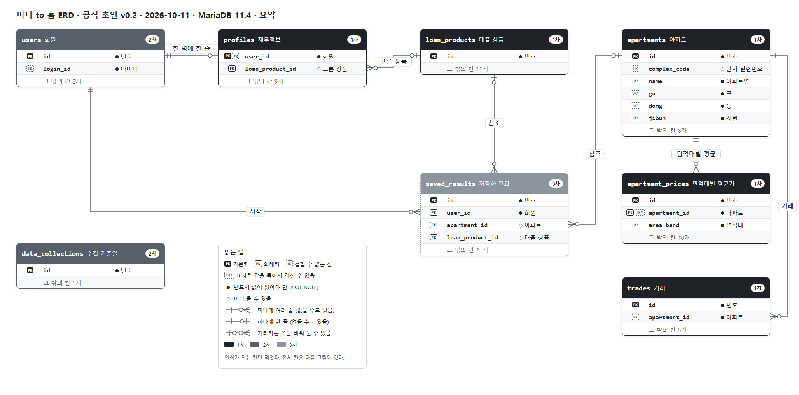
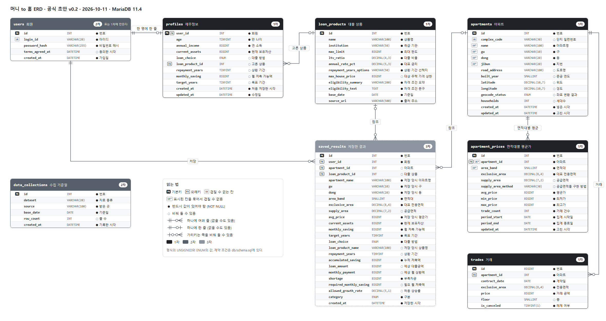
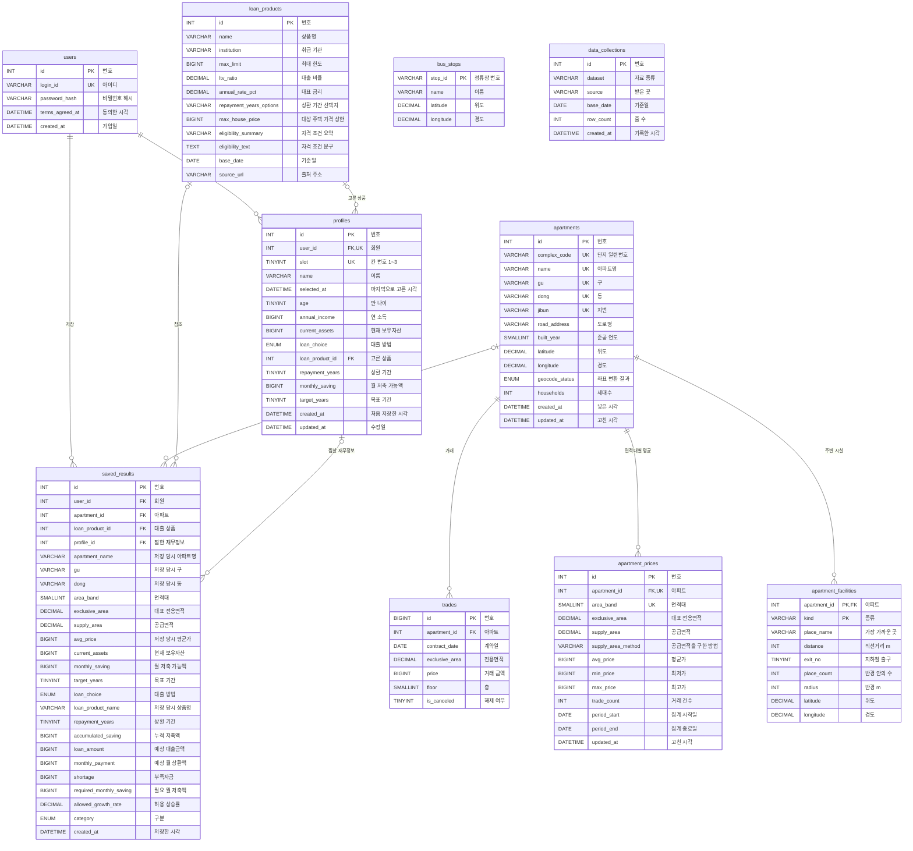

# 머니 to 홈 DB 설계서

| 항목 | 내용 |
| --- | --- |
| 문서 상태 | 공식 초안 (v0.3). 아키텍처에서 정한 두 가지(DB 접근 방법, 로그인 상태를 두는 곳)를 반영하고 생성 스크립트를 `db/schema.sql`로 옮겼다. 표와 관계도는 v0.2에서 바뀌지 않았다. |
| 작성일 | 2026-10-11 |
| 기준 문서 | `docs/02_requirements.md` (v1.10), `docs/03_ui_design.md` (v1.5), `docs/06_architecture.md` (v0.2) |
| DB | MariaDB 11.4. 개발 도구는 HeidiSQL |
| 생성 스크립트 | `db/schema.sql`. MariaDB 11.4에서 실행해 확인했다. |
| 표 | 8개, 칸 93개. 1차 5개, 2차 2개, 3차 1개 |
| 바뀐 것 (2026-10-21) | 재무정보를 회원 한 명에 **3개까지** 둔다 (`profiles`에 `id`, `slot`, `name`, `selected_at`). 찜(`saved_results`)에 어느 재무정보로 찜했는지(`profile_id`)를 남긴다. 3.2, 3.8, 4장, `db/schema.sql`, 옮기는 SQL `db/migrate_20261021_multi_profile.sql`. 1.2의 PNG 그림은 아직 다시 만들지 않았다 (Mermaid 그림은 고쳤다). |

## 목차

1. 한눈에 보기
2. 설계 기준
3. 표 정의
4. 관계와 삭제 규칙
5. 데이터를 넣는 순서
6. 주요 조회와 인덱스
7. 권장안을 명세서와 대조한 결과
8. 설계하면서 발견한 것
9. 정한 것과 남은 것

부록 A. 요구사항과 표의 대응
부록 B. 테이블 생성 스크립트

---

## 1. 한눈에 보기

### 1.1 표 목록

이름은 명세서 3.9의 "주요 데이터와 관계"와 7장의 Task에 적힌 것을 그대로 썼다.

| 표 | 담는 것 | 줄 수 (예상) | 단계 | 근거 |
| --- | --- | --- | --- | --- |
| `users` | 회원. 아이디, 비밀번호 해시, 가입일 | 회원 수 | 2차 (1차에 테스트 사용자 한 줄) | FR-USER-01, 14, T-USER-01, 08 |
| `profiles` | 회원의 재무정보, 대출 선택, 저축 계획. 회원 한 명에 3줄까지 (재무정보 1 ~ 3, 2026-10-21) | 회원 수 × 1 ~ 3 | 1차 | FR-PROFILE-04, T-PROFILE-01, T-PLAN-01 |
| `loan_products` | 대출 상품의 조건 | 2 | 1차 | FR-DATA-06, T-LOAN-03 |
| `apartments` | 아파트. 주소, 준공 연도, 좌표, 세대수 | 약 1,054 | 1차 | FR-DATA-04, 13, T-DATA-08 |
| `trades` | 실거래 한 건씩 | 약 16,919 | 1차 | FR-DATA-02, 09, T-DATA-08 |
| `apartment_prices` | 아파트와 면적대별 평균가, 거래 건수, 공급면적. 화면이 읽는 표 | 약 1,848 | 1차 | FR-DATA-02, 12, FR-APT-01, 16 |
| `apartment_facilities` | 아파트마다 주변 시설 종류별 가장 가까운 곳, 거리, 반경 안의 수 | 아파트 × 10 (약 10,550) | 3차 | FR-MAP-23 |
| `bus_stops` | 광주 5개 구의 시내버스 정류장. 이름과 좌표 (2026-10-20) | 약 4,267 | 3차 | FR-MAP-23 |
| `data_collections` | 자료의 수집 기준일 | 자료 종류 × 수집 횟수 | 2차 | FR-DATA-05, T-DATA-10 |
| `saved_results` | 회원이 저장한 계산 결과 | 저장 횟수 | 3차 | FR-RESULT-07, 08, T-RESULT-06 |

줄 수는 2025-10-07 ~ 2026-10-06의 광주 5개 구 실거래 자료를 실제로 넣어 센 값이다. 아파트와 면적대의 조합은 1,851개인데, 거래가 모두 해제된 3개는 평균가 줄을 만들지 않아 1,848줄이다. 이 문서의 줄 수는 모두 이 CSV를 넣어 센 값이다. 실제 자료는 API로 지난달까지 12개월을 받으므로 줄 수가 이와 다르다.

### 1.2 관계도

**요약.** 표와 관계, 열쇠가 되는 칸만 그렸다.

[](images/04_erd_summary.png)

**전체.** 표의 모든 칸을 그렸다. 그림을 누르면 크게 보인다.

[](images/04_erd.png)

| 표시 | 뜻 |
| --- | --- |
| PK, FK, UK | 기본키, 외래키, 겹칠 수 없는 칸 |
| UK* | 표시된 칸을 묶어서 겹칠 수 없다. `apartments`는 구, 동, 지번, 이름을 묶고, `apartment_prices`는 아파트와 면적대를 묶는다. |
| ●, ○ | 반드시 값이 있어야 하는 칸, 비워 둘 수 있는 칸 |
| 선 끝의 두 줄 | 하나 |
| 선 끝의 동그라미와 한 줄 | 없거나 하나 |
| 선 끝의 동그라미와 세 갈래 | 없거나 여러 줄 |
| 머리의 색 | 진한 순서로 1차, 2차, 3차 |

두 그림은 `db/schema.sql`을 읽어서 만든다. 표를 고치면 스크립트를 고친 뒤 그림을 다시 만든다.

같은 내용을 Mermaid로도 적었다. GitHub에서는 그림으로 보인다.



### 1.3 관계 요약

| 관계 | 종류 | 뜻 |
| --- | --- | --- |
| `users` → `profiles` | 1 : 0 ~ 3 | 회원 한 명에 재무정보 3줄까지 (재무정보 1 ~ 3, 2026-10-21). 입력 전에는 없다. |
| `loan_products` → `profiles` | 0 또는 1 : 여러 | 상품 하나를 여러 회원이 고를 수 있다. 아직 고르지 않았거나 대출 없이 계산이면 연결이 없다. |
| `apartments` → `trades` | 1 : 여러 | 아파트 하나에 거래 여러 건 |
| `apartments` → `apartment_prices` | 1 : 여러 | 아파트 하나에 면적대별로 한 줄씩 |
| `users` → `saved_results` | 1 : 여러 | 회원이 결과를 여러 개 저장한다. |
| `apartments`, `loan_products` → `saved_results` | 0 또는 1 : 여러 | 저장한 결과가 가리키는 아파트와 상품. 원본이 없어져도 저장한 결과는 남는다. |
| `profiles` → `saved_results` | 0 또는 1 : 여러 | 어느 재무정보로 찜했는지. 그 재무정보를 지워도 찜은 남고 연결만 비워진다 ("삭제된 재무정보", 2026-10-21). |
| `data_collections` | 혼자 | 다른 표와 연결하지 않는다. |
| `bus_stops` | 혼자 | 다른 표와 연결하지 않는다. 아파트와의 거리는 화면이 좌표로 잰다 (2026-10-20). |

---

## 2. 설계 기준

명세서에 이미 정해져 있어 그대로 따른 규칙이다.

| 기준 | 내용 | 근거 |
| --- | --- | --- |
| 금액 | 모두 원 단위 정수, BIGINT. 화면에서 만원으로 받은 값에 10,000을 곱해 넣는다. | NFR-12, C-01 |
| 주민등록번호 | 칸을 두지 않는다. 만 나이만 저장한다. | NFR-25, FR-USER-16 |
| 수집하지 않는 것 | 실명, 연락처, 계좌번호, 주소, 위치의 칸을 두지 않는다. | FR-USER-16, NFR-23 |
| 비밀번호 | 되돌릴 수 없는 해시만 저장한다. | FR-USER-14 |
| 로그인하지 않은 사용자 | DB에 저장하지 않는다. 값은 브라우저에만 둔다. | FR-PROFILE-04, FR-USER-20 |
| 면적대 | 전용면적의 소수점 아래를 버린 값(㎡) | FR-DATA-02 |
| 평균가 | 수집할 때 미리 계산해 저장한다. 화면은 이 표만 읽는다. | FR-DATA-02, NFR-08 |
| 계산 결과 | 구분, 부족자금, 예상 대출금액 같은 계산 결과는 저장하지 않는다. 사용자의 값에 따라 달라지므로 서버가 요청마다 계산한다. 예외는 `saved_results`뿐이다. | NFR-13, NFR-18 |
| 빈 값 | 좌표, 세대수, 공급면적을 알 수 없으면 비워 둔다(NULL). | FR-MAP-07, FR-APT-13, 15 |
| 조회 | 사용자 입력값은 SQL에 직접 붙이지 않고 매개변수로 전달한다. | NFR-09 |
| 이름 | 표와 칸은 영문 소문자와 밑줄. 표 이름은 복수형이다. (임의로 정함) | |
| 글자 | 문자 집합은 `utf8mb4`, 정렬 규칙은 `utf8mb4_unicode_ci`. 한글과 기호(㎡)를 그대로 담는다. (임의로 정함) | |
| 설명 | 표와 칸마다 한글 설명(COMMENT)을 달았다. HeidiSQL의 표 화면에서 칸 옆에 보인다. | |

---

## 3. 표 정의

"빈 값" 칸의 ○는 NULL을 허용한다는 뜻이다. "(임의)"는 명세서에 없어 이 문서에서 정한 것이다.

### 3.1 `users` 회원

2차에 쓴다. 다만 `profiles`가 이 표를 가리키므로 1차에 표를 만들고 테스트 사용자 한 줄을 넣어 둔다 (T-USER-08).

| 칸 | 형식 | 빈 값 | 설명 | 근거 |
| --- | --- | --- | --- | --- |
| `id` | INT UNSIGNED, 자동 증가 | | 기본키 | |
| `login_id` | VARCHAR(20) | | 아이디. 겹칠 수 없다. 영문 소문자로 시작하는 5 ~ 20자의 영문 소문자와 숫자 | FR-USER-02, 19 |
| `password_hash` | VARCHAR(255) | | 비밀번호 해시 | FR-USER-14 |
| `terms_agreed_at` | DATETIME | ○ | 수집 항목과 목적에 동의한 시각. 3차 (임의) | FR-USER-05 |
| `created_at` | DATETIME | | 가입일 | T-USER-01 |

- 아이디 규칙과 비밀번호 규칙(8자 이상, 영문과 숫자)은 서버에서 검사한다.
- 로그인 상태는 표로 두지 않는다. 8장의 7번을 본다.

### 3.2 `profiles` 재무정보, 대출 선택, 저축 계획

회원 한 명에 **3줄까지**다 (2026-10-21. 예전에는 한 줄이었다). 화면의 "재무정보 1 ~ 3" 칸 하나가 한 줄이다. (`user_id`, `slot`)을 묶어 겹칠 수 없게 해서 같은 칸이 두 줄 생기지 않는다. 입력 단계로 처음 저장하면 재무정보 1이 생기고, 대출상품 단계와 저축 계획 단계를 마칠 때마다 해당 칸이 채워진다 (FR-PROFILE-04). 로그인한 시작 화면(P-01)에서 일곱 값을 한 번에 넣어 칸을 더하거나 고칠 수 있다.

| 칸 | 형식 | 빈 값 | 설명 | 근거 |
| --- | --- | --- | --- | --- |
| `id` | INT UNSIGNED, 자동 증가 | | 기본키. 지운 번호는 다시 쓰지 않는다. 찜(`saved_results.profile_id`)이 이 번호를 가리킨다. (2026-10-21) | |
| `user_id` | INT UNSIGNED | | `users.id`를 가리키는 외래키 | FR-USER-15 |
| `slot` | TINYINT UNSIGNED | | 칸 번호. 1, 2, 3 중 하나. 더할 때 비어 있는 가장 작은 번호를 쓴다. 회원 안에서 겹칠 수 없다. (2026-10-21) | |
| `name` | VARCHAR(10) | | 칸 이름. 1 ~ 10자. 처음에는 "재무정보 1"처럼 칸 번호로 짓고, 시작 화면에서 바꿀 수 있다. (2026-10-21) | |
| `selected_at` | DATETIME | ○ | 시작 화면에서 이 칸을 골라 지도를 본 마지막 시각. 다음에 로그인하면 이 값이 가장 늦은 칸이 골라져 있다. 아무 칸도 고른 적이 없으면 칸 번호가 가장 작은 것 (2026-10-21) | |
| `age` | TINYINT UNSIGNED | | 만 나이. 15 ~ 100. 계산에 쓰지 않는다. | FR-PROFILE-01, 08 |
| `annual_income` | BIGINT | | 연 소득(원). 0 ~ 100억. 계산에 쓰지 않는다. | FR-PROFILE-01, 21 |
| `current_assets` | BIGINT | | 현재 보유자산(원). 0 ~ 100억 | FR-PROFILE-01, 21 |
| `loan_choice` | ENUM('product', 'none') | ○ | 대출 방법. 비어 있으면 아직 고르지 않은 것, `none`은 대출 없이 계산 | FR-LOAN-03, 15 |
| `loan_product_id` | INT UNSIGNED | ○ | 고른 상품. `loan_products.id`를 가리킨다. | FR-LOAN-03 |
| `repayment_years` | TINYINT UNSIGNED | ○ | 상환 기간(년). 고른 상품의 선택지 중 하나 | FR-LOAN-11 |
| `monthly_saving` | BIGINT | ○ | 월 저축 가능액(원). 0 ~ 10억 | FR-PLAN-01, FR-PROFILE-21 |
| `target_years` | TINYINT UNSIGNED | ○ | 목표 기간(년). 0, 3, 5, 10 중 하나. 0은 "지금" | FR-PLAN-02 |
| `created_at` | DATETIME | | 처음 저장한 시각 | |
| `updated_at` | DATETIME | | 수정일 | T-PROFILE-01 |

대출 선택의 세 칸은 아래 셋 중 하나의 모습만 허용한다 (CHECK 제약).

| 상태 | `loan_choice` | `loan_product_id` | `repayment_years` |
| --- | --- | --- | --- |
| 아직 고르지 않음 | 빈 값 | 빈 값 | 빈 값 |
| 상품을 고름 | `product` | 있음 | 있음 |
| 대출 없이 계산 | `none` | 빈 값 | 빈 값 |

- 상환 기간이 그 상품의 선택지에 있는지는 서버에서 검사한다. 표의 제약으로는 걸 수 없다.
- 시나리오 탭에서 다시 계산하면 **지금 고른 재무정보 줄의** `monthly_saving`과 `target_years`를 고친다 (FR-RESULT-06).
- 칸을 지우면 그 줄을 지운다. 그 칸으로 찜한 결과는 남고 `saved_results.profile_id`만 비워진다 (4장). 같은 칸 번호로 새로 만들어도 `id`가 달라 예전 찜과 이어지지 않는다.
- 다섯째 줄 이상은 서버가 막는다 (3개까지). 표의 제약으로는 걸 수 없다.

저장한 값을 언제 남기고 언제 지우는지는 아래와 같다.

| 사용자가 한 일 | 브라우저의 값 | DB의 값 |
| --- | --- | --- |
| 이전 버튼으로 앞 단계에 돌아감 | 모두 남긴다. | 모두 남긴다. 고친 단계만 그 단계를 마칠 때 다시 저장한다. |
| "이어서 하기" | DB의 값으로 채운다. | 그대로 |
| "처음부터 다시 입력"을 누름 | 모두 지운다. | 아직 그대로 둔다. |
| 그 뒤 재무정보 단계를 마침 | | 재무정보를 새 값으로 바꾸고, **대출 선택과 저축 계획의 칸을 비운다.** |

- "처음부터 다시 입력"을 누른 순간에 DB를 지우지 않는 이유는, 잘못 눌렀거나 입력하다 그만둔 경우에 저장해 둔 값을 잃지 않게 하려는 것이다.
- 재무정보를 저장하는 요청에 "처음부터 다시 시작했음"을 함께 보내, 서버가 대출과 저축의 다섯 칸(`loan_choice`, `loan_product_id`, `repayment_years`, `monthly_saving`, `target_years`)을 비운다. API 명세에서 확정한다.

### 3.3 `loan_products` 대출 상품

두 줄이다. 조사(R-01, R-02)가 끝나면 초기 데이터로 넣는다. "대출 없이 계산"은 상품이 아니므로 줄을 만들지 않는다.

| 칸 | 형식 | 빈 값 | 설명 | 근거 |
| --- | --- | --- | --- | --- |
| `id` | INT UNSIGNED, 자동 증가 | | 기본키. 카드는 이 순서로 보여 준다. | |
| `name` | VARCHAR(100) | | 상품명 | FR-DATA-06 |
| `institution` | VARCHAR(50) | | 취급 기관 | FR-DATA-06 |
| `max_limit` | BIGINT | | 최대 한도(원) | FR-DATA-06, C-05 |
| `ltv_ratio` | DECIMAL(4,3) | | 주택가격 대비 대출 비율. 70%면 0.700. 0보다 크고 1 이하 | FR-DATA-06, C-05, C-06 |
| `annual_rate_pct` | DECIMAL(5,3) | | 대표 금리. 연 4.0%면 4.000. 0 이상 | FR-DATA-06, C-07 |
| `repayment_years_options` | VARCHAR(50) | | 상환 기간 선택지. "10,15,20,30"처럼 쉼표로 이어 적는다. | FR-DATA-06, FR-LOAN-11 |
| `max_house_price` | BIGINT | ○ | 대상 주택 가격 상한(원). 상한이 없으면 비운다. 계산에 쓰지 않고 표시만 한다. | FR-DATA-06, FR-LOAN-14 |
| `eligibility_summary` | VARCHAR(200) | | 자격 조건 요약. 카드에 보인다. (임의) | 8장의 2번 |
| `eligibility_text` | TEXT | | 자격 조건 문구. "자세히" 창에 보인다. | FR-DATA-06, FR-LOAN-02 |
| `base_date` | DATE | | 조건의 기준일 | FR-DATA-06, FR-LOAN-09 |
| `source_url` | VARCHAR(500) | | 출처 주소 | FR-DATA-06, FR-LOAN-09 |

금리는 퍼센트 값으로 저장한다. 계산 모듈에서 100으로 나눠 쓴다. 단위가 섞이지 않게 칸 이름에 `pct`를 붙였다.

### 3.4 `apartments` 아파트

아파트 한 곳에 한 줄이다. 좌표와 세대수처럼 면적과 상관없는 값을 둔다.

| 칸 | 형식 | 빈 값 | 설명 | 근거 |
| --- | --- | --- | --- | --- |
| `id` | INT UNSIGNED, 자동 증가 | | 기본키 | |
| `complex_code` | VARCHAR(30) | ○ | 실거래가 API의 단지 일련번호. 있으면 겹칠 수 없다. R-03에서 확인하기 전까지 비워 둔다. | 명세서 3.9, R-03 |
| `name` | VARCHAR(100) | | 아파트명 | FR-APT-05 |
| `gu` | VARCHAR(10) | | 구 | FR-APT-02 |
| `dong` | VARCHAR(20) | | 동 | FR-APT-02 |
| `jibun` | VARCHAR(20) | | 지번. "506-8", "산1-9" 같은 글자가 있어 숫자형으로 두지 않는다. | 명세서 3.9 |
| `road_address` | VARCHAR(100) | ○ | 도로명 | FR-APT-05 |
| `built_year` | SMALLINT UNSIGNED | ○ | 준공 연도 | FR-APT-10 |
| `latitude` | DECIMAL(10,7) | ○ | 위도. 변환에 실패하면 비운다. | FR-DATA-04, FR-MAP-07 |
| `longitude` | DECIMAL(10,7) | ○ | 경도 | FR-DATA-04, FR-MAP-07 |
| `geocode_status` | ENUM('ok', 'failed') | ○ | 좌표 변환 결과. 비어 있으면 아직 변환하지 않은 것 (임의) | FR-DATA-04 |
| `households` | INT UNSIGNED | ○ | 세대수. 주소로 연결되지 않으면 비운다. 기준 시점은 `data_collections`에 둔다. | FR-DATA-13, FR-APT-15 |
| `created_at`, `updated_at` | DATETIME | | | |

- **같은 아파트로 묶는 기준**: 구, 동, 지번, 아파트명이 모두 같은 것. 네 칸을 묶어 겹칠 수 없게 한다. 단지 일련번호가 확인되면 그것을 먼저 쓴다.
- 이름만으로는 묶지 않는다. 실제 자료에서 같은 구 안에 같은 이름이 여러 번지에 있는 경우가 52개, 한 번지에 이름이 여러 개인 경우가 9개 있다.
- 거래마다 준공 연도나 도로명이 다르게 적힌 아파트가 있다(준공 연도 10곳, 도로명 46곳). 거래에 가장 많이 나온 값을 넣는다. (임의)
- 구와 동의 목록은 이 표에서 뽑는다. 따로 표를 두지 않는다. 7장의 6번을 본다.

### 3.5 `trades` 거래

실거래 한 건에 한 줄이다. 화면은 이 표를 직접 읽지 않고, 평균을 다시 계산할 때와 수집 결과를 대조할 때 쓴다.

| 칸 | 형식 | 빈 값 | 설명 | 근거 |
| --- | --- | --- | --- | --- |
| `id` | BIGINT UNSIGNED, 자동 증가 | | 기본키 | |
| `apartment_id` | INT UNSIGNED | | `apartments.id`를 가리킨다. | 명세서 3.9 |
| `contract_date` | DATE | | 계약일 | FR-DATA-10 |
| `exclusive_area` | DECIMAL(8,4) | | 전용면적(㎡). 자료가 소수 넷째 자리까지 온다. | FR-DATA-10 |
| `price` | BIGINT | | 거래 금액(원) | FR-DATA-10, NFR-12 |
| `floor` | SMALLINT | ○ | 층. 공개시스템의 값과 대조할 때 거래를 찾는 데 쓴다. (임의) | NFR-21 |
| `is_canceled` | TINYINT(1) | | 해제 여부. 해제된 거래는 저장하되 평균에서 뺀다. | FR-DATA-03 |

- **겹침을 막는 열쇠를 두지 않는다.** 실제 자료에 아파트, 면적, 계약일, 금액, 층이 모두 같은 줄이 1,077건 있어서 거래를 하나로 가려낼 값이 없다.
- 그래서 다시 수집할 때는 **그 구와 계약 연월의 거래를 모두 지우고 다시 넣는다** (FR-DATA-09, 부록 C).
- 거래 금액, 전용면적, 계약일 중 하나라도 없는 거래는 넣지 않는다 (FR-DATA-10).

### 3.6 `apartment_prices` 면적대별 평균가

아파트와 면적대의 조합마다 한 줄이다. 지도, 목록, 아파트 창이 읽는 표다.

| 칸 | 형식 | 빈 값 | 설명 | 근거 |
| --- | --- | --- | --- | --- |
| `id` | INT UNSIGNED, 자동 증가 | | 기본키 | |
| `apartment_id` | INT UNSIGNED | | `apartments.id`를 가리킨다. | 명세서 3.9 |
| `area_band` | SMALLINT UNSIGNED | | 면적대. 전용면적의 소수점 아래를 버린 값. 화면의 "전용 84㎡" | FR-DATA-02 |
| `exclusive_area` | DECIMAL(8,4) | | 대표 전용면적. 그 면적대의 거래에 가장 많이 나온 전용면적. 평으로 바꿀 때 쓴다. (임의) | FR-APT-14, 8장의 3번 |
| `supply_area` | DECIMAL(7,2) | ○ | 공급면적(㎡). 자료에 값이 있으면 모두 넣는다. 없으면 비우고, 화면에는 전용면적만 표시한다. | FR-DATA-12, FR-APT-13 |
| `supply_area_method` | VARCHAR(30) | ○ | 공급면적을 구한 방법. 아래 표의 이름 중 하나. 화면에는 쓰지 않는다. | FR-DATA-12 |
| `avg_price` | BIGINT | | 평균가(원). 해제된 거래를 뺀 평균. 원 미만은 반올림한다. (반올림은 임의) | FR-APT-01, FR-DATA-03 |
| `min_price` | BIGINT | | 최저가(원) | FR-APT-16 |
| `max_price` | BIGINT | | 최고가(원) | FR-APT-16 |
| `trade_count` | INT UNSIGNED | | 거래 건수. 해제된 거래를 뺀 수 | FR-APT-05 |
| `period_start`, `period_end` | DATE | | 집계한 거래의 계약일 범위 | 명세서 3.9 |
| `updated_at` | DATETIME | | | |

- `apartment_id`와 `area_band`를 묶어 겹칠 수 없게 한다.
- 거래가 전부 해제된 조합은 줄을 만들지 않는다.
- 같은 조합 안에서 공급면적이 갈리면 거래에 가장 많이 나온 값을 넣는다. 실제 자료에서 169개 조합이 1 ~ 2㎡씩 갈린다.
- 공급면적은 대표 전용면적보다 커야 한다 (CHECK 제약). 실제 자료에 어긋나는 줄은 없다.

공급면적을 구한 방법의 이름과, 실제 자료를 넣었을 때의 줄 수다.

| `supply_area_method` | 뜻 | 줄 수 |
| --- | --- | --- |
| `ledger_sum` | 건축물대장의 주거공용을 더한 값 | 199 |
| `ledger_partial` | 대장에서 주거공용으로 구분되는 것만 더한 값. 실제보다 작을 수 있다. | 187 |
| `ledger_inferred` | 대장의 공용 용도를 해석해 추정한 값 | 669 |
| `borrowed` | 같은 주소에서 전용면적이 비슷한 다른 세대의 공용면적을 빌린 값 | 9 |
| `legacy` | 기존 자료의 값을 그대로 둔 것. 출처를 다시 확인하지 않았다. | 619 |
| 빈 값 | 공급면적을 구하지 못함. 전용면적만 표시한다. | 165 |
| 합계 | | 1,848 (공급면적 있음 1,683, 91%) |

### 3.7a `apartment_facilities` 주변 시설 (3차, 2026-10-19)

아파트와 시설 종류마다 한 줄이다. `data/load_facilities.py`가 카카오 로컬 API(장소 검색)로 미리 받아 넣는다. 서버와 화면은 카카오를 부르지 않고 이 표만 읽는다 (NFR-08). 바뀐 시설은 스크립트를 다시 돌려 반영하고, 받은 날은 `data_collections`(`facilities`)에 남긴다.

| 칸 | 형식 | 빈 값 | 설명 | 근거 |
| --- | --- | --- | --- | --- |
| `apartment_id` | INT UNSIGNED | | `apartments.id`. 아파트를 지우면 같이 지운다. 기본키의 앞 | FR-MAP-23 |
| `kind` | VARCHAR(20) | | `subway`, `school`, `mart`, `convenience`, `hospital`, `elementary`, `middle`, `high`, `university`, `bus`(2026-10-20 더함. 가장 가까운 버스정류장, `bus_stops`에서 계산). 기본키의 뒤 | FR-MAP-23 |
| `place_name` | VARCHAR(100) | ○ | 가장 가까운 곳의 이름. 반경 안에 없으면 비운다 (화면은 "근처에 없음") | |
| `distance` | INT UNSIGNED | ○ | 직선거리. m. 지하철역은 가장 가까운 출구까지 | |
| `exit_no` | TINYINT UNSIGNED | ○ | 지하철역의 가장 가까운 출구 번호. 못 찾으면 비우고 `distance`는 역까지 | |
| `place_count` | INT UNSIGNED | | 반경 안의 수. 병원은 동물병원을 뺀 수 | |
| `radius` | INT UNSIGNED | | 찾은 반경. m. 대학교만 5000, 나머지 1000 | |
| `latitude`, `longitude` | DECIMAL(10,7) | ○ | 그 곳의 좌표. 지하철역은 가장 가까운 출구. 지도에서 고른 아파트와 점선으로 잇는다 (2026-10-19 더함) | FR-MAP-23 |

### 3.7b `bus_stops` 버스정류장 (3차, 2026-10-20)

광주 5개 구의 시내버스 정류장마다 한 줄이다. `data/load_facilities.py`가 `data/bus_stops_gwangju.csv`(국토교통부 「전국 버스정류장 위치정보」에서 광주만 고른 파일)를 넣는다. 카카오 장소 검색은 시내버스 정류장을 돌려주지 않아 이 자료를 쓴다. 지도는 화면 안의 정류장을 A-28로 읽어 역세권과 상관없이 모두 띄운다 (아파트마다 가장 가까운 한 곳만 띄우면 카카오맵보다 훨씬 적게 보였다). 넣을 때마다 전부 지우고 다시 넣고, 받은 날은 `data_collections`(`bus_stops`)에 남긴다.

| 칸 | 형식 | 빈 값 | 설명 | 근거 |
| --- | --- | --- | --- | --- |
| `stop_id` | VARCHAR(20) | | 정류장 번호. 원본의 정류장번호 (예: `KJB3908`). 기본키 | FR-MAP-23 |
| `name` | VARCHAR(100) | | 정류장 이름. 길 건너편 정류장은 이름이 같고 번호가 다르다 | |
| `latitude`, `longitude` | DECIMAL(10,7) | | 좌표. (위도, 경도)에 인덱스를 두어 지도 영역으로 찾는다 | FR-MAP-23 |

### 3.7 `data_collections` 수집 기준일

자료를 넣을 때마다 한 줄을 남긴다. 화면에는 자료 종류별로 가장 최근 줄의 기준일을 보여 준다.

| 칸 | 형식 | 빈 값 | 설명 | 근거 |
| --- | --- | --- | --- | --- |
| `id` | INT UNSIGNED, 자동 증가 | | 기본키 | |
| `dataset` | VARCHAR(20) | | 자료 종류. `trades`, `coordinates`, `supply_area`, `households`, `facilities`, `bus_stops` | FR-DATA-05 |
| `source` | VARCHAR(100) | | 받은 곳. "실거래가 API", "실거래가 공개시스템 CSV"처럼 적는다. | |
| `base_date` | DATE | | 기준일. 거래는 수집한 날, 세대수는 자료의 기준 시점 | FR-DATA-05, FR-APT-15 |
| `row_count` | INT UNSIGNED | ○ | 넣은 줄 수 | |
| `created_at` | DATETIME | | 기록한 시각 | |

대출 상품의 기준일은 상품마다 다를 수 있어 `loan_products.base_date`에 둔다.

### 3.8 `saved_results` 저장한 결과 (3차)

저장한 그대로 다시 보여 주기 위해, 저장할 때의 조건과 결과를 이 표에 복사해 둔다. 열어 볼 때 다시 계산하지 않는다 (와이어프레임 C3).

| 묶음 | 칸 | 형식 | 빈 값 | 설명 |
| --- | --- | --- | --- | --- |
| 열쇠 | `id` | INT UNSIGNED, 자동 증가 | | 기본키 |
| | `user_id` | INT UNSIGNED | | `users.id`를 가리킨다. 본인 것만 조회한다. |
| | `apartment_id` | INT UNSIGNED | ○ | `apartments.id`를 가리킨다. "지도에서 이 아파트 보기"에 쓴다. |
| | `loan_product_id` | INT UNSIGNED | ○ | `loan_products.id`를 가리킨다. |
| | `profile_id` | INT UNSIGNED | ○ | 찜할 때 고른 재무정보. `profiles.id`를 가리킨다. 그 재무정보를 지우면 비워진다. 비어 있으면 화면에 "삭제된 재무정보"로 보인다 (2026-10-21) |
| 아파트 | `apartment_name` | VARCHAR(100) | | 저장 당시의 아파트명 |
| | `gu`, `dong` | VARCHAR | | 저장 당시의 지역 |
| | `area_band` | SMALLINT UNSIGNED | | 면적대 |
| | `exclusive_area` | DECIMAL(8,4) | | 대표 전용면적 |
| | `supply_area` | DECIMAL(7,2) | ○ | 공급면적 |
| | `avg_price` | BIGINT | | 저장 당시의 평균가. 목표 부동산 가격 |
| 조건 | `current_assets` | BIGINT | | 현재 보유자산 |
| | `monthly_saving` | BIGINT | | 월 저축 가능액 |
| | `target_years` | TINYINT UNSIGNED | | 목표 기간 |
| | `loan_choice` | ENUM('product', 'none') | | 대출 방법 |
| | `loan_product_name` | VARCHAR(100) | ○ | 저장 당시의 상품명 |
| | `repayment_years` | TINYINT UNSIGNED | ○ | 상환 기간 |
| 결과 | `accumulated_saving` | BIGINT | | 누적 저축액 (C-02) |
| | `loan_amount` | BIGINT | ○ | 예상 대출금액 (C-05). 대출 없이 계산이면 비운다. |
| | `monthly_payment` | BIGINT | ○ | 예상 월 상환액 (C-07) |
| | `shortage` | BIGINT | | 부족자금 (C-10). 음수면 그 절댓값이 여유자금 |
| | `required_monthly_saving` | BIGINT | ○ | 필요 월 저축액 (C-11). 표시하지 않는 경우에는 비운다. |
| | `allowed_growth_rate` | DECIMAL(5,1) | ○ | 허용 상승률(연 %) (C-12). 표시하지 않는 경우에는 비운다. |
| | `category` | ENUM('now', 'within', 'lack') | | 구분 (C-09) |
| 시각 | `created_at` | DATETIME | | 저장한 시각 |

근거는 FR-RESULT-05, 07, 08과 FR-USER-12, 15다. 3차에 만들 때 화면에 실제로 보이는 줄과 한 번 더 맞춰 본다.

---

## 4. 관계와 삭제 규칙

| 외래키 | 가리키는 곳 | 가리키는 줄이 지워지면 | 이유 |
| --- | --- | --- | --- |
| `profiles.user_id` | `users.id` | 함께 지운다 (CASCADE) | 탈퇴하면 재무정보도 지운다 (FR-USER-12). |
| `saved_results.user_id` | `users.id` | 함께 지운다 (CASCADE) | 탈퇴하면 저장한 결과도 지운다 (FR-USER-12). |
| `profiles.loan_product_id` | `loan_products.id` | 지우지 못하게 막는다 (RESTRICT) | 고른 사람이 있는 상품이 사라지면 안 된다. |
| `trades.apartment_id` | `apartments.id` | 함께 지운다 (CASCADE) | 아파트 없이 거래만 남을 수 없다. |
| `apartment_prices.apartment_id` | `apartments.id` | 함께 지운다 (CASCADE) | 위와 같다. |
| `saved_results.apartment_id` | `apartments.id` | 빈 값으로 바꾼다 (SET NULL) | 저장한 결과는 남긴다. 아파트명은 복사해 두었다. |
| `saved_results.loan_product_id` | `loan_products.id` | 빈 값으로 바꾼다 (SET NULL) | 위와 같다. |
| `saved_results.profile_id` | `profiles.id` | 빈 값으로 바꾼다 (SET NULL) | 재무정보를 지워도 찜은 남긴다. 화면은 "삭제된 재무정보"로 묶는다 (2026-10-21). |

- 다시 수집할 때 `apartments`의 줄은 지우지 않는다. 지웠다가 다시 넣으면 번호가 바뀌어 `saved_results`의 연결이 끊어진다. 있으면 고치고 없으면 넣는다.
- 탈퇴는 `users`의 줄 하나를 지우면 끝난다. 나머지는 제약이 지운다.

---

## 5. 데이터를 넣는 순서

수집과 적재는 팀이 직접 실행하는 스크립트다. 서버가 요청을 처리하는 중에는 외부 API를 부르지 않는다 (NFR-08).

| 순서 | 하는 일 | 표 | 다시 실행하면 |
| --- | --- | --- | --- |
| 1 | 표를 만든다. | 전체 | 이미 있으면 건너뛴다. |
| 2 | 대출 상품 두 개를 넣는다. | `loan_products` | 있으면 고친다. |
| 3 | 1차용 테스트 사용자 한 줄을 넣는다. | `users` | 있으면 건너뛴다. |
| 4 | 실거래에서 아파트를 뽑아 넣는다. | `apartments` | 있으면 고치고 없으면 넣는다. |
| 5 | 거래를 넣는다. | `trades` | 그 구와 계약 연월의 거래를 지우고 다시 넣는다. |
| 6 | 면적대별 평균가, 최저가, 최고가, 거래 건수를 계산한다. | `apartment_prices` | 전부 다시 계산해 고친다. 거래가 없어진 조합은 지운다. |
| 7 | 주소를 좌표로 바꾼다. | `apartments` | 좌표가 빈 줄만 다시 시도한다. |
| 8 | 공급면적과 구한 방법을 붙인다. 값이 있으면 모두 넣는다. | `apartment_prices` | 전부 다시 붙인다. |
| 9 | 세대수를 붙인다. | `apartments` | 전부 다시 붙인다. |
| 10 | 기준일을 남긴다. | `data_collections` | 줄을 하나 더한다. |
| 11 | 주변 시설을 넣는다 (`data/load_facilities.py`). 좌표가 있어야 한다. | `apartment_facilities` | 전부 지우고 다시 넣는다. 기준일은 10과 같이 남긴다. |
| 12 | 버스정류장을 넣는다 (`data/load_facilities.py`의 `--from-file`, `--add-bus`가 11과 같이 한다). | `bus_stops` | 전부 지우고 다시 넣는다. 기준일은 10과 같이 남긴다. |

### 5.1 실거래 CSV의 열이 들어가는 곳

지금 갖고 있는 자료(실거래가 공개시스템에서 내려받은 CSV, 팀원이 공급면적을 붙인 것)를 기준으로 적었다. API로 받을 때의 항목 이름은 R-03에서 확인한 뒤 같은 표에 맞춘다.

| CSV의 열 | 들어가는 칸 | 바꾸는 방법 |
| --- | --- | --- |
| 시군구 | `apartments.gu`, `apartments.dong` | "전남광주통합특별시 서구 치평동"을 띄어쓰기로 나눠 둘째와 셋째를 쓴다. 둘째가 동구, 서구, 남구, 북구, 광산구인 줄만 넣는다. CSV에는 전남의 시와 군이 섞여 있다. |
| 번지 | `apartments.jibun` | 그대로 |
| 단지명 | `apartments.name` | 그대로 |
| 건축년도 | `apartments.built_year` | 아파트의 거래에 가장 많이 나온 값 |
| 도로명 | `apartments.road_address` | 아파트의 거래에 가장 많이 나온 값. "-"는 빈 값 |
| 전용면적(㎡) | `trades.exclusive_area` | 그대로. 소수점 아래를 버려 면적대를 만든다. |
| 계약년월, 계약일 | `trades.contract_date` | 이어 붙여 날짜로 바꾼다. |
| 거래금액(만원) | `trades.price` | 쉼표를 빼고 10,000을 곱한다. |
| 층 | `trades.floor` | 그대로 |
| 해제사유발생일 | `trades.is_canceled` | 값이 있으면 1, "-"면 0 |
| 공급면적(㎡) | `apartment_prices.supply_area` | 조합에서 가장 많이 나온 값. 값이 있으면 모두 넣는다. |
| 대조상태, 비고 | `apartment_prices.supply_area_method` | 방법을 3.6의 이름으로 바꿔 넣는다. |
| 동, 매수자, 매도자, 거래유형, 중개사소재지, 등기일자 | 넣지 않는다. | 쓰는 화면이 없다. |

### 5.2 HeidiSQL에서 표를 만드는 방법

1. HeidiSQL로 MariaDB 11.4에 접속한다.
2. [파일] > [SQL 파일 불러오기]로 `db/schema.sql`을 연다.
3. F9를 눌러 실행한다. `money_to_home` DB와 표 8개가 생기고 테스트 사용자 한 줄이 들어간다.
4. 왼쪽 목록에서 표를 누르면 칸의 형식과 한글 설명을 볼 수 있다.

- 스크립트는 여러 번 실행해도 된다. 이미 있는 표와 테스트 사용자는 건너뛴다.
- 표의 모양을 고쳤을 때는 그 표를 지운 뒤 다시 실행한다. 표를 지우면 안의 자료도 지워진다.
- 네 명이 각자 자기 PC의 DB로 개발한다. 표를 손으로 만들지 않고 이 스크립트로만 만든다 (FR-DATA-11).
- 접속 정보는 `.env`의 `DB_HOST`, `DB_PORT`, `DB_NAME`, `DB_USER`, `DB_PASSWORD`에 넣는다.

---

## 6. 주요 조회와 인덱스

화면이 실제로 하는 조회로 설계를 확인했다.

| 번호 | 조회 | 읽는 표 | 쓰는 인덱스 | 근거 |
| --- | --- | --- | --- | --- |
| 1 | 거래가 있는 구와 동의 목록 | `apartments`, `apartment_prices` | `apartments`의 (구, 동, 지번, 이름) | FR-APT-02, T-APT-01 |
| 2 | 지도에 보이는 영역의 아파트와 면적대별 평균가 | `apartments`, `apartment_prices` | `apartments`의 (위도, 경도) | FR-MAP-01, 22 |
| 3 | 구와 동으로 고른 지역의 아파트. 좌표가 없는 아파트 포함 | 위와 같다. | `apartments`의 (구, 동, …) | FR-APT-02, FR-MAP-07 |
| 4 | 면적대, 평균가, 준공 연도 조건 | 위와 같다. | `apartment_prices`의 평균가, 면적대 | FR-APT-03, 09, 10 |
| 5 | 아파트 이름 검색 | `apartments` | 없음. 1,054줄이라 전부 훑어도 빠르다. | FR-MAP-08 |
| 6 | 아파트 한 곳의 정보와 모든 면적대 | `apartments`, `apartment_prices` | `apartment_prices`의 (아파트, 면적대) | FR-APT-12, 13, 15, 16 |
| 7 | 상품 목록 | `loan_products` | | FR-LOAN-01, 02 |
| 8 | 내 재무정보(3개까지) 조회와 저장 | `profiles` | (회원, 칸 번호) | FR-PROFILE-04, 05 |
| 9 | 수집 기준일 | `data_collections` | | FR-DATA-05 |
| 10 | 내가 저장한 결과 목록 | `saved_results` | (회원, 저장한 시각) | FR-RESULT-08 |
| 11 | 지도에 보이는 영역의 버스정류장 (A-28) | `bus_stops` | (위도, 경도) | FR-MAP-23 |

- **구분과 개수는 DB에서 세지 않는다.** 지금 가능, 기간 내 가능, 자금 부족은 사용자의 보유자산과 대출 선택에 따라 달라진다. 서버가 2번의 결과를 받아 공통 계산 모듈로 구분하고(C-05, C-09), 동별·구별 개수와 표시 위치(그 동 아파트 좌표의 평균)도 그 자리에서 센다 (FR-MAP-20, 21, 31).
- 조합이 광주 5개 구 전체로 1,848개뿐이라 전부 읽어 계산해도 3초 기준(NFR-01)에 충분하다고 본다. 실제 속도는 만든 뒤 재서 확인한다.

2번 조회의 모습은 아래와 같다.

```sql
SELECT a.id, a.name, a.gu, a.dong, a.latitude, a.longitude, a.built_year, a.households,
       p.area_band, p.exclusive_area, p.supply_area, p.avg_price, p.min_price, p.max_price, p.trade_count
FROM apartments a
JOIN apartment_prices p ON p.apartment_id = a.id
WHERE a.latitude BETWEEN %(south)s AND %(north)s
  AND a.longitude BETWEEN %(west)s AND %(east)s
  AND p.area_band BETWEEN %(area_min)s AND %(area_max)s
  AND p.avg_price BETWEEN %(price_min)s AND %(price_max)s;
```

---

## 7. 권장안을 명세서와 대조한 결과

ERD를 그리기 전에 물었던 12가지를 명세서와 하나씩 대조했다. 10개는 그대로 반영했다. 6번은 명세서와 달라 명세서를 따랐고, 9번은 팀장이 정한 대로 명세서를 고쳤다.

| 번호 | 권장안 | 명세서 | 결과 |
| --- | --- | --- | --- |
| 1 | 3차까지 그리고 단계를 표시 | 표 이름이 3차(`saved_results`)까지 적혀 있다. | 반영 |
| 2 | 재무정보, 대출 선택, 저축 계획을 한 표에 | 3.9의 `profiles`가 세 가지를 모두 담는다고 적혀 있다. | 반영 |
| 3 | 로그인하지 않은 사용자는 DB에 두지 않음 | FR-PROFILE-04 | 반영 |
| 4 | 거래 표와 평균 표를 모두 둠 | FR-DATA-02 | 반영 |
| 5 | 아파트 표와 아파트·면적 표로 나눔 | 3.9의 `apartments`, `apartment_prices` | 반영 |
| 6 | 구와 동을 따로 표로 둠 | 3.9는 구와 동을 `apartments`의 칸으로 적었다. 부록 C는 동 표시의 위치를 "그 동 아파트 좌표의 평균"으로 정했다. | **명세서를 따름.** 표를 두지 않는다. 목록, 개수, 표시 위치를 모두 `apartments`에서 구할 수 있고, 표가 하나 줄어든다. |
| 7 | 평균가를 미리 계산해 저장 | FR-DATA-02 ("조회용으로 저장") | 반영 |
| 8 | 공급면적이 갈리면 가장 많은 값 하나 | 정한 것이 없다. | 반영 (임의) |
| 9 | 공급면적의 값과 방법을 모두 저장하고 화면에서 고름 | v1.7의 FR-DATA-12는 "전용률이 85%를 넘으면 저장하지 않는다"였다. | **팀장 결정 (2026-10-11): 공급면적이 있는 아파트는 모두 표시하고, 없으면 전용면적만 표시한다.** 명세서를 v1.8로 고쳤다. 값을 모두 넣고 구한 방법을 칸에 남긴다. |
| 10 | 상환 기간 선택지를 글자로 저장 | FR-DATA-06 ("상환 기간 선택지") | 반영 |
| 11 | 탈퇴하면 함께 삭제 | FR-USER-12 | 반영 |
| 12 | 저장한 결과는 조건과 결과를 복사 | 3.9 ("계산 조건과 결과"), 와이어프레임 C3 | 반영 |

---

## 8. 설계하면서 발견한 것

### 8.1 명세서와 다른 문서를 고친 것

설계하다 발견한 다섯 가지다. 모두 반영했다.

| 번호 | 발견한 것 | 처리 |
| --- | --- | --- |
| 1 | `users` 표를 만드는 Task(T-USER-01)가 2차였다. 그런데 1차의 `profiles`가 `users`를 가리키고, 1차에 테스트 사용자를 준비하는 Task(T-USER-08)도 있다. | 표는 1차에 만든다. 명세서 v1.8에서 T-USER-08과 T-USER-01의 문장을 고쳤다. |
| 2 | 대출상품 카드에는 자격 조건 요약이, "자세히" 창에는 문구 전체가 나온다 (와이어프레임 P-03 ①, ⑥). FR-DATA-06에는 "자격 조건 문구" 하나뿐이었다. | `eligibility_summary` 칸을 더했다. 명세서 v1.8에서 FR-DATA-06을 "자격 조건의 요약과 문구"로 고쳤다. R-01, R-02를 조사할 때 두 가지를 다 적는다. |
| 3 | 화면 설계서 8.1은 "111㎡ (전용 84㎡)"를 평으로 바꾸면 "34평 (전용 26평)"이라고 적었다. 84를 3.3058로 나누면 25평이고, 실제 전용면적 84.94를 나눠야 26평이 된다. | 면적대(84)와 따로 대표 전용면적(84.94) 칸을 두었다. 평은 대표 전용면적으로 계산한다고 화면 설계서 v1.3의 8.1과 명세서 부록 C에 적었다. |
| 4 | 평균가의 원 미만을 어떻게 처리할지 정한 곳이 없었다. | 반올림으로 정하고 명세서 부록 C에 적었다. |
| 5 | 팀원이 만든 공급면적은 구한 방법이 여러 가지인데, FR-DATA-12는 대장으로 계산하는 방법과 85% 기준만 적었다. | 팀장 결정에 따라 FR-DATA-12를 고쳤다. 값이 있으면 모두 넣고 구한 방법을 함께 저장한다. 화면 설계서 v1.3의 8.2와 8.3도 고쳤다. |

### 8.2 알고 있어야 하는 것

| 번호 | 내용 |
| --- | --- |
| 6 | **만 나이는 저장한 뒤 바뀌지 않는다.** 생년월일을 저장하지 않으므로 해가 지나도 그대로다. 나이는 표시용이라 계산에는 영향이 없다. |
| 7 | **로그인 상태를 담는 표를 두지 않았다.** 서명한 쿠키에 회원 번호를 담기로 정했다 (아키텍처 문서 T-3). 서버가 로그인 상태를 저장하지 않으므로 `sessions` 표가 필요 없다. |
| 8 | **거래에는 겹침을 막을 열쇠가 없다.** 모든 값이 같은 줄이 1,077건 있다. 다시 수집할 때 구와 계약 연월 단위로 지우고 넣는 규칙을 반드시 지켜야 한다. |
| 9 | **단지 일련번호는 아직 확인하지 못했다.** API에 있으면 `complex_code`에 넣고 아파트를 묶는 기준으로 쓴다. 없으면 구, 동, 지번, 이름으로 묶는다 (R-03). |
| 10 | **표가 필요 없는 3차 기능**: 주변 시설(화면에서 카카오맵을 직접 호출), 비슷한 아파트(조회로 구함), 공유하기, 용어 설명(화면의 고정 문구), 아이디 기억(쿠키), 광주 5개 구 경계 좌표(화면의 파일) |
| 11 | **표가 더 생길 수 있는 3차 기능**: 구별 변동 그래프와 변동률(FR-PLAN-06, 10)은 자료가 정해지면 구와 월별 지수를 담는 표가 하나 필요하다 (N-06). 저축 수익률 가정(FR-PLAN-07)을 넣으면 `profiles`에 칸이 하나 늘어난다. |
| 12 | **CHECK 제약은 마지막 방어선이다.** 나이 범위와 금액 상한을 표에도 걸었지만, 사용자에게 보여 줄 오류 문구는 서버 검증에서 만든다 (FR-PROFILE-09). |
| 13 | **공급면적에는 어색한 값이 섞여 있다.** 값이 정수로 올림되어 있고, 전용면적과 거의 같은 값이 15건쯤 있다(예: 전용 59.88㎡에 공급 60㎡). 모두 표시하기로 했으므로 화면에 그대로 나온다. 눈에 띄면 원본 CSV에서 고치고 다시 넣는다. |
| 14 | **구한 방법이 `legacy`인 619줄은 출처를 모른다.** 9.2의 D-2로 팀원에게 확인한다. |

### 8.3 실제로 실행해 확인한 것

임시 DB(MariaDB 11.4)를 따로 띄워 `db/schema.sql`을 실행하고, 실거래 CSV 다섯 개를 넣어 시험했다. 시험이 끝난 뒤 임시 DB는 지웠다. 기존에 쓰던 DB는 건드리지 않았다.

| 확인한 것 | 결과 |
| --- | --- |
| 스크립트 실행 | 표 8개와 칸 93개가 오류 없이 만들어졌다. 모든 칸에 설명이 달렸다. |
| 스크립트를 한 번 더 실행 | 오류 없이 건너뛴다. 테스트 사용자도 한 줄 그대로다. |
| 실제 자료 넣기 | 아파트 1,054줄, 거래 16,919줄, 평균가 1,848줄이 모두 들어갔다. 칸의 길이나 형식에 걸린 줄이 없다. |
| 공급면적 | 평균가 1,848줄 중 1,683줄(91%)에 값이 들어갔다. 구한 방법이 빠진 줄은 없다. |
| 가장 큰 금액 | 20억 4,700만 원(2,047,000,000)이 들어간다. |
| 아파트 겹침 | 구, 동, 지번, 이름이 같은 줄을 다시 넣으면 막힌다. |
| 회원 한 명에 재무정보 한 줄 | 두 번째 줄을 넣으면 막힌다. |
| 대출 선택의 세 가지 모습 | 상품만 있고 상환 기간이 없는 경우, 대출 없이 계산인데 상품이 있는 경우가 막힌다. 올바른 세 가지는 들어간다. |
| 처음부터 다시 입력 | 재무정보를 새 값으로 바꾸면서 대출 선택과 저축 계획의 다섯 칸을 한 번에 비울 수 있다. |
| 범위 제약 | 만 14세, 목표 기간 7년, 보유자산 100억 원 초과, 전용면적보다 작은 공급면적이 막힌다. |
| 아이디 겹침 | 같은 아이디로 가입하면 막힌다. |
| 쓰는 사람이 있는 대출 상품 삭제 | 막힌다. |
| 아파트 삭제 | 그 아파트의 거래와 평균가가 함께 지워지고, 저장한 결과는 남으며 아파트 연결만 비워진다. |
| 회원 삭제 | 재무정보와 저장한 결과가 함께 지워진다. |
| 구와 동의 목록 | 5개 구, 82개 동이 나온다. |
| 동과 조건으로 검색, 이름 검색 | 결과가 나온다. |
| 구와 계약 연월 단위로 거래 지우기 | 동구의 2026년 9월 거래 78건만 지워진다. |

속도는 재지 않았다. 좌표가 아직 없어서 지도 영역으로 찾는 조회(6장의 2번)는 시험하지 못했다.

---

## 9. 정한 것과 남은 것

### 9.1 정한 것 (2026-10-11)

| 번호 | 질문 | 결정 |
| --- | --- | --- |
| D-1 | 공급면적을 어디까지 쓰는가 | 공급면적이 있는 아파트는 모두 표시한다. 없는 아파트는 전용면적만 표시한다. 전용률 85% 기준은 쓰지 않는다. |
| D-3 | "처음부터 다시 입력"을 고르면 예전에 저장한 대출 선택과 저축 계획을 지우는가 | 지운다. 이전 버튼으로 돌아갈 때는 모두 남긴다. 지우는 때는 3.2의 규칙을 따른다. |
| D-8 | DB 제품과 개발 도구 | MariaDB 11.4. 개발 도구는 HeidiSQL. 접속은 MySQL용 클라이언트로 한다. |
| D-5 | 로그인 상태를 어디에 두는가 | 서명한 쿠키. 표를 두지 않는다. (아키텍처 문서 T-3) |
| D-6 | DB에 접근하는 방법 | PyMySQL로 SQL을 직접 쓴다. 값은 매개변수로 넘긴다. (아키텍처 문서 T-2) |

### 9.2 남은 것

| 번호 | 질문 | 선택지 | 지금 초안 |
| --- | --- | --- | --- |
| D-2 | 공급면적 자료의 "기존값"(619줄)은 어디서 온 값인가 | 팀원에게 확인 | 확인 전. 표시는 하고 있다. |
| D-4 | 준공 연도와 도로명이 거래마다 다를 때 | ① 가장 많이 나온 값 ② 가장 최근 거래의 값 | ① |
| D-7 | `saved_results`를 칸으로 풀어 쓸지, 조건과 결과를 JSON 한 칸에 담을지 | ① 칸으로 ② JSON | ①. 3차에 만들 때 다시 본다. |
| D-9 | "처음부터 다시 입력"을 누른 순간에 DB를 지울지, 새 재무정보를 저장할 때 지울지 | ① 저장할 때 ② 누른 순간 (확인 창 필요) | ①. 잘못 눌렀을 때 저장한 값을 잃지 않는다. |

---

## 부록 A. 요구사항과 표의 대응

DB에 값이 있어야 지킬 수 있는 요구사항만 적었다.

| 요구사항 | 표와 칸 |
| --- | --- |
| FR-USER-01, 02, 19 | `users.login_id` (겹침 금지) |
| FR-USER-14 | `users.password_hash` |
| FR-USER-05 | `users.terms_agreed_at` |
| FR-USER-12 | `profiles`, `saved_results`의 외래키 (CASCADE) |
| FR-USER-15 | `profiles.user_id`, `saved_results.user_id`로 본인 것만 조회 |
| FR-USER-16, NFR-25 | 주민등록번호, 실명, 연락처, 주소의 칸이 없다. |
| FR-PROFILE-01, 04, 05, 10 | `profiles.age`, `annual_income`, `current_assets` |
| FR-PROFILE-08, 21 | `profiles`의 CHECK 제약 |
| FR-LOAN-03, 11, 13, 15 | `profiles.loan_choice`, `loan_product_id`, `repayment_years` |
| FR-PLAN-01, 02 | `profiles.monthly_saving`, `target_years` |
| FR-RESULT-06 | `profiles.monthly_saving`, `target_years`를 고친다. |
| FR-LOAN-01, 02, 09, 14, FR-DATA-06 | `loan_products`의 모든 칸 |
| FR-APT-01, 05, 16 | `apartment_prices.avg_price`, `min_price`, `max_price`, `trade_count` |
| FR-APT-02 | `apartments.gu`, `dong` |
| FR-APT-03, 09, 10 | `apartment_prices.area_band`, `avg_price`, `apartments.built_year` |
| FR-APT-13, 14, FR-MAP-19 | `apartment_prices.supply_area`, `exclusive_area`, `area_band` |
| FR-APT-15, FR-DATA-13 | `apartments.households`, `data_collections` (`households`의 기준일) |
| FR-MAP-01, 07, 22, FR-DATA-04 | `apartments.latitude`, `longitude`, `geocode_status` |
| FR-MAP-08 | `apartments.name` |
| FR-MAP-20, 21, 31 | `apartments.gu`, `dong`, 좌표. 개수는 서버가 센다. |
| FR-MAP-23 | `apartment_facilities`, `bus_stops` |
| FR-DATA-02, 03, 09, 10 | `trades`의 모든 칸 |
| FR-DATA-05 | `data_collections.base_date` |
| FR-DATA-12 | `apartment_prices.supply_area`, `supply_area_method` |
| FR-RESULT-07, 08 | `saved_results` |
| NFR-12 | 금액 칸은 모두 BIGINT |

---

## 부록 B. 테이블 생성 스크립트

`db/schema.sql`과 같은 내용이다. 고칠 때는 그 파일을 고치고 이 부록과 1.2의 그림을 다시 만든다. MariaDB 11.4에서 실행해 확인했다 (8.3).

```sql
-- 머니 to 홈 테이블 생성 스크립트 (공식 초안 v0.2, 2026-10-11)
-- 대상: MariaDB 11.4
-- 설계 문서: docs/04_database_design.md
--
-- 실행 방법 (HeidiSQL): [파일] > [SQL 파일 불러오기]로 이 파일을 열고 F9를 누른다.
-- 여러 번 실행해도 된다. 이미 있는 표는 건너뛴다.
-- 표의 모양을 고쳤을 때는 그 표를 지운 뒤 다시 실행한다.

CREATE DATABASE IF NOT EXISTS money_to_home CHARACTER SET utf8mb4 COLLATE utf8mb4_unicode_ci;
USE money_to_home;

-- ------------------------------------------------------------------
-- 회원 (2차. 표는 1차에 만들고 테스트 사용자 한 줄을 넣는다)
-- ------------------------------------------------------------------
CREATE TABLE IF NOT EXISTS users (
  id               INT UNSIGNED NOT NULL AUTO_INCREMENT COMMENT '번호',
  login_id         VARCHAR(20)  NOT NULL COMMENT '아이디. 영문 소문자로 시작하는 5~20자의 영문 소문자와 숫자',
  password_hash    VARCHAR(255) NOT NULL COMMENT '비밀번호 해시. 원래 값으로 되돌릴 수 없다',
  terms_agreed_at  DATETIME     NULL     COMMENT '동의한 시각. 3차',
  created_at       DATETIME     NOT NULL DEFAULT CURRENT_TIMESTAMP COMMENT '가입일',
  PRIMARY KEY (id),
  UNIQUE KEY uq_users_login_id (login_id)
) ENGINE=InnoDB DEFAULT CHARSET=utf8mb4 COLLATE=utf8mb4_unicode_ci COMMENT='회원';

-- ------------------------------------------------------------------
-- 대출 상품 (1차). 두 줄. 대출 없이 계산은 상품이 아니므로 줄이 없다
-- ------------------------------------------------------------------
CREATE TABLE IF NOT EXISTS loan_products (
  id                       INT UNSIGNED NOT NULL AUTO_INCREMENT COMMENT '번호. 카드를 이 순서로 보여 준다',
  name                     VARCHAR(100) NOT NULL COMMENT '상품명',
  institution              VARCHAR(50)  NOT NULL COMMENT '취급 기관',
  max_limit                BIGINT       NOT NULL COMMENT '최대 한도. 원',
  ltv_ratio                DECIMAL(4,3) NOT NULL COMMENT '대출 비율. 70%면 0.700',
  annual_rate_pct          DECIMAL(5,3) NOT NULL COMMENT '대표 금리. 연 4.0%면 4.000',
  repayment_years_options  VARCHAR(50)  NOT NULL COMMENT '상환 기간 선택지. 10,15,20,30처럼 쉼표로 잇는다',
  max_house_price          BIGINT       NULL     COMMENT '대상 주택 가격 상한. 원. 없으면 비운다',
  eligibility_summary      VARCHAR(200) NOT NULL COMMENT '자격 조건 요약. 카드에 보인다',
  eligibility_text         TEXT         NOT NULL COMMENT '자격 조건 문구. 자세히 창에 보인다',
  base_date                DATE         NOT NULL COMMENT '기준일',
  source_url               VARCHAR(500) NOT NULL COMMENT '출처 주소',
  PRIMARY KEY (id),
  CONSTRAINT ck_loan_limit CHECK (max_limit > 0),
  CONSTRAINT ck_loan_ltv   CHECK (ltv_ratio > 0 AND ltv_ratio <= 1),
  CONSTRAINT ck_loan_rate  CHECK (annual_rate_pct >= 0)
) ENGINE=InnoDB DEFAULT CHARSET=utf8mb4 COLLATE=utf8mb4_unicode_ci COMMENT='대출 상품';

-- ------------------------------------------------------------------
-- 재무정보, 대출 선택, 저축 계획 (1차). 회원 한 명에 한 줄
-- ------------------------------------------------------------------
CREATE TABLE IF NOT EXISTS profiles (
  id               INT UNSIGNED     NOT NULL AUTO_INCREMENT COMMENT '번호. 찜이 이 번호를 가리킨다 (2026-10-21)',
  user_id          INT UNSIGNED     NOT NULL COMMENT '회원',
  slot             TINYINT UNSIGNED NOT NULL COMMENT '칸 번호. 1, 2, 3 중 하나 (재무정보 1 ~ 3)',
  name             VARCHAR(10)      NOT NULL COMMENT '칸 이름. 1~10자',
  age              TINYINT UNSIGNED NOT NULL COMMENT '만 나이. 15~100. 계산에 쓰지 않는다',
  annual_income    BIGINT           NOT NULL COMMENT '연 소득. 원. 계산에 쓰지 않는다',
  current_assets   BIGINT           NOT NULL COMMENT '현재 보유자산. 원',
  loan_choice      ENUM('product', 'none') NULL COMMENT '대출 방법. 비어 있으면 아직 고르지 않음, none은 대출 없이 계산',
  loan_product_id  INT UNSIGNED     NULL     COMMENT '고른 상품',
  repayment_years  TINYINT UNSIGNED NULL     COMMENT '상환 기간. 년',
  monthly_saving   BIGINT           NULL     COMMENT '월 저축 가능액. 원',
  target_years     TINYINT UNSIGNED NULL     COMMENT '목표 기간. 0, 3, 5, 10 중 하나. 0은 지금',
  created_at       DATETIME NOT NULL DEFAULT CURRENT_TIMESTAMP COMMENT '처음 저장한 시각',
  updated_at       DATETIME NOT NULL DEFAULT CURRENT_TIMESTAMP ON UPDATE CURRENT_TIMESTAMP COMMENT '수정일',
  selected_at      DATETIME NULL     COMMENT '시작 화면에서 이 칸을 골라 지도를 본 마지막 시각',
  PRIMARY KEY (id),
  UNIQUE KEY uq_profiles_user_slot (user_id, slot),
  KEY ix_profiles_loan_product (loan_product_id),
  CONSTRAINT fk_profiles_user FOREIGN KEY (user_id) REFERENCES users (id) ON DELETE CASCADE,
  CONSTRAINT fk_profiles_loan_product FOREIGN KEY (loan_product_id) REFERENCES loan_products (id),
  CONSTRAINT ck_profiles_slot   CHECK (slot BETWEEN 1 AND 3),
  CONSTRAINT ck_profiles_name   CHECK (CHAR_LENGTH(name) BETWEEN 1 AND 10),
  CONSTRAINT ck_profiles_age    CHECK (age BETWEEN 15 AND 100),
  CONSTRAINT ck_profiles_income CHECK (annual_income BETWEEN 0 AND 10000000000),
  CONSTRAINT ck_profiles_assets CHECK (current_assets BETWEEN 0 AND 10000000000),
  CONSTRAINT ck_profiles_saving CHECK (monthly_saving IS NULL OR monthly_saving BETWEEN 0 AND 1000000000),
  CONSTRAINT ck_profiles_target CHECK (target_years IS NULL OR target_years IN (0, 3, 5, 10)),
  CONSTRAINT ck_profiles_loan   CHECK (
       (loan_choice IS NULL      AND loan_product_id IS NULL     AND repayment_years IS NULL)
    OR (loan_choice = 'none'     AND loan_product_id IS NULL     AND repayment_years IS NULL)
    OR (loan_choice = 'product'  AND loan_product_id IS NOT NULL AND repayment_years IS NOT NULL)
  )
) ENGINE=InnoDB DEFAULT CHARSET=utf8mb4 COLLATE=utf8mb4_unicode_ci COMMENT='재무정보';

-- ------------------------------------------------------------------
-- 아파트 (1차). 아파트 한 곳에 한 줄
-- ------------------------------------------------------------------
CREATE TABLE IF NOT EXISTS apartments (
  id              INT UNSIGNED      NOT NULL AUTO_INCREMENT COMMENT '번호',
  complex_code    VARCHAR(30)       NULL     COMMENT '단지 일련번호. 실거래가 API의 값. 확인 전에는 비운다',
  name            VARCHAR(100)      NOT NULL COMMENT '아파트명',
  gu              VARCHAR(10)       NOT NULL COMMENT '구',
  dong            VARCHAR(20)       NOT NULL COMMENT '동',
  jibun           VARCHAR(20)       NOT NULL COMMENT '지번. 506-8, 산1-9 같은 글자',
  road_address    VARCHAR(100)      NULL     COMMENT '도로명',
  built_year      SMALLINT UNSIGNED NULL     COMMENT '준공 연도',
  latitude        DECIMAL(10,7)     NULL     COMMENT '위도. 변환에 실패하면 비운다',
  longitude       DECIMAL(10,7)     NULL     COMMENT '경도',
  geocode_status  ENUM('ok', 'failed') NULL  COMMENT '좌표 변환 결과. 비어 있으면 아직 변환하지 않음',
  households      INT UNSIGNED      NULL     COMMENT '세대수. 연결되지 않으면 비운다',
  created_at      DATETIME NOT NULL DEFAULT CURRENT_TIMESTAMP COMMENT '넣은 시각',
  updated_at      DATETIME NOT NULL DEFAULT CURRENT_TIMESTAMP ON UPDATE CURRENT_TIMESTAMP COMMENT '고친 시각',
  PRIMARY KEY (id),
  UNIQUE KEY uq_apartments_address (gu, dong, jibun, name),
  UNIQUE KEY uq_apartments_complex_code (complex_code),
  KEY ix_apartments_lat_lng (latitude, longitude)
) ENGINE=InnoDB DEFAULT CHARSET=utf8mb4 COLLATE=utf8mb4_unicode_ci COMMENT='아파트';

-- ------------------------------------------------------------------
-- 거래 (1차). 실거래 한 건에 한 줄
-- 겹침을 막는 열쇠가 없다. 다시 수집할 때는 그 구와 계약 연월의 거래를 지우고 넣는다
-- ------------------------------------------------------------------
CREATE TABLE IF NOT EXISTS trades (
  id              BIGINT UNSIGNED NOT NULL AUTO_INCREMENT COMMENT '번호',
  apartment_id    INT UNSIGNED    NOT NULL COMMENT '아파트',
  contract_date   DATE            NOT NULL COMMENT '계약일',
  exclusive_area  DECIMAL(8,4)    NOT NULL COMMENT '전용면적. ㎡',
  price           BIGINT          NOT NULL COMMENT '거래 금액. 원',
  floor           SMALLINT        NULL     COMMENT '층',
  is_canceled     TINYINT(1)      NOT NULL DEFAULT 0 COMMENT '해제 여부. 1이면 평균에서 뺀다',
  PRIMARY KEY (id),
  KEY ix_trades_apartment_date (apartment_id, contract_date),
  KEY ix_trades_contract_date (contract_date),
  CONSTRAINT fk_trades_apartment FOREIGN KEY (apartment_id) REFERENCES apartments (id) ON DELETE CASCADE,
  CONSTRAINT ck_trades_price CHECK (price > 0),
  CONSTRAINT ck_trades_area  CHECK (exclusive_area > 0)
) ENGINE=InnoDB DEFAULT CHARSET=utf8mb4 COLLATE=utf8mb4_unicode_ci COMMENT='거래';

-- ------------------------------------------------------------------
-- 면적대별 평균가 (1차). 아파트와 면적대의 조합마다 한 줄. 화면이 읽는 표
-- ------------------------------------------------------------------
CREATE TABLE IF NOT EXISTS apartment_prices (
  id                  INT UNSIGNED      NOT NULL AUTO_INCREMENT COMMENT '번호',
  apartment_id        INT UNSIGNED      NOT NULL COMMENT '아파트',
  area_band           SMALLINT UNSIGNED NOT NULL COMMENT '면적대. 전용면적의 소수점 아래를 버린 값. ㎡',
  exclusive_area      DECIMAL(8,4)      NOT NULL COMMENT '대표 전용면적. 거래에 가장 많이 나온 값. 평으로 바꿀 때 쓴다',
  supply_area         DECIMAL(7,2)      NULL     COMMENT '공급면적. ㎡. 구하지 못하면 비운다',
  supply_area_method  VARCHAR(30)       NULL     COMMENT '공급면적을 구한 방법. ledger_sum, ledger_partial, ledger_inferred, borrowed, legacy',
  avg_price           BIGINT            NOT NULL COMMENT '평균가. 원. 해제된 거래를 뺀 평균',
  min_price           BIGINT            NOT NULL COMMENT '최저가. 원',
  max_price           BIGINT            NOT NULL COMMENT '최고가. 원',
  trade_count         INT UNSIGNED      NOT NULL COMMENT '거래 건수. 해제된 거래를 뺀 수',
  period_start        DATE              NOT NULL COMMENT '집계 시작일',
  period_end          DATE              NOT NULL COMMENT '집계 종료일',
  updated_at          DATETIME NOT NULL DEFAULT CURRENT_TIMESTAMP ON UPDATE CURRENT_TIMESTAMP COMMENT '고친 시각',
  PRIMARY KEY (id),
  UNIQUE KEY uq_prices_apartment_band (apartment_id, area_band),
  KEY ix_prices_avg_price (avg_price),
  KEY ix_prices_area_band (area_band),
  CONSTRAINT fk_prices_apartment FOREIGN KEY (apartment_id) REFERENCES apartments (id) ON DELETE CASCADE,
  CONSTRAINT ck_prices_count  CHECK (trade_count >= 1),
  CONSTRAINT ck_prices_range  CHECK (min_price <= avg_price AND avg_price <= max_price),
  CONSTRAINT ck_prices_supply CHECK (supply_area IS NULL OR supply_area > exclusive_area)
) ENGINE=InnoDB DEFAULT CHARSET=utf8mb4 COLLATE=utf8mb4_unicode_ci COMMENT='면적대별 평균가';

-- ------------------------------------------------------------------
-- 주변 시설 (3차, FR-MAP-23). 아파트와 시설 종류마다 한 줄. data/load_facilities.py가 카카오 장소 검색으로 미리 받아 넣는다
-- 서버와 화면은 카카오를 부르지 않고 이 표만 읽는다 (NFR-08). 다시 넣을 때는 전부 지우고 넣는다
-- ------------------------------------------------------------------
CREATE TABLE IF NOT EXISTS apartment_facilities (
  apartment_id  INT UNSIGNED      NOT NULL COMMENT '아파트',
  kind          VARCHAR(20)       NOT NULL COMMENT '종류. subway, school, mart, convenience, hospital, elementary, middle, high, university, bus',
  place_name    VARCHAR(100)      NULL     COMMENT '가장 가까운 곳의 이름. 반경 안에 없으면 비운다',
  distance      INT UNSIGNED      NULL     COMMENT '아파트에서 그곳까지의 직선거리. m. 지하철역은 가장 가까운 출구까지',
  exit_no       TINYINT UNSIGNED  NULL     COMMENT '지하철역의 가장 가까운 출구 번호. 출구를 못 찾으면 비우고 distance는 역까지',
  place_count   INT UNSIGNED      NOT NULL DEFAULT 0 COMMENT '반경 안의 수',
  radius        INT UNSIGNED      NOT NULL COMMENT '찾은 반경. m. 대학교만 5000, 나머지 1000',
  latitude      DECIMAL(10,7)     NULL     COMMENT '그 곳의 위도. 지하철역은 가장 가까운 출구. 반경 안에 없으면 비운다',
  longitude     DECIMAL(10,7)     NULL     COMMENT '경도',
  PRIMARY KEY (apartment_id, kind),
  CONSTRAINT fk_facilities_apartment FOREIGN KEY (apartment_id) REFERENCES apartments (id) ON DELETE CASCADE
) ENGINE=InnoDB DEFAULT CHARSET=utf8mb4 COLLATE=utf8mb4_unicode_ci COMMENT='주변 시설';

-- 10-19 오후 이전에 표를 만든 DB에 좌표 칸을 더한다 (이미 있으면 건너뛴다)
ALTER TABLE apartment_facilities ADD COLUMN IF NOT EXISTS latitude  DECIMAL(10,7) NULL COMMENT '그 곳의 위도. 지하철역은 가장 가까운 출구. 반경 안에 없으면 비운다' AFTER radius;
ALTER TABLE apartment_facilities ADD COLUMN IF NOT EXISTS longitude DECIMAL(10,7) NULL COMMENT '경도' AFTER latitude;

-- ------------------------------------------------------------------
-- 버스정류장 (3차, FR-MAP-23, 2026-10-20). 광주 5개 구의 시내버스 정류장마다 한 줄
-- data/load_facilities.py가 data/bus_stops_gwangju.csv(국토교통부 전국 버스정류장 위치정보)에서 넣는다
-- 지도가 화면 안 정류장을 A-28로 읽는다. 다시 넣을 때는 전부 지우고 넣는다
-- ------------------------------------------------------------------
CREATE TABLE IF NOT EXISTS bus_stops (
  stop_id    VARCHAR(20)    NOT NULL COMMENT '정류장 번호. 국토교통부 자료의 정류장번호 (예: KJB3908)',
  name       VARCHAR(100)   NOT NULL COMMENT '정류장 이름',
  latitude   DECIMAL(10,7)  NOT NULL COMMENT '위도',
  longitude  DECIMAL(10,7)  NOT NULL COMMENT '경도',
  PRIMARY KEY (stop_id),
  KEY ix_bus_stops_lat_lng (latitude, longitude)
) ENGINE=InnoDB DEFAULT CHARSET=utf8mb4 COLLATE=utf8mb4_unicode_ci COMMENT='버스정류장';

-- ------------------------------------------------------------------
-- 수집 기준일 (2차). 자료를 넣을 때마다 한 줄
-- ------------------------------------------------------------------
CREATE TABLE IF NOT EXISTS data_collections (
  id          INT UNSIGNED NOT NULL AUTO_INCREMENT COMMENT '번호',
  dataset     VARCHAR(20)  NOT NULL COMMENT '자료 종류. trades, coordinates, supply_area, households, facilities, bus_stops',
  source      VARCHAR(100) NOT NULL COMMENT '받은 곳',
  base_date   DATE         NOT NULL COMMENT '기준일',
  row_count   INT UNSIGNED NULL     COMMENT '줄 수',
  created_at  DATETIME     NOT NULL DEFAULT CURRENT_TIMESTAMP COMMENT '기록한 시각',
  PRIMARY KEY (id),
  KEY ix_collections_dataset_date (dataset, base_date)
) ENGINE=InnoDB DEFAULT CHARSET=utf8mb4 COLLATE=utf8mb4_unicode_ci COMMENT='수집 기준일';

-- ------------------------------------------------------------------
-- 저장한 결과 (3차). 저장할 때의 조건과 결과를 복사해 둔다
-- ------------------------------------------------------------------
CREATE TABLE IF NOT EXISTS saved_results (
  id                       INT UNSIGNED      NOT NULL AUTO_INCREMENT COMMENT '번호',
  user_id                  INT UNSIGNED      NOT NULL COMMENT '회원',
  apartment_id             INT UNSIGNED      NULL     COMMENT '아파트. 원본이 지워지면 비워진다',
  loan_product_id          INT UNSIGNED      NULL     COMMENT '대출 상품. 원본이 지워지면 비워진다',
  profile_id               INT UNSIGNED      NULL     COMMENT '찜한 재무정보. 그 재무정보를 지우면 비워진다 (2026-10-21)',
  apartment_name           VARCHAR(100)      NOT NULL COMMENT '저장 당시 아파트명',
  gu                       VARCHAR(10)       NOT NULL COMMENT '저장 당시 구',
  dong                     VARCHAR(20)       NOT NULL COMMENT '저장 당시 동',
  area_band                SMALLINT UNSIGNED NOT NULL COMMENT '면적대',
  exclusive_area           DECIMAL(8,4)      NOT NULL COMMENT '대표 전용면적',
  supply_area              DECIMAL(7,2)      NULL     COMMENT '공급면적',
  avg_price                BIGINT            NOT NULL COMMENT '저장 당시 평균가. 원',
  current_assets           BIGINT            NOT NULL COMMENT '현재 보유자산. 원',
  monthly_saving           BIGINT            NOT NULL COMMENT '월 저축 가능액. 원',
  target_years             TINYINT UNSIGNED  NOT NULL COMMENT '목표 기간. 년',
  loan_choice              ENUM('product', 'none') NOT NULL COMMENT '대출 방법',
  loan_product_name        VARCHAR(100)      NULL     COMMENT '저장 당시 상품명',
  repayment_years          TINYINT UNSIGNED  NULL     COMMENT '상환 기간. 년',
  accumulated_saving       BIGINT            NOT NULL COMMENT '누적 저축액. 원',
  loan_amount              BIGINT            NULL     COMMENT '예상 대출금액. 원',
  monthly_payment          BIGINT            NULL     COMMENT '예상 월 상환액. 원',
  shortage                 BIGINT            NOT NULL COMMENT '부족자금. 원. 음수면 그 절댓값이 여유자금',
  required_monthly_saving  BIGINT            NULL     COMMENT '필요 월 저축액. 원',
  allowed_growth_rate      DECIMAL(5,1)      NULL     COMMENT '허용 상승률. 연 %',
  category                 ENUM('now', 'within', 'lack') NOT NULL COMMENT '구분. 지금 가능, 기간 내 가능, 자금 부족',
  created_at               DATETIME NOT NULL DEFAULT CURRENT_TIMESTAMP COMMENT '저장한 시각',
  PRIMARY KEY (id),
  KEY ix_saved_user_created (user_id, created_at),
  KEY ix_saved_profile (profile_id),
  CONSTRAINT fk_saved_user FOREIGN KEY (user_id) REFERENCES users (id) ON DELETE CASCADE,
  CONSTRAINT fk_saved_apartment FOREIGN KEY (apartment_id) REFERENCES apartments (id) ON DELETE SET NULL,
  CONSTRAINT fk_saved_loan_product FOREIGN KEY (loan_product_id) REFERENCES loan_products (id) ON DELETE SET NULL,
  CONSTRAINT fk_saved_profile FOREIGN KEY (profile_id) REFERENCES profiles (id) ON DELETE SET NULL
) ENGINE=InnoDB DEFAULT CHARSET=utf8mb4 COLLATE=utf8mb4_unicode_ci COMMENT='저장한 결과';

-- ------------------------------------------------------------------
-- 1차용 테스트 사용자 (T-USER-08). 이 해시로는 로그인할 수 없다
-- ------------------------------------------------------------------
INSERT IGNORE INTO users (id, login_id, password_hash) VALUES (1, 'testuser', '!');
```
