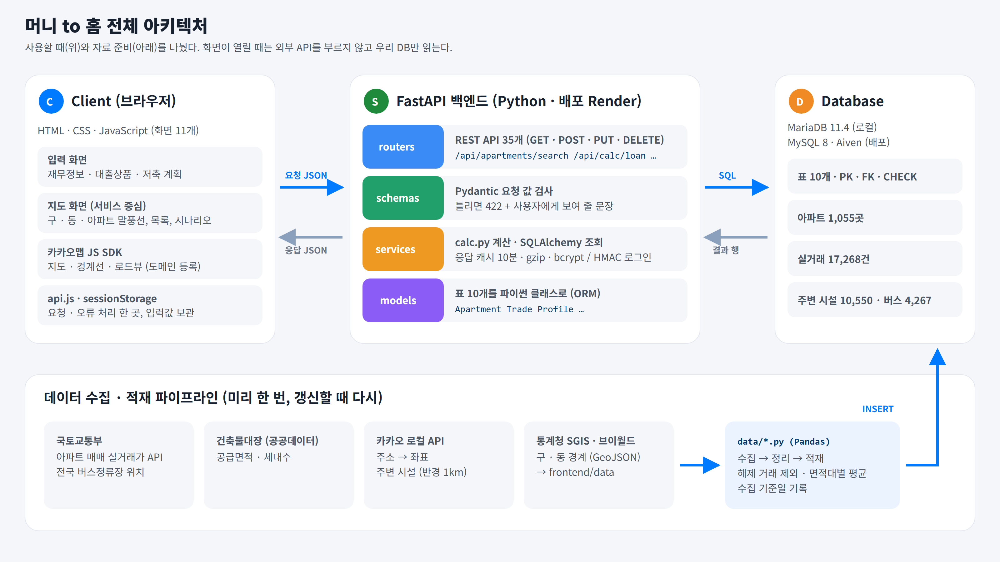
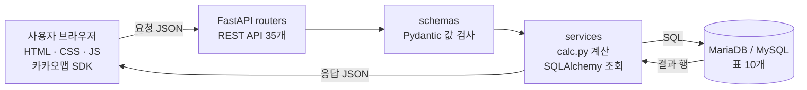
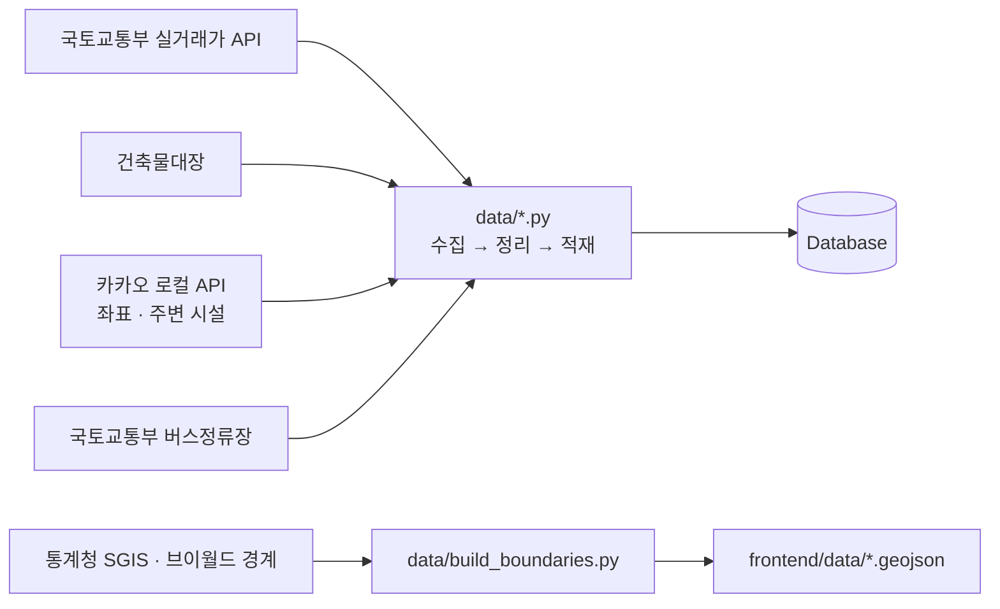

# 1. 서비스 기획 및 아키텍처 설계서

| 항목 | 내용 |
| --- | --- |
| 프로젝트 | 머니 to 홈 (Money to Home) |
| 팀 | 김해원(팀장) · 김목산 · 박채은 · 안세환 |
| 기간 | 2026.10.06 ~ 10.21 (16일) |
| 서비스 주소 | https://money-to-home.onrender.com/ |
| 저장소 | https://github.com/semiproejct/Money_to_Home |
| 기준 | `develop` 브랜치, 2026-10-26 |

---

## ① 프로젝트 개요

### 프로젝트 주제

**내 자산 · 저축 · 대출로 목표할 수 있는 집을 지도에서 찾는 내 집 마련 시뮬레이터**

### 서비스 설명

사용자가 보유자산, 매달 모을 수 있는 돈, 대출 상품을 넣으면 광주 5개 구 아파트마다 **지금 가능 / 목표 기간 안에 가능 / 자금 부족**을 계산해 지도에 보여 줍니다. 아파트를 고르면 부족하거나 남는 돈, 필요한 월 저축액, 집값이 매년 몇 %까지 올라도 되는지(허용 상승률)를 알려 줍니다.

### 해결하고자 하는 문제

첫 집을 준비하는 사람은 세 가지 도구를 따로 씁니다.

| 지금 있는 도구 | 알려 주는 것 | 알려 주지 않는 것 |
| --- | --- | --- |
| 은행 대출 계산기 | 대출 금액에 따른 월 상환액 | 그 돈으로 어떤 집을 살 수 있는지 |
| 부동산 시세 앱 | 지역별 가격 | 내 자금으로 가능한 집인지 |
| 적금 계산기 | 몇 년 뒤 모이는 금액 | 그때 집을 사기에 충분한지 |

셋을 직접 맞춰 봐야 해서 "나는 어느 동네의 어떤 집을 목표로 삼을 수 있는가"에 답하기 어렵습니다. 머니 to 홈은 이 세 계산을 한 번에 이어 줍니다.

### 대상 도메인 및 데이터

| 구분 | 내용 |
| --- | --- |
| 도메인 | 부동산(아파트 매매) × 개인 재무 계획 |
| 지역 | 광주 5개 구 (동구 · 서구 · 남구 · 북구 · 광산구) |
| 핵심 데이터 | 국토교통부 아파트 매매 실거래가, 최근 12개월(지난달까지) 17,268건 · 아파트 1,055곳 |
| 보조 데이터 | 건축물대장(공급면적 · 세대수), 카카오 로컬 API(좌표 · 주변 시설), 국토교통부 버스정류장, 통계청 SGIS · 브이월드(구 · 동 경계) |
| 대출 데이터 | 한국주택금융공사 보금자리론, 카카오뱅크 주택담보대출의 공개 조건 |

### 사용한 LLM API 또는 모델

**사용하지 않았습니다.**

- 이 서비스의 핵심 결과는 "얼마가 부족한가"라는 숫자입니다. 같은 입력에는 항상 같은 숫자가 나와야 하고, 사용자가 식을 따라 검산할 수 있어야 합니다.
- 그래서 LLM이 문장을 만들어 주는 방식 대신, 정해 둔 계산식 13개(C-01 ~ C-13)를 서버의 `backend/services/calc.py` 한 곳에 두고 계산합니다.
- 계산식은 손으로 계산한 사례와 비교하는 자동 테스트(pytest)로 검증합니다. 전체 테스트는 333개입니다.
- 이 결정은 "집값을 예측하지 않는다", "추정치임을 밝힌다"는 서비스 원칙과도 맞습니다.
- LLM은 개발 과정의 보조 도구(Claude Code)로만 썼습니다. 저장소의 `CLAUDE.md`에 규칙을 적어 두고, 만든 코드는 테스트와 PR 검토로 확인했습니다.

### 주요 사용자 및 사용 시나리오

**주요 사용자:** 광주 5개 구에서 첫 아파트 구매를 준비하는 청년 · 사회초년생

**사용 시나리오 (예: 28세, 보유자산 5,000만 원, 월 150만 원 저축, 5년, 보금자리론 30년)**

1. 재무정보를 넣습니다. 주민등록번호 앞 7자리로 만 나이만 계산합니다.
2. 대출 상품을 고릅니다. 예상 최대 대출금액 1억 1,667만 원, 월 상환액 약 64만 원이 나옵니다.
3. 저축 계획을 넣습니다. 5년 뒤 자기자금 1억 4,000만 원, 목표 가능 가격 4억 6,667만 원이 나옵니다.
4. 지도에서 서구 치평동을 고릅니다. 지금 가능 5곳 · 기간 내 가능 14곳 · 자금 부족 3곳이 표시됩니다.
5. 상무1차우미 59㎡를 고르면 시나리오 탭에 "여유자금 9,099만 원, 허용 상승률 연 23.3%"가 나옵니다.
6. 로그인했다면 이 결과를 찜하고, 마이페이지에서 재무정보(최대 3칸)와 찜을 조회 · 수정 · 삭제합니다.

---

## ② 전체 아키텍처



### 사용할 때의 흐름



### 데이터 적재 흐름



### 구성 요소

| 구성 요소 | 기술 | 역할 |
| --- | --- | --- |
| Client | HTML · CSS · JavaScript (프레임워크 없음), 카카오맵 JS SDK | 입력 화면 4단계, 지도 화면(구 → 동 → 아파트 말풍선), 아래 창(목록 · 아파트 정보 · 시나리오), 마이페이지. 화면 하나로 모바일과 웹(1024px 이상)을 함께 지원 |
| FastAPI 백엔드 | Python 3.12, FastAPI, Pydantic, SQLAlchemy | REST API 35개, 요청 값 검사, 계산, DB 조회, 로그인(bcrypt · HMAC 쿠키), 응답 캐시, gzip 압축, 화면 파일 제공 |
| Database | MariaDB 11.4 (로컬), MySQL 8 · Aiven (배포) | 표 10개. PK · FK · UNIQUE · CHECK 제약 |
| 수집 · 적재 파이프라인 | Pandas, requests (`data/*.py`) | 외부 자료를 받아 정리하고 DB에 넣음. 수집 기준일을 `data_collections`에 기록 |
| LLM 연동 모듈 | 없음 | 위 ① 참고. 계산은 결정적인 계산식으로 함 |
| 배포 | Render (서버), Aiven (DB) 무료 플랜 | `main` 머지 시 Render가 자동 재배포 |

### 폴더 구조

```
backend/   main.py(앱 · 라우터 등록) · routers/ · schemas/ · services/(calc.py 포함) · models/
frontend/  HTML 11개 · css/ · js/ · data/(경계 GeoJSON) · img/
db/        schema.sql · seed_loan_products.sql · migrate_*.sql
data/      수집 · 적재 스크립트와 CSV
tests/     pytest 333개
docs/      기획 · 요구사항 · 화면 · DB · API 설계 문서
```

---

## ③ 요청 흐름 설명

사용자가 지도에서 아파트의 구분과 필요자금을 확인하기까지의 흐름입니다.

1. 사용자가 입력 화면에서 재무정보 · 대출 · 저축 계획을 넣습니다. 값은 브라우저의 `sessionStorage`에 보관되어 새로고침해도 남습니다.
2. 지도 화면에서 "서구 치평동"을 고르면 프론트엔드(`frontend/js/api.js`)가 `POST /api/apartments/search`를 부릅니다. 본문에는 조건(보유자산 · 저축 · 기간 · 대출), 지역, 필터, 정렬을 JSON으로 담습니다.
3. FastAPI의 `schemas`(Pydantic)가 값의 종류와 범위를 검사합니다. 틀리면 계산하지 않고 422와 안내 문장(예: `{"detail": "숫자만 입력할 수 있습니다.", "field": "current_assets"}`)을 돌려줍니다.
4. `services/apartment.py`가 SQLAlchemy로 그 동의 아파트와 면적대별 평균가(`apartments` + `apartment_prices`)를 조회합니다.
5. `services/calc.py`가 아파트 면적마다 대출금액, 구분(지금 가능 · 기간 내 · 부족), 부족 · 여유자금을 계산합니다.
6. 결과를 JSON으로 돌려줍니다. 같은 요청은 10분 동안 캐시해 두고 바로 돌려줍니다.

```json
{
  "target_price": 466666666,
  "own_funds": 140000000,
  "counts": { "now": 5, "within": 14, "lack": 3, "total": 22 },
  "apartments": [
    { "id": 151, "name": "상무1차우미", "category": "now",
      "areas": [{ "area_band": 59, "avg_price": 163357143, "shortage": -90992857, "loan_amount": 114350000 }] }
  ]
}
```

7. 화면은 받은 숫자로 지도 말풍선(면적 · 실거래가 · 여유/부족)과 목록을 그립니다. **화면은 계산하지 않습니다.**
8. 말풍선을 누르면 `GET /api/apartments/151`(아파트 정보 · 주변 시설)과 `POST /api/apartments/151/scenario`(필요자금 · 허용 상승률)를 부릅니다.

---

## ④ 주요 설계 결정

### 1. 도메인 · 데이터 선택

- **광주 5개 구, 아파트 매매만:** 2주 안에 자료 수집부터 지도 표시까지 끝까지 만들 수 있는 범위로 좁혔습니다. 전세 · 월세, 빌라 · 오피스텔은 가격 기준이 달라 뺐습니다.
- **실거래가의 평균을 씀:** 매물 호가가 아니라 실제로 거래된 가격이라 목표 가격의 기준으로 믿을 수 있습니다. 기간은 "지난달까지 최근 12개월"로 맞췄고, 해제(취소)된 거래는 평균에서 뺍니다.
- **하지 않는 것을 정함:** 집값 예측, 대출 심사, 매물 소개는 하지 않습니다. 모든 결과에 "가정에 따른 추정치"를 밝힙니다.

### 2. DB 스키마

| 표 | 담는 것 | 줄 수 |
| --- | --- | --- |
| `users` | 회원 (아이디, bcrypt 해시) | 회원 수 |
| `profiles` | 재무정보 · 대출 선택 · 저축 계획. 회원 한 명에 최대 3칸 | 회원 수 × 3 이하 |
| `loan_products` | 대출 상품 2개 | 2 |
| `apartments` | 아파트 (주소 · 준공 연도 · 좌표 · 세대수) | 1,055 |
| `trades` | 실거래 한 건씩 | 17,268 |
| `apartment_prices` | 면적대별 평균가 · 최저 · 최고 · 거래 건수 | 1,852 |
| `apartment_facilities` | 주변 시설 (지하철 · 학교 · 마트 · 편의점 · 병원 · 버스 등) | 10,550 |
| `bus_stops` | 버스정류장 위치 | 4,267 |
| `data_collections` | 자료 수집 기준일 | 수집 때마다 |
| `saved_results` | 찜한 시나리오 (저장 당시 값 복사) | 찜 수 |

| 결정 | 이유 |
| --- | --- |
| 회원과 재무정보를 나눔 | 로그인하지 않아도 계산이 되고, 저장할 때만 회원에 붙입니다. 2026-10-21부터 회원당 최대 3칸(`UNIQUE (user_id, slot)`, `CHECK slot 1~3`) |
| 평균가를 미리 계산 | 거래 17,268건을 요청마다 더하지 않고 적재 때 면적대별 1,852줄로 보관합니다 |
| 구분은 저장하지 않음 | "지금 가능"은 사람마다 다르므로 요청마다 계산합니다 |
| 찜은 그때 값을 복사 | 실거래 자료가 바뀌어도 저장할 때의 결과를 보여 줍니다. 원본 아파트 · 상품 · 재무정보가 지워지면 연결만 비웁니다(SET NULL) |
| 탈퇴 시 함께 삭제 | `users` → `profiles` · `saved_results`는 ON DELETE CASCADE |
| CHECK 제약 | 가격 > 0, 0 < 대출 비율 ≤ 1, 최저 ≤ 평균 ≤ 최고처럼 잘못된 값을 표가 막습니다 |
| 좌표 INDEX | 지도에 보이는 영역의 아파트를 위도 · 경도 범위로 빠르게 찾습니다 |

전체 칸 정의와 ERD는 [DB 설계서](../04_database_design.md), 생성 스크립트는 [db/schema.sql](../../db/schema.sql)에 있습니다.

### 3. API 설계

| 메서드 | 기준 | 개수 | 예 |
| --- | --- | --- | --- |
| GET | 저장된 것을 그대로 꺼냄 | 13 | `/api/apartments/{id}`, `/api/loan-products`, `/api/profiles`, `/api/saved-results` |
| POST | 보낸 값으로 계산 · 검색, 또는 새로 만듦 | 12 | `/api/apartments/search`, `/api/calc/loan`, `/api/auth/signup`, `/api/saved-results` |
| PUT | 고침 | 7 | `/api/profiles/{id}`, `/api/auth/password` |
| DELETE | 지움 | 3 | `/api/profiles/{id}`, `/api/saved-results/{id}`, `/api/auth/me` |

- **계산 · 검색을 POST로 한 이유:** 조건 · 지역 · 필터 · 정렬을 묶은 JSON을 보내야 하고, 보유자산 같은 금융정보가 주소(방문 기록 · 서버 로그)에 남지 않게 본문으로 보냅니다.
- **계산은 서버만 함:** 계산식을 `calc.py` 한 곳에 두어 어느 화면이든 같은 숫자가 나옵니다.
- **계산 값은 요청에 담음:** 서버가 저장된 값을 꺼내 쓰지 않으므로 로그인 없이 모든 계산이 됩니다.
- **오류 모양 통일:** 상태 코드 + 사용자에게 보여 줄 문장(`detail`) + 문제가 된 칸(`field`).

전체 목록은 [API 명세서](../05_api_spec.md)와 서버의 `/docs`(Swagger UI)에 있습니다.

### 4. 외부 데이터 연동 방식 (LLM 연동 항목 대체)

| 결정 | 이유 |
| --- | --- |
| 외부 API는 화면이 열릴 때 부르지 않음 | 속도(아파트 수십~수백 곳을 한 번에 계산), 호출 횟수 제한, 외부 장애에도 서비스 유지 |
| 미리 받아 정리 · 적재 | API가 주는 건 거래 한 건씩이라 해제 거래 제외 · 면적대별 평균 · 공급면적 · 좌표를 이어 붙여야 함 |
| 수집 기준일 기록 | 화면에 "실거래 2026년 10월 12일 기준"을 보여 주고, 갱신 시 응답 캐시도 자동으로 무효가 됨 |
| 키 보호 | 공공데이터 · 카카오 REST 키는 서버 `.env`에만. 화면에는 도메인 등록으로 보호되는 카카오맵 JavaScript 키만 |

### 5. 예외 처리

| 상황 | 처리 |
| --- | --- |
| 값이 틀림 | Pydantic이 422 + 안내 문장. 화면은 입력란 아래에 바로 표시 |
| 없는 아파트 · 면적 | 404 + "찾는 것이 없습니다." |
| 로그인 필요 | 401. 화면은 로그인 화면으로 보내고, 로그인 뒤 보던 화면으로 돌아옴 |
| DB 연결 실패 | `/api/health`가 `{"db": "error"}`, 자세한 내용은 서버 로그에만 (접속 정보 노출 방지) |
| 화면의 네트워크 · 서버 오류 | 불러오지 못함 화면과 "다시 시도" 버튼. 불러오는 중에는 회색 자리표시 |
| 좌표 없는 아파트 | 지도에 찍지 않고 목록에 "위치 없음" 표시 |

### 6. 화면에 보여 주는 지표 (대시보드 항목 대체)

| 지표 | 의미 | 위치 |
| --- | --- | --- |
| 목표 가능 가격 | 목표 시점의 자기자금 + 최대 대출로 살 수 있는 집값 상한 | 지도 · 목록 머리 |
| 구분별 개수 | 지금 가능 · 기간 내 가능 · 자금 부족 아파트 수 | 목록 탭, 구 · 동 표시 |
| 실거래 평균가 · 가격 범위 · 거래 건수 | 최근 12개월 면적대별 | 말풍선, 아파트 정보 탭 |
| 부족 · 여유자금 | 집값 − 자기자금 − 대출 | 말풍선, 시나리오 탭 |
| 필요 월 저축액 | 부족분을 기간 안에 채우려면 매달 모아야 하는 돈 | 시나리오 탭 |
| 허용 상승률 | 집값이 매년 몇 %까지 올라도 목표 가능한지 | 시나리오 탭 |
| 주변 시설 · 도보 시간 | 지하철 출구 · 학교 · 마트 등, 직선거리 × 1.3 ÷ 분당 67m | 아파트 정보 탭, 지도 점선 |

화면 모습은 [4. 서비스 화면 안내](04_service_screens.md)에 있습니다.
