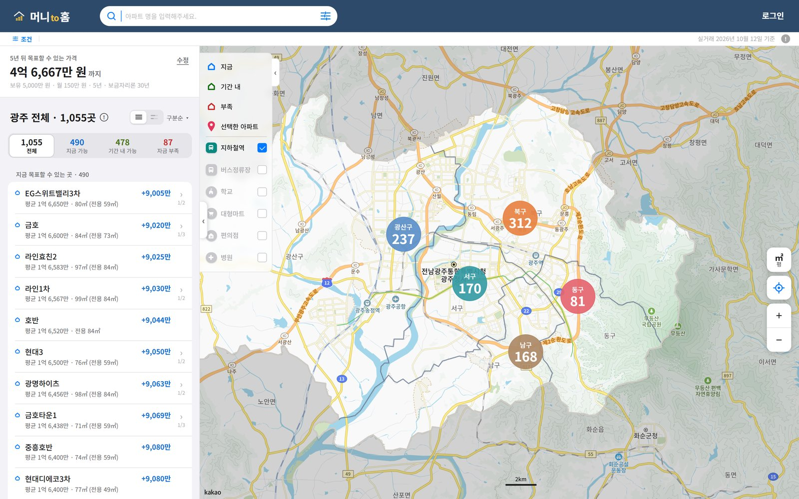
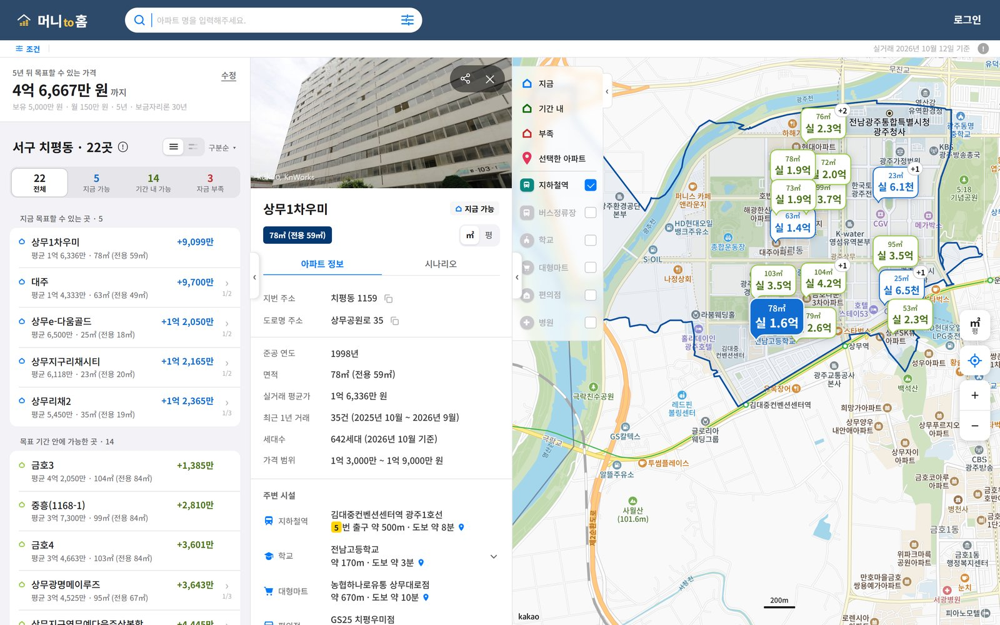
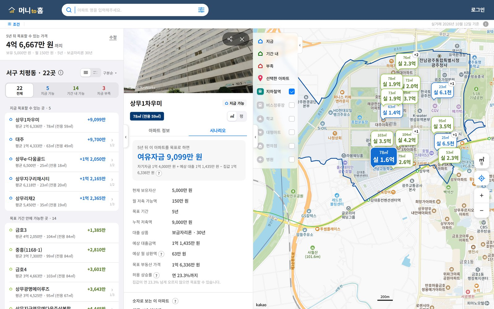
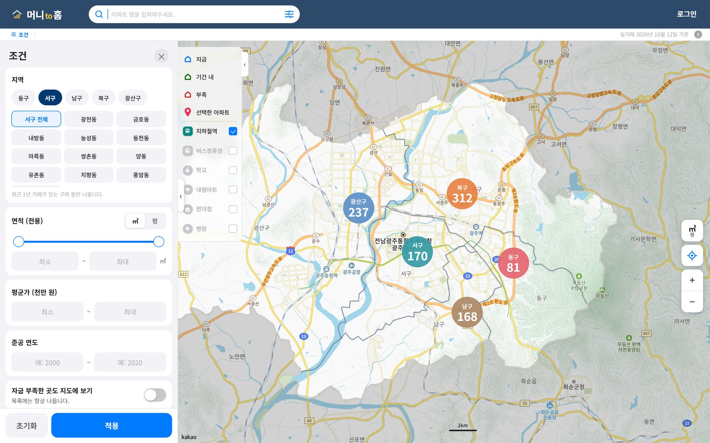
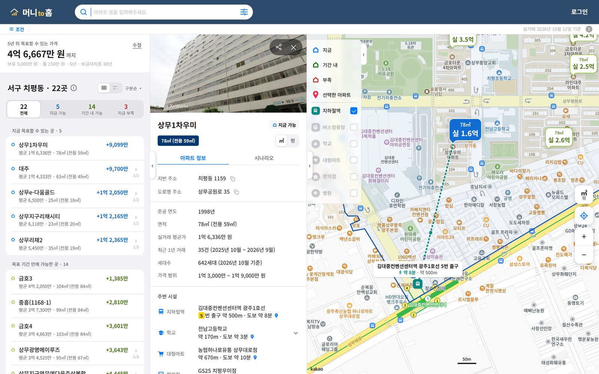
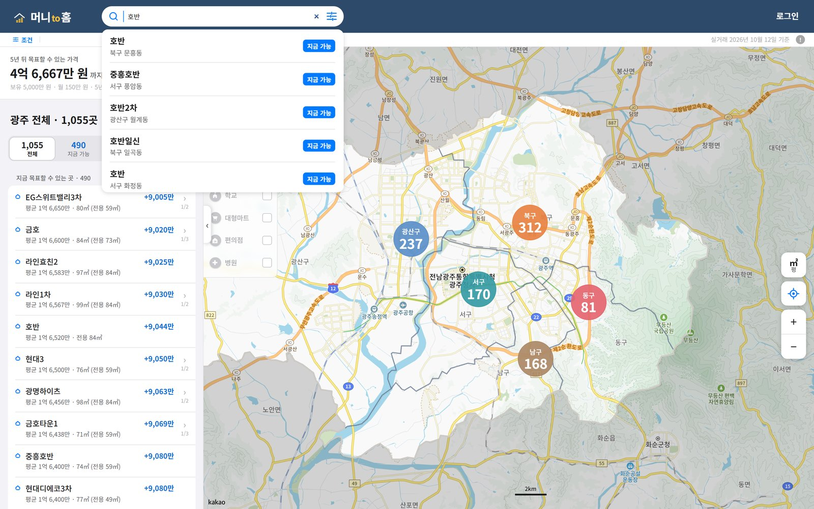
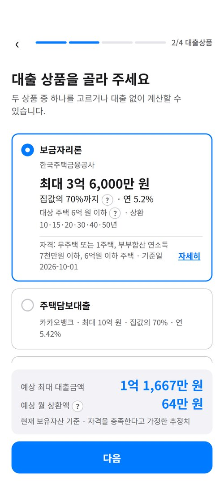
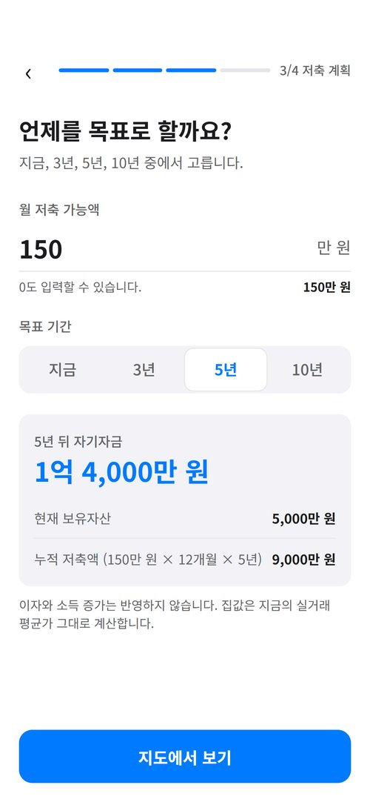
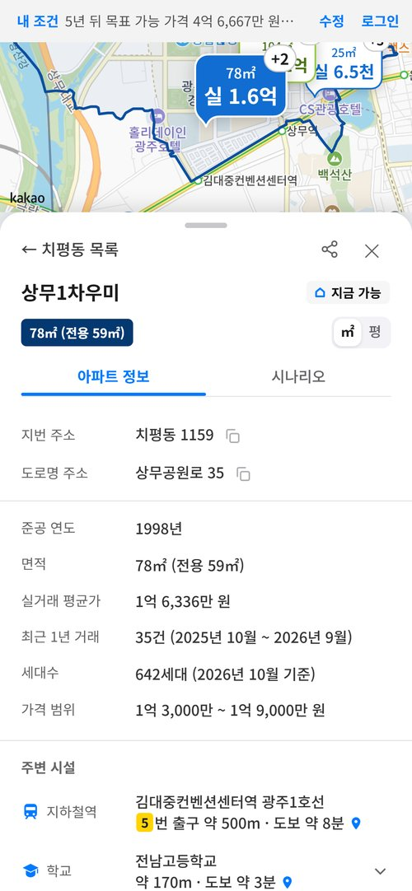
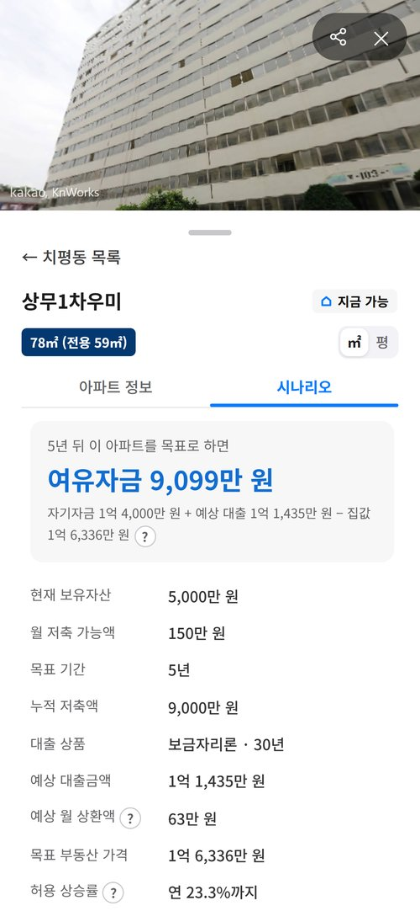

# 4. 서비스 화면 안내 (인사이트 대시보드 항목)

머니 to 홈에는 별도의 관리자용 대시보드가 없습니다. 수집한 실거래 데이터와 계산 결과(인사이트)는 **지도 화면이 곧 대시보드**처럼 보여 줍니다. 이 문서는 어떤 데이터가 어느 화면에 어떤 지표로 나오는지를 정리합니다.

- 직접 보기: https://money-to-home.onrender.com/ (무료 서버라 첫 화면이 30~60초 늦을 수 있음)
- 캡처 기준 입력값: 28세 · 보유자산 5,000만 원 · 월 150만 원 저축 · 5년 · 보금자리론 30년
- 캡처 시점: 2026-10-20 (마이페이지 · 재무정보 3칸은 10-21 추가로 캡처에 없음)

---

## 1. 지도: 광주 전체

| 보여 주는 데이터 | 지표 |
| --- | --- |
| 아파트 1,055곳의 면적대별 평균가 | 5개 구마다 아파트 수 (구 표시) |
| 계산 결과 | 지금 가능 490 · 기간 내 가능 478 · 자금 부족 87 (목록 탭) |
| 입력값으로 계산 | 5년 뒤 목표할 수 있는 가격 4억 6,667만 원 (목록 맨 위) |
| 수집 기준일 | 오른쪽 위 "실거래 2026년 10월 12일 기준" |

## 2. 지도: 동을 고르고 아파트 보기

| 보여 주는 데이터 | 지표 |
| --- | --- |
| 치평동 아파트 22곳 | 지금 가능 5 · 기간 내 14 · 부족 3 |
| 말풍선 | 면적 · 실거래 평균가 · 구분 색 (파랑 지금 가능, 초록 기간 내, 빨강 부족) |
| 아파트 정보 | 준공 연도, 면적, 평균가, 최근 1년 거래 35건(2025.10 ~ 2026.09), 세대수 642, 가격 범위 1억 3,000만 ~ 1억 9,000만 원 |
| 주변 시설 | 지하철 출구까지 약 500m · 도보 약 8분, 학교 · 마트 · 편의점 · 병원 |
| 경계 | 고른 동의 경계를 남색 선으로 |

## 3. 시나리오: 필요자금 인사이트

| 지표 | 값 (상무1차우미 59㎡) | 계산 |
| --- | --- | --- |
| 여유자금 | 9,099만 원 | 자기자금 1억 4,000만 + 예상 대출 1억 1,435만 − 집값 1억 6,336만 |
| 예상 월 상환액 | 약 63만 원 | 원리금균등, 연 5.2%, 30년 |
| 허용 상승률 | 연 23.3% | 집값이 매년 이만큼 올라도 5년 뒤 목표 가능 |
| 필요 월 저축액 | (부족할 때만) | 부족분을 기간 안에 채우는 월 저축액 |

## 4. 조건 검색 · 주변 시설 · 이름 검색

| 조건 검색 | 주변 시설 거리 | 이름 검색 |
| --- | --- | --- |
|  |  |  |
| 지역 · 전용면적 · 평균가 · 준공 연도 | 아파트에서 시설까지 점선과 도보 시간 | 광주 5개 구 전체에서 이름으로 |

## 5. 모바일 입력 흐름

| 시작 | 재무정보 | 대출상품 | 저축 계획 | 아파트 창 | 시나리오 |
| --- | --- | --- | --- | --- | --- |
|  |  |  |  |  |  |
| 로그인 없이 시작 | 주민번호 앞 7자리 → 만 나이 | 예상 최대 대출 1억 1,667만 | 5년 뒤 자기자금 1억 4,000만 | 아래 창 80% | 여유자금 · 허용 상승률 |

---

## 데이터 갱신 시 화면 변화

실거래 자료를 다시 수집 · 적재하면 (운영 가이드 ⑥):

1. 오른쪽 위 "실거래 ○월 ○일 기준"이 새 기준일로 바뀝니다.
2. 아파트 평균가 · 거래 건수 · 가격 범위가 새 12개월 자료로 바뀝니다.
3. 같은 입력이라도 구분(지금 가능 · 기간 내 · 부족) 개수와 부족 · 여유자금이 바뀝니다.
4. 아파트 찾기 응답 캐시는 기준일이 바뀌면 자동으로 무효가 되어 바로 반영됩니다.
